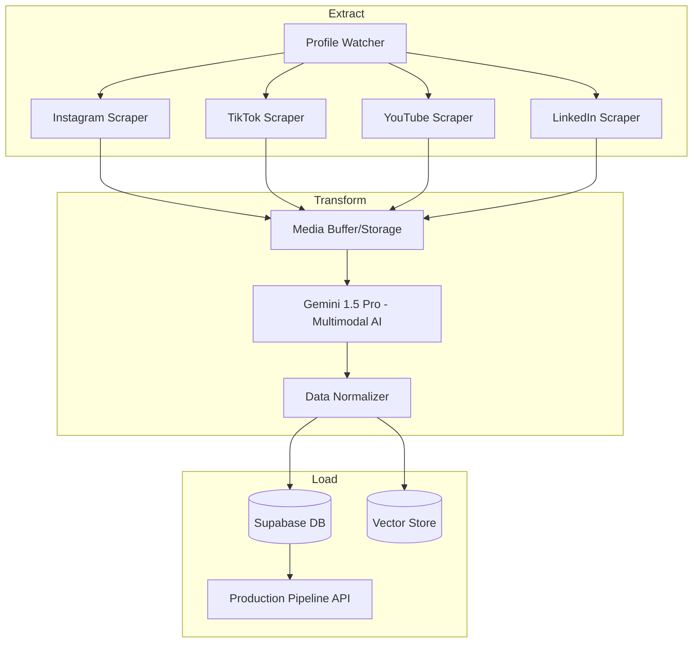

# Viral ETL Service - Architecture Document

## 1. Introdução
Este documento define a arquitetura do serviço de ETL (Extract, Transform, Load) da Virals, focado em inteligência de benchmarking multicanal. O objetivo é extrair conteúdos de Instagram, TikTok, YouTube e LinkedIn, realizar uma análise multimodal profunda (vídeo/imagem/texto) usando IA, e disponibilizar esses dados estruturados para a pipeline de produção de criativos.

## 2. High Level Architecture

### 2.1 Technical Summary
O serviço opera como uma pipeline modular em Node.js. A extração é realizada por conectores específicos por plataforma. A transformação utiliza o **Gemini 1.5 Pro (Multimodal)** para analisar não apenas o texto, mas a dinâmica visual e sonora dos vídeos. Os dados são normalizados em um schema único e armazenados no **Supabase** (PostgreSQL + Vector), permitindo buscas semânticas por "estilos de conteúdo" ou "ganchos visuais".

### 2.2 Platform & Infrastructure
- **Banco de Dados:** Supabase (PostgreSQL + pgvector).
- **IA Multimodal:** Google Gemini 1.5 Pro API.
- **Orquestração:** GitHub Actions (Cron Jobs) ou Node.js Scheduler.
- **Armazenamento de Mídia:** Supabase Storage (buffer temporário para análise).

### 2.3 Architecture Diagram (Mermaid)


## 3. Data Models

### 3.1 ViralBenchmarkSchema
**Purpose:** Representação unificada de um conteúdo de benchmark analisado.

- **id:** UUID (Primary Key)
- **platform:** enum (instagram, tiktok, youtube, linkedin)
- **original_url:** text (Unique)
- **author_handle:** text
- **content_type:** enum (video, image, carousel, text)
- **metadata:** jsonb (likes, views, post_date, etc.)
- **analysis:** jsonb
    - **transcription:** text
    - **visual_description:** text (cenas, objetos, cores)
    - **audio_analysis:** text (música, tom, efeitos)
    - **narrative_structure:** json (hook, body, cta)
    - **creative_score:** float (calculado por IA)
- **embedding:** vector(1536) (para busca semântica)
- **status:** enum (pending, processing, completed, error)
- **created_at:** timestamp

## 4. Component Definitions

### 4.1 Extract Components (Scrapers)
- **Responsibility:** Navegar nas plataformas e extrair metadados e arquivos de mídia brutos.
- **Tech:** Playwright / Puppeteer (para bypass de proteção) ou APIs de terceiros (Apify/RapidAPI).

### 4.2 Transform Components (AI Engine)
- **Responsibility:** Enviar o vídeo/imagem para o Gemini, processar o prompt de análise profunda e extrair a estrutura narrativa.
- **Prompt Strategy:** "Analise a dinâmica de corte deste vídeo, identifique o hook inicial (visual e sonoro) e descreva a transição para o CTA final."

### 4.3 Load Components (Storage)
- **Responsibility:** Persistir dados no Supabase e gerar embeddings para o campo `analysis`.

## 5. Unified Project Structure
```plaintext
services/ETL/
├── Extract/
│   ├── Links/                # Arquivos MD com links monitorados
│   ├── monitor/              # Watcher que detecta novos conteúdos
│   └── scrapers/             # Lógica específica (IG, TT, YT, LI)
├── Transform/
│   ├── video-intelligence/   # Integração com Gemini 1.5 Pro
│   ├── processors/           # Normalização e limpeza de dados
│   └── prompt-templates/     # Prompts específicos para cada rede
└── Load/
    ├── database/             # Cliente Supabase e queries
    └── exporters/            # Handoff para pipeline de produção
```

## 6. Próximos Passos
1. **Configuração do Supabase:** Criar tabelas e habilitar `pgvector`.
2. **Implementação do Scraper Base:** Começar por uma plataforma (ex: Instagram) via links manuais.
3. **PoC de Análise Gemini:** Testar a análise de um Reel do Instagram usando a API Multimodal.
