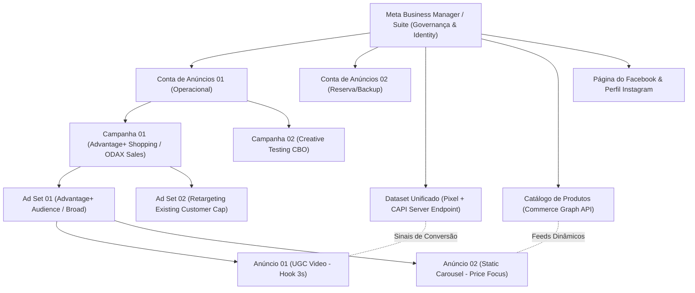
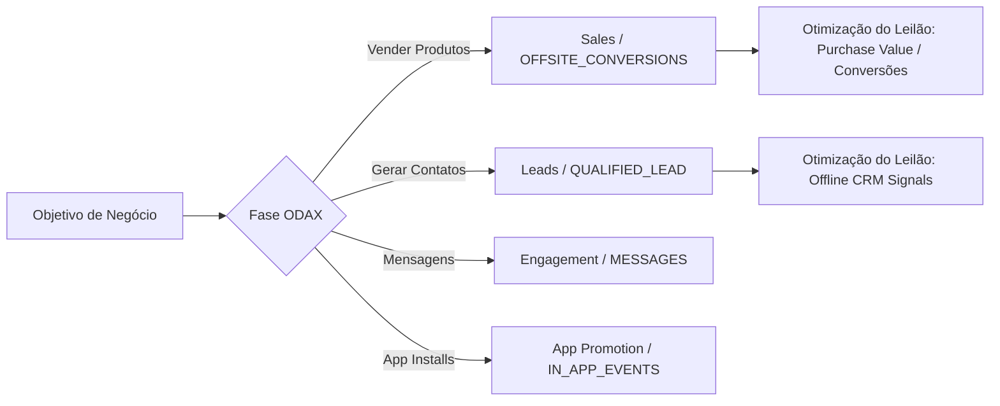
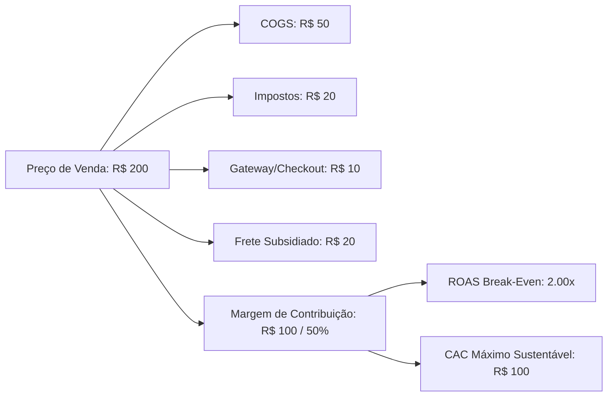
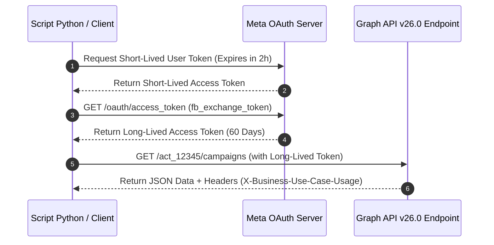

# MÓDULO 01 — FUNDAMENTOS OFICIAIS, ECOSSISTEMA E ESTRUTURA DE CONTA
**Programa:** MBA Meta Performance Engineering  
**Edição:** 2026  
**Disciplinas Integradas:** Meta Ads Engineering, Meta Developers & Business Economics  
**Tempo estimado de estudo:** 12 horas  

---

## 1. O ECOSSISTEMA DA META EM 2026: VISÃO SISTÊMICA DE ARQUITETURA

Em 2026, a plataforma da Meta consolidou-se como uma **infraestrutura distribuída de processamento de sinais de alta velocidade, inteligência preditiva e leilões estocásticos em tempo real**. Para o Engenheiro de Performance, o entendimento da plataforma começa pela compreensão da sua arquitetura de dados e da topologia de ativos corporativos.



### 1.1 Hierarquia Oficial e Topologia de Ativos Corporativos

1. **Meta Business Manager / Business Suite (BM):** O nó central de identidade e autorização. Implementa **RBAC (Role-Based Access Control)** com escopos rígidos (`ADMIN`, `DEVELOPER`, `FINANCE_ANALYST`, `ADVERTISER`).
2. **Contas de Anúncios (Ad Accounts):** Contêineres isolados de alocação orçamentária, faturamento, fusos horários e moedas. Cada conta possui um identificador único de nó Graph API no formato `act_{account_id}`.
3. **Datasets (Pixels & CAPI Endpoints):** A infraestrutura legada de "Pixels" foi totalmente absorvida pelo **Meta Dataset Engine**. Um Dataset é um receptáculo de dados multicanal que unifica:
   - Sinais do navegador (Pixel Client-Side JS).
   - Sinais do servidor (Conversions API - CAPI Server-Side).
   - Sinais de aplicativo (Meta App SDK / SKAdNetwork / AEM).
   - Eventos de conversão offline (CRM & Point of Sale).
4. **Catálogos de Produtos (Commerce Catalog):** Grafos de inventário atualizados síncrona ou assincronamente via Commerce Graph API para anúncios de catálogo dinâmico (DPA / Advantage+ Shopping).

---

## 2. HIERARQUIA ESTRUTURAL DE CAMPANHAS E MAPPING ODAX (2026)

A arquitetura de campanhas no Meta Ads segue rigorosamente o framework **ODAX (Outcome-Driven Ad Experiences)**. 



### 2.1 Mapeamento Detalhado de Objetivos e Endpoints Graph API

| Objetivo ODAX | `objective` na API | `optimization_goal` no Ad Set | Evento de Otimização Recomendado |
| :--- | :--- | :--- | :--- |
| **VENDAS (Sales)** | `OUTCOMES_SALES` | `OFFSITE_CONVERSIONS` ou `VALUE` | `Purchase` (com parâmetros `value` e `currency`) |
| **CADASTROS (Leads)** | `OUTCOMES_LEADS` | `LEAD` ou `OFFSITE_CONVERSIONS` | `Lead` ou `QualifiedLead` (vias CRM Feedback) |
| **ENGAJAMENTO (Engagement)**| `OUTCOMES_ENGAGEMENT` | `MESSAGES` ou `OFFSITE_CONVERSIONS` | `MessagingConversationStarted` / `Subscribe` |
| **TRÁFEGO (Traffic)** | `OUTCOMES_TRAFFIC` | `LANDING_PAGE_VIEWS` | `LandingPageView` (NUNCA usar `LINK_CLICKS`) |
| **RECONHECIMENTO (Awareness)**| `OUTCOMES_AWARENESS` | `AD_RECALL_PAYOFF` ou `REACH` | `Impressions` |
| **PROMOÇÃO DO APP** | `OUTCOMES_APP_PROMOTION`| `IN_APP_EVENTS` | `AppInstall` / `MobilePurchase` |

---

## 3. UNIT ECONOMICS I: MODELAGEM MATEMÁTICA E FINANCEIRA DO TRÁFEGO PAGO

A engenharia de performance exige a definição exata das fronteiras de viabilidade econômica antes do lançamento de qualquer campanha no leilão.



### 3.1 Dedução das Equações Financeiras

#### A. Margem de Contribuição Bruta ($MC$)
$$MC = PV - (\text{COGS} + \text{Impostos} + \text{Taxa Gateway} + \text{Frete Subsidiado})$$

#### B. ROAS de Break-Even ($ROAS_{BE}$)
$$ROAS_{BE} = \frac{PV}{MC}$$

#### C. CAC Máximo Sustentável ($CAC_{max}$)
Considerando uma meta de Margem Operacional Líquida Desejada ($\%ML$):
$$CAC_{max} = MC - (PV \times \%ML)$$

#### D. Marketing Efficiency Ratio (MER) & Blended ROAS
$$MER = \frac{\text{Receita Bruta Total (Omnichannel)}}{\text{Gasto Total em Mídia Pago (Meta + Outros)}}$$

### 3.2 Tabela de Sensibilidade de ROAS x Margem de Contribuição

| Margem de Contribuição ($MC / PV$) | $ROAS_{BE}$ | ROAS Target para 20% de Margem Líquida | $CAC_{max}$ (Produto de R\$ 300) |
| :--- | :--- | :--- | :--- |
| **70%** (Infoprodutos / SaaS) | **1.43x** | **2.00x** | R\$ 210,00 |
| **50%** (E-commerce padrão) | **2.00x** | **3.33x** | R\$ 150,00 |
| **30%** (Eletrônicos / Revenda) | **3.33x** | **10.00x** | R\$ 90,00 |
| **15%** (Supermercado / Margem Baixa)| **6.67x** | **33.33x** | R\$ 45,00 |

---

## 4. META DEVELOPERS: ARQUITETURA DA GRAPH API E RATE LIMITING

### 4.1 O Fluxo de Autenticação OAuth 2.0 e Renovação de Tokens



### 4.2 Leitura dos Headers de Rate Limit (Business Use Case - BUC Limits)
A Meta insere o header `X-Business-Use-Case-Usage` em cada resposta HTTP. O cliente deve parsear esse JSON para evitar bloqueios por *Rate Limit Exceeded* (Erros `17` e `613`):

```json
{
  "act_1002938475": [
    {
      "type": "ads_insights",
      "call_count": 42,
      "cpu_time": 25,
      "total_time": 30,
      "estimated_time_to_regain_access": 0
    }
  ]
}
```

---

## 5. PROJETO PRÁTICO DA SEMANA: COLETOR RESILIENTE DE CAMPANHAS (`collector/campaigns.py`)

Código Python de nível de produção com tratamento de rate limit, suporte a paginação e expiração de tokens.

```python
import os
import time
import json
import requests
from dotenv import load_dotenv
import pandas as pd

load_dotenv()

ACCESS_TOKEN = os.getenv("META_ACCESS_TOKEN")
AD_ACCOUNT_ID = os.getenv("META_AD_ACCOUNT_ID") # act_XXXXXXXXXX
GRAPH_VERSION = "v26.0"

class MetaGraphClient:
    """
    Cliente robusto para a Graph API Meta com tratamento de Rate Limit e Retries.
    """
    def __init__(self, access_token: str, ad_account_id: str):
        self.access_token = access_token
        self.ad_account_id = ad_account_id if ad_account_id.startswith("act_") else f"act_{ad_account_id}"
        self.base_url = f"https://graph.facebook.com/{GRAPH_VERSION}"

    def _check_rate_limit(self, response: requests.Response):
        """Monitora os headers de uso da API e aplica pause preditivo."""
        usage_header = response.headers.get("X-Business-Use-Case-Usage")
        if usage_header:
            try:
                usage_data = json.loads(usage_header)
                for account_id, metrics in usage_data.items():
                    for metric in metrics:
                        call_count = metric.get("call_count", 0)
                        total_time = metric.get("total_time", 0)
                        if call_count > 80 or total_time > 80:
                            print(f"⚠️ Rate Limit em 80%+. Aplicando cooling pause de 60s...")
                            time.sleep(60)
            except Exception as e:
                pass

    def get_campaigns_with_metrics(self):
        url = f"{self.base_url}/{self.ad_account_id}/campaigns"
        params = {
            "fields": "id,name,status,objective,daily_budget,insights{spend,impressions,clicks,cpm,ctr,purchase_roas}",
            "effective_status": "['ACTIVE']",
            "access_token": self.access_token,
            "limit": 50
        }
        
        all_campaigns = []
        while url:
            res = requests.get(url, params=params if "access_token" not in url else None)
            self._check_rate_limit(res)
            
            if res.status_code != 200:
                print(f"❌ Erro na API ({res.status_code}): {res.text}")
                break
                
            data = res.json()
            for camp in data.get("data", []):
                insights_list = camp.get("insights", {}).get("data", [])
                insight = insights_list[0] if len(insights_list) > 0 else {}
                
                # Extrair ROAS se disponível
                roas_data = insight.get("purchase_roas", [])
                roas = float(roas_data[0].get("value", 0.0)) if len(roas_data) > 0 else 0.0
                
                all_campaigns.append({
                    "campaign_id": camp.get("id"),
                    "campaign_name": camp.get("name"),
                    "objective": camp.get("objective"),
                    "daily_budget": float(camp.get("daily_budget", 0)) / 100.0,
                    "spend": float(insight.get("spend", 0.0)),
                    "impressions": int(insight.get("impressions", 0)),
                    "clicks": int(insight.get("clicks", 0)),
                    "cpm": float(insight.get("cpm", 0.0)),
                    "ctr": float(insight.get("ctr", 0.0)),
                    "roas": roas
                })
                
            url = data.get("paging", {}).get("next")
            
        return pd.DataFrame(all_campaigns)

if __name__ == "__main__":
    client = MetaGraphClient(ACCESS_TOKEN, AD_ACCOUNT_ID)
    df = client.get_campaigns_with_metrics()
    print("=== COLETOR DE CAMPANHAS META OS ===")
    print(df.to_string(index=False))
```

---

## 6. EXERCÍCIOS DE FIXAÇÃO E PROVA DE CONCEITO

### Questão 1 (Análise Financeira Avançada)
Um infoproduto vendido por R\$ 500,00 possui COGS de R\$ 0,00, Impostos de 10%, Taxa de Checkout de 8% e Gastos de Suporte de R\$ 20,00 por aluno. A empresa deseja ter uma Margem Operacional Líquida de 30%.
1. Calcule a Margem de Contribuição Absoluta e Percentual.
2. Calcule o $ROAS_{BE}$ e o $CAC_{max}$ aceitável.

### Questão 2 (Graph API Architecture)
Explique como o cliente Python acima trata o Rate Limit da Meta e previne o Erro `613` em requisições de grande volume.

---
*Fim do Módulo 01 (Versão Expandida com Diagramas Mermaid).*
