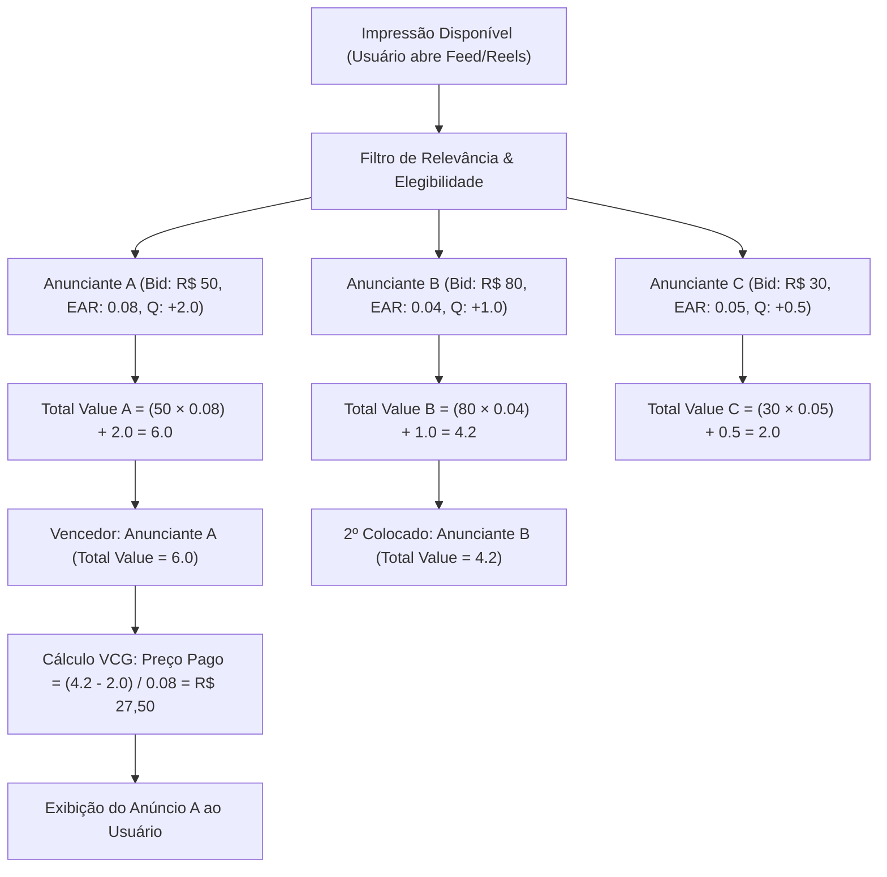
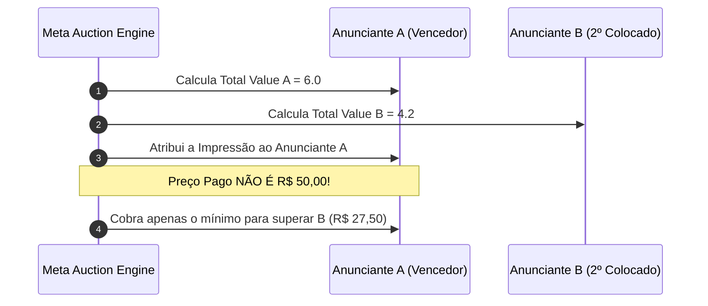
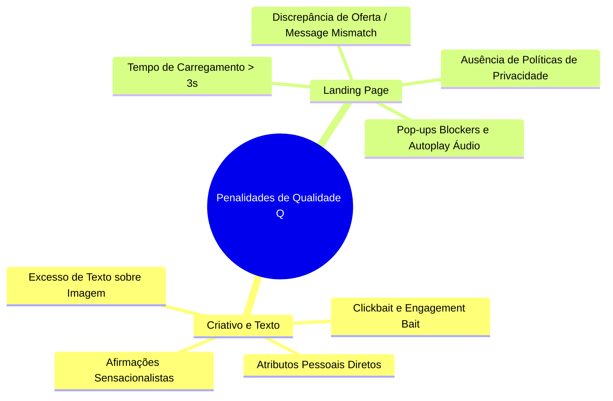

# MÓDULO 02 — SISTEMA DE LEILÃO, TOTAL VALUE, EAR E AD QUALITY
**Programa:** MBA Meta Performance Engineering  
**Edição:** 2026  
**Disciplinas Integradas:** Meta Ads Engineering, Microeconomia & Decision Science  
**Tempo estimado de estudo:** 14 horas  

---

## 1. O LEILÃO MULTIVARIADO DA META EM 2026

Diferente dos leilões tradicionais de commodities onde vence unicamente quem oferece a maior quantia monetária, o leilão do Meta Ads opera como uma **mecanismo multivariado de maximização de valor social e econômico**. O algoritmo busca o equilíbrio de Nash entre o retorno do anunciante e a experiência de consumo do usuário.



---

## 2. A FÓRMULA DO VALOR TOTAL (TOTAL VALUE FORMULA)

A equação fundamental de ordenação das propostas no leilão é expressa por:

$$V = (Bid \times EAR) + Q$$

### 2.1 Análise Profunda dos Componentes da Fórmula

#### A. Lance do Anunciante ($Bid$)
Representa a disposição máxima a pagar pelo resultado pretendido. Em campanhas com lance automático (Lowest Cost), o algoritmo calcula o lance dinâmico equivalente com base no orçamento e no ritmo do dia ($w_t$).

#### B. Taxa de Ação Estimada ($EAR$ - Estimated Action Rate)
Uma estimativa estocástica em tempo real da probabilidade de determinado usuário realizar a ação de conversão:

$$EAR = P(\text{Conversão} \mid \text{Usuário}_i, \text{Anúncio}_j, \text{Contexto}_k)$$

O valor do $EAR$ é atualizado continuamente via inferência probabilística bayesiana a partir de sinais como histórico de cliques, horário, tipo de rede, afinidade com formato (Reels vs Feed) e histórico do conjunto de anúncios.

#### C. Score de Qualidade e Relevância ($Q$)
A valoração quantitativa do grau de adequação do anúncio e da experiência pós-clique na Landing Page:

$$Q = \text{Feedback Positivo} - \text{Feedback Negativo} - \text{Penalidades de Landing Page}$$

---

## 3. O MECANISMO VCK (VICKREY-CLARKE-GROVES) E PRECIFICAÇÃO REAL

O Meta Ads utiliza uma variação do **Mecanismo Vickrey-Clarke-Groves (VCG)**. A propriedade matemática fundamental do VCG é que ele é um **Mecanismo Verdadeiro (Truthful / Dominant-Strategy Incentive Compatible)**: a estratégia ótima do anunciante é declarar o valor real que o resultado vale para o seu negócio.



### 3.1 Equação do Preço Pago no VCG

$$\text{Preço Pago pelo Vencedor (A)} = \frac{V_B - Q_A}{EAR_A}$$

Onde $V_B$ é o Valor Total do segundo colocado ($B$), $Q_A$ é a qualidade do vencedor e $EAR_A$ é a taxa de ação estimada do vencedor.

---

## 4. PENALIDADES DE QUALIDADE ($Q$) E IMPACTO NO CPM



---

## 5. SIMULADOR AVANÇADO DE LEILÃO VCG EM PYTHON (`analytics/auction_simulator.py`)

```python
import pandas as pd
import numpy as np

class VCGAuctionEngine:
    """
    Motor de Simulação de Leilão VCG multivariado do Meta Ads.
    Calcula ordenação, vencedores e precificação com base em Bid, EAR e Quality.
    """
    def __init__(self, advertisers: list):
        self.advertisers = advertisers

    def run_auction(self):
        results = []
        for adv in self.advertisers:
            # V = (Bid * EAR) + Q
            total_value = (adv['bid'] * adv['ear']) + adv['quality']
            results.append({
                'name': adv['name'],
                'bid': adv['bid'],
                'ear': adv['ear'],
                'quality': adv['quality'],
                'total_value': total_value
            })
            
        df = pd.DataFrame(results).sort_values(by='total_value', ascending=False).reset_index(drop=True)
        
        winner = df.iloc[0].to_dict()
        runner_up = df.iloc[1].to_dict() if len(df) > 1 else None
        
        if runner_up:
            # Formula: Price_A = (TotalValue_B - Quality_A) / EAR_A
            required_bid = (runner_up['total_value'] - winner['quality']) / winner['ear']
            paid_price = max(0.01, min(winner['bid'], required_bid))
        else:
            paid_price = winner['bid'] * 0.5
            
        winner['price_paid'] = paid_price
        winner['savings_pct'] = ((winner['bid'] - paid_price) / winner['bid']) * 100.0
        
        return winner, df

if __name__ == "__main__":
    bidders = [
        {'name': 'Engenharia de Performance (Alta Qualidade)', 'bid': 40.0, 'ear': 0.10, 'quality': 3.0},
        {'name': 'Concorrente A (Lance Agressivo)', 'bid': 100.0, 'ear': 0.03, 'quality': 0.0},
        {'name': 'Concorrente B (Padrão)', 'bid': 50.0, 'ear': 0.05, 'quality': 1.0}
    ]
    
    engine = VCGAuctionEngine(bidders)
    winner, ranking = engine.run_auction()
    
    print("=== RESULTADO DO LEILÃO VCG META ADS ===")
    print(ranking.to_string(index=False))
    print(f"\n🏆 Vencedor: {winner['name']}")
    print(f"💰 Preço Pago VCG: R$ {winner['price_paid']:.2f} (Economia de {winner['savings_pct']:.1f}%)")
```

---

## 6. EXERCÍCIOS DE FIXAÇÃO

### Questão 1 (Matemática de VCG)
Dois anunciantes disputam um leilão. Anunciante A tem $Bid = R\$ 60,00$, $EAR = 0.05$, $Q = 1.0$. Anunciante B tem $Bid = R\$ 40,00$, $EAR = 0.10$, $Q = 0.5$.
1. Determine o Valor Total ($V$) de cada um e indique o vencedor.
2. Calcule o preço efetivo que o vencedor pagará por essa conversão.

---
*Fim do Módulo 02 (Versão Expandida com Diagramas Mermaid).*
