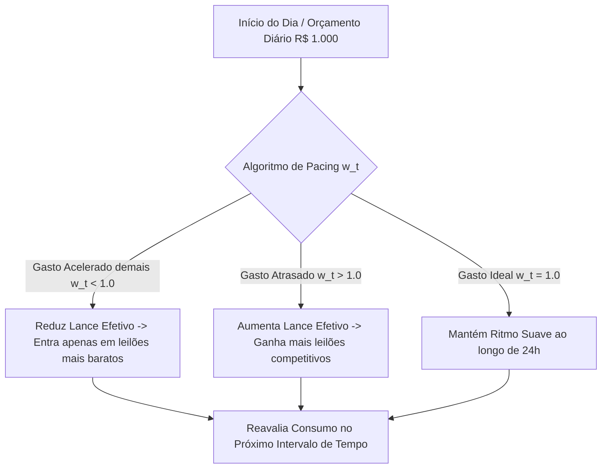
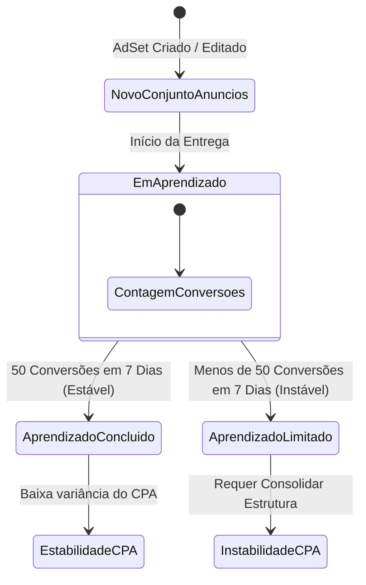
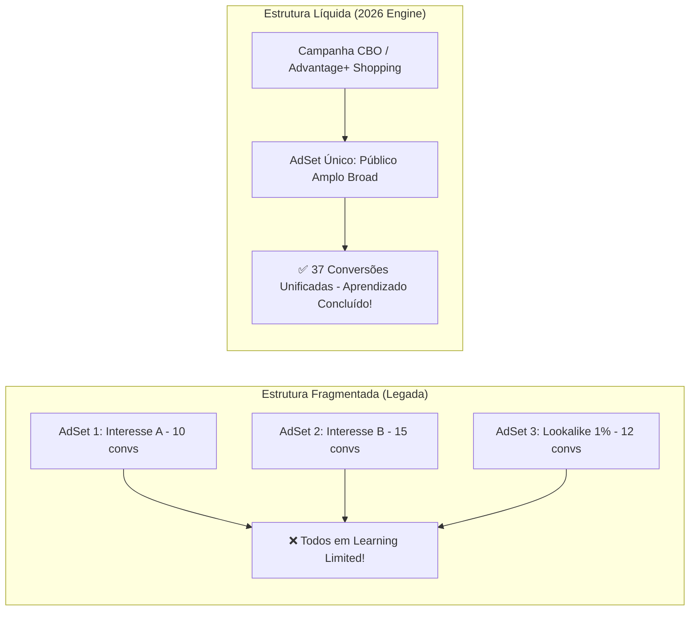

# MÓDULO 03 — ENTREGA, FASE DE APRENDIZADO (LEARNING PHASE), PACING E OTIMIZAÇÃO
**Programa:** MBA Meta Performance Engineering  
**Edição:** 2026  
**Disciplinas Integradas:** Meta Ads Engineering, Data Science & Machine Learning Systems  
**Tempo estimado de estudo:** 14 horas  

---

## 1. O SISTEMA DE ENTREGA DA META E O ALGORITMO DE PACING

O **Sistema de Entrega (Delivery System)** da Meta é o motor encarregado de regular a velocidade de gasto do orçamento do anunciante ao longo das 24 horas do dia, evitando que o orçamento acabe nas primeiras horas da manhã ou fique retido ao final do dia.



### 1.1 Equação do Multiplicador de Pacing
O lance efetivo no leilão é ajustado dinamicamente pelo fator de pacing $w_t$:

$$Bid_{\text{efetivo}}(t) = Bid_{\text{original}} \times w_t$$

Onde $w_t$ é calculado com base no desvio entre o orçamento consumido real e o orçamento projetado para o instante $t$.

---

## 2. A FASE DE APRENDIZADO (LEARNING PHASE) E LEARNING LIMITED



---

## 3. O FRAMEWORK DE LIQUIDEZ (LIQUIDITY FRAMEWORK)



---

## 4. PROJETO PRÁTICO: MONITOR DE SAÚDE DA FASE DE APRENDIZADO EM PYTHON (`analytics/learning_phase_monitor.py`)

```python
import os
import pandas as pd
from facebook_business.api import FacebookAdsApi
from facebook_business.adobjects.adaccount import AdAccount

def audit_learning_phase(ad_account_id: str):
    """
    Audita a saúde da estrutura da conta calculando a porcentagem de orçamento preso em Learning Limited.
    """
    account = AdAccount(ad_account_id)
    fields = ['id', 'name', 'learning_stage_info', 'daily_budget']
    params = {'effective_status': ['ACTIVE']}
    
    adsets = account.get_ad_sets(fields=fields, params=params)
    
    total_budget = 0.0
    limited_budget = 0.0
    report = []
    
    for adset in adsets:
        budget = float(adset.get('daily_budget', 0)) / 100.0
        total_budget += budget
        
        info = adset.get('learning_stage_info', {})
        status = info.get('status', 'UNKNOWN')
        conversions = info.get('attribution_learn_stage_conversions', 0)
        
        if status == 'LEARNING_LIMITED':
            limited_budget += budget
            
        report.append({
            'adset_id': adset.get('id'),
            'adset_name': adset.get('name'),
            'budget': budget,
            'status': status,
            'conversions_7d': conversions
        })
        
    df = pd.DataFrame(report)
    pct_limited = (limited_budget / total_budget * 100.0) if total_budget > 0 else 0.0
    
    print("=== AUDITORIA DE FASE DE APRENDIZADO (META OS) ===")
    print(f"Orçamento Ativo Total: R$ {total_budget:.2f}")
    print(f"Orçamento em Learning Limited: R$ {limited_budget:.2f} ({pct_limited:.1f}%)")
    
    if pct_limited > 20.0:
        print("🚨 ALERTA: Mais de 20% do orçamento está comprometido por fragmentação de dados!")
    else:
        print("✅ ESTRUTURA SAUDÁVEL: Baixa fragmentação identificada.")
        
    return df

if __name__ == "__main__":
    # audit_learning_phase("act_123456789")
    pass
```

---

## 5. EXERCÍCIOS DE FIXAÇÃO

### Questão 1 (Liquidez de Conta)
Uma empresa possui R\$ 500,00/dia de orçamento divididos em 10 conjuntos de anúncios. Cada conversão custa R\$ 50,00 em média.
1. Quantas conversões por semana cada conjunto gera?
2. Por que essa conta estará em *Learning Limited* permanente?
3. Apresente o plano de consolidação em estrutura líquida CBO.

---
*Fim do Módulo 03.*
