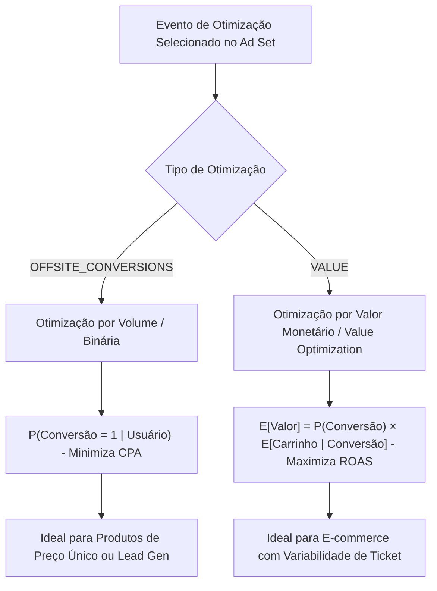
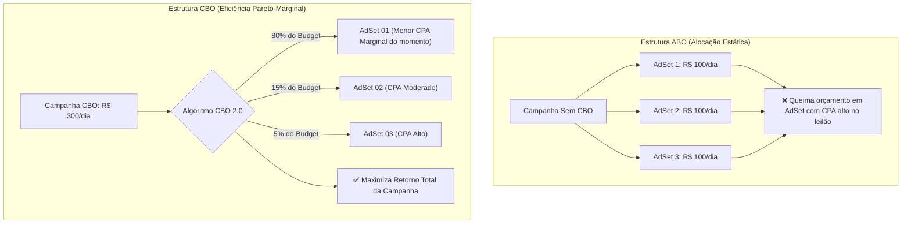

# MÓDULO 04 — OBJETIVOS, BID STRATEGIES E EVENTOS DE CONVERSÃO
**Programa:** MBA Meta Performance Engineering  
**Edição:** 2026  
**Disciplinas Integradas:** Meta Ads Engineering, Meta Developers & Direct Response Architecture  
**Tempo estimado de estudo:** 12 horas  

---

## 1. OTIMIZAÇÃO POR VALOR VS. OTIMIZAÇÃO POR VOLUME

No ecossistema Meta Ads em 2026, os algoritmos de otimização dividem-se fundamentalmente em duas classes de modelos estatísticos de Machine Learning:



---

## 2. COMPARATIVO CBO (CAMPAIGN BUDGET OPTIMIZATION) VS ABO



---

## 3. ESPECIFICAÇÃO DE PAYLOAD E SCHEMA DE EVENTOS PADRÃO (`Purchase`)

```json
{
  "event_name": "Purchase",
  "event_time": 1759162800,
  "event_id": "ORDER_2026_99812",
  "custom_data": {
    "currency": "BRL",
    "value": 349.90,
    "content_type": "product",
    "contents": [
      {
        "id": "SKU_7721",
        "quantity": 1,
        "item_price": 349.90
      }
    ],
    "order_id": "ORDER_2026_99812"
  }
}
```

---

## 4. PROJETO PRÁTICO: GESTOR DE ORÇAMENTOS E LANCES EM PYTHON (`automation/budget_manager.py`)

```python
import os
from facebook_business.api import FacebookAdsApi
from facebook_business.adobjects.campaign import Campaign
from facebook_business.adobjects.adset import AdSet

def update_campaign_budget(campaign_id: str, new_daily_budget_brl: float):
    """
    Atualiza o orçamento diário de uma campanha CBO via Graph API Meta.
    """
    budget_in_cents = int(new_daily_budget_brl * 100)
    campaign = Campaign(campaign_id)
    campaign[Campaign.Field.daily_budget] = budget_in_cents
    response = campaign.remote_update()
    print(f"✅ Campanha {campaign_id} atualizada para R$ {new_daily_budget_brl:.2f}/dia.")
    return response

def update_adset_bid_strategy(adset_id: str, bid_strategy: str, bid_amount_brl: float = None):
    """
    Atualiza a estratégia de lance de um AdSet.
    Estratégias: 'LOWEST_COST_WITHOUT_CAP', 'COST_CAP', 'BID_CAP'
    """
    adset = AdSet(adset_id)
    adset[AdSet.Field.bid_strategy] = bid_strategy
    if bid_amount_brl and bid_strategy in ['COST_CAP', 'BID_CAP']:
        adset[AdSet.Field.bid_amount] = int(bid_amount_brl * 100)
    response = adset.remote_update()
    print(f"✅ AdSet {adset_id} atualizado para a estratégia {bid_strategy}.")
    return response

if __name__ == "__main__":
    # update_campaign_budget("2384912345678", 500.0)
    pass
```

---

## 5. EXERCÍCIOS DE FIXAÇÃO

### Questão 1 (Engenharia de Sinais)
Um e-commerce de vestuário otimiza campanhas para `OFFSITE_CONVERSIONS` (Quantidade de Vendas), mas metade de suas vendas vem de vestidos de festa de R\$ 1.500,00 e a outra metade de meias de R\$ 19,90.
1. Qual o impacto negativo dessa configuração no leilão?
2. Como migrar a conta para a otimização por `VALUE` (ROAS)?

---
*Fim do Módulo 04.*
