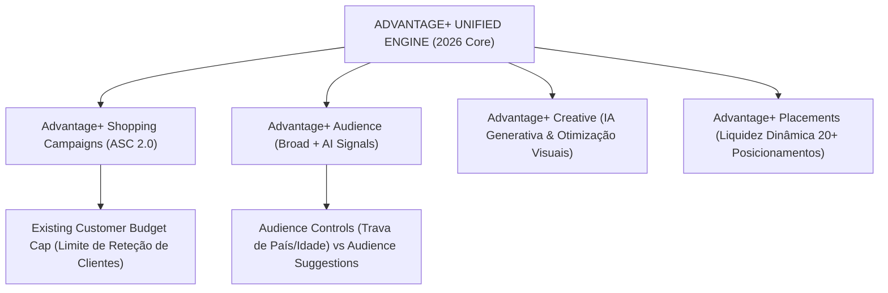
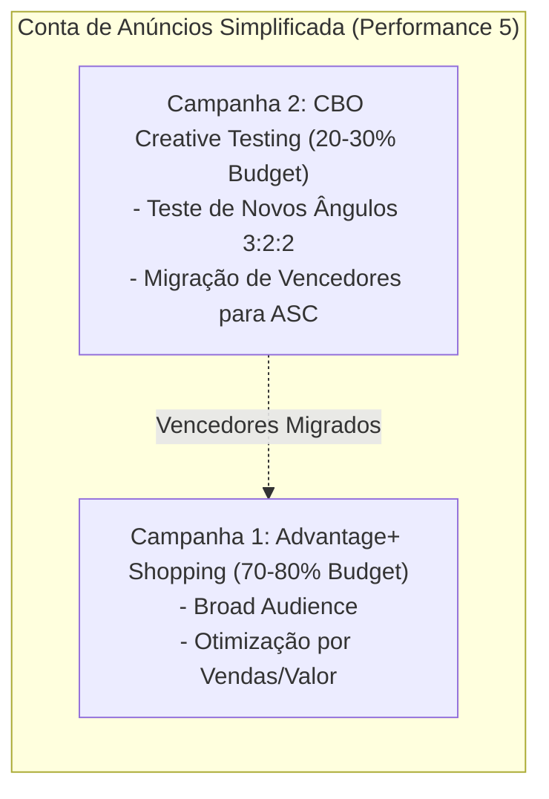

# MÓDULO 05 — ADVANTAGE+ 2026: ESTRUTURA UNIFICADA E AUTOMAÇÃO DE CAMPANHA
**Programa:** MBA Meta Performance Engineering  
**Edição:** 2026  
**Disciplinas Integradas:** Meta Ads Engineering, AI Systems & Campaign Architecture  
**Tempo estimado de estudo:** 12 horas  

---

## 1. O MOTOR UNIFICADO ADVANTAGE+ ENGINE (2026)

Em 2026, as soluções de automação da Meta foram totalmente consolidadas no **Advantage+ Unified Engine**, eliminando a fragilização de sinal e centralizando a inteligência artificial da plataforma.



---

## 2. ARQUITETURA DE CONTA RECOMENDADA (ACCOUNT SIMPLIFICATION)



---

## 3. A MIGRATION API `migrate_to_advantage_plus`

```http
POST /v26.0/act_1002938475/migrate_to_advantage_plus HTTP/1.1
Host: graph.facebook.com
Authorization: Bearer EAAG...
Content-Type: application/json

{
  "campaign_ids": ["2384912345678"],
  "apply_creative_enhancements": true,
  "enable_advantage_audience": true
}
```

---

## 4. PROJETO PRÁTICO: AUDITOR DE ADOÇÃO ADVANTAGE+ EM PYTHON (`analytics/advantage_plus_auditor.py`)

```python
import pandas as pd
from facebook_business.api import FacebookAdsApi
from facebook_business.adobjects.adaccount import AdAccount

def audit_advantage_plus_adoption(ad_account_id: str):
    """
    Calcula a porcentagem do orçamento alocado na suíte automatizada Advantage+.
    """
    account = AdAccount(ad_account_id)
    params = {'date_preset': 'last_30d'}
    campaigns = account.get_campaigns(fields=['id', 'name', 'smart_promotion_type'], params=params)
    
    total_spend = 0.0
    advantage_spend = 0.0
    report = []
    
    for camp in campaigns:
        insights = camp.get_insights(fields=['spend'], params={'date_preset': 'last_30d'})
        spend = float(insights[0]['spend']) if len(insights) > 0 else 0.0
        total_spend += spend
        
        is_advantage = camp.get('smart_promotion_type') in ['SMART_SHOPPING', 'ADVANTAGE_PLUS']
        if is_advantage:
            advantage_spend += spend
            
        report.append({
            'campaign_id': camp.get('id'),
            'name': camp.get('name'),
            'spend_30d': spend,
            'is_advantage': is_advantage
        })
        
    df = pd.DataFrame(report)
    pct = (advantage_spend / total_spend * 100.0) if total_spend > 0 else 0.0
    
    print("=== AUDITORIA DE ADOÇÃO ADVANTAGE+ ===")
    print(f"Gasto Total 30d: R$ {total_spend:.2f}")
    print(f"Gasto Advantage+: R$ {advantage_spend:.2f} ({pct:.1f}%)")
    
    if pct < 60.0:
        print("⚠️ ALERTA: Migrar campanhas legadas para Advantage+ Shopping (Performance 5).")
    else:
        print("✅ ESTRUTURA ALINHADA COM AS BOAS PRÁTICAS.")
        
    return df

if __name__ == "__main__":
    # audit_advantage_plus_adoption("act_123456789")
    pass
```

---

## 5. EXERCÍCIOS DE FIXAÇÃO

### Questão 1 (Arquitetura de Campanhas)
Como justificar para um cliente tradicional a substituição de 10 campanhas de público segmentado por uma única estrutura Advantage+ Shopping (ASC 2.0) com *Existing Customer Budget Cap* de 15%?

---
*Fim do Módulo 05.*
