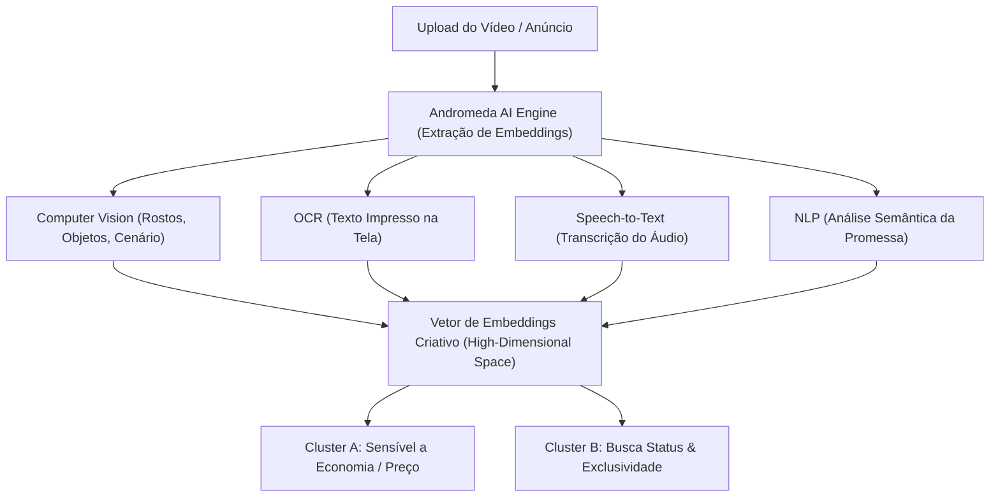

# MÓDULO 06 — CRIATIVO ALGORÍTMICO, TAXONOMIA E CREATIVE DIVERSITY (AGO/2026)
**Programa:** MBA Meta Performance Engineering  
**Edição:** 2026  
**Disciplinas Integradas:** Creative Intelligence, Computer Vision & Meta Ads Engineering  
**Tempo estimado de estudo:** 12 horas  

---

## 1. O CRIATIVO COMO MECANISMO DE SEGMENTAÇÃO (*CREATIVE AS TARGETING*)

No modelo de entrega moderna da Meta, o conteúdo do criativo é o fator determinante para a seleção do cluster de audiência no leilão.



---

## 2. METRICA DE DIVERSIDADE CRIATIVA (CREATIVE DIVERSITY SCORE 2026)

```mermaid
flowchart TD
    subgraph LOW_DIVERSITY ["❌ Baixa Diversidade (Self-Overlap Canibalização)"]
        V1["Vídeo 1: Gancho Vermelho"] ┐
        V2["Vídeo 2: Gancho Azul"]     ├─► Apontam para o MESMO Vector Space!
        V3["Vídeo 3: Gancho Verde"]    ┘   Disputam a mesma audiência -> CPA Sobe!
    end

    subgraph HIGH_DIVERSITY ["✅ Alta Diversidade (Expansão de Mercado)"]
        H1["UGC Vídeo: Depoimento Real"] ──► Audiência A (Prova Social)
        H2["Motion Infográfico: Dados"]  ──► Audiência B (Analítica)
        H3["Estático: Comparativo"]      ──► Audiência C (Visual Rápida)
    end
```

---

## 3. PROJETO PRÁTICO: CLASSIFICADOR DE DIVERSIDADE CRIATIVA EM PYTHON (`creative/creative_classifier.py`)

```python
import pandas as pd

def analyze_creative_diversity(creative_names: list):
    """
    Recebe nomes de anúncios no padrão da taxonomia e calcula o Score de Diversidade.
    Padrão Nomenclatura: [ANGULO]_[GANCHO]_[FORMATO]_[CRIADOR]_[DATA]
    """
    angles, formats, hooks = [], [], []
    for name in creative_names:
        parts = name.split('_')
        if len(parts) >= 3:
            angles.append(parts[0])
            hooks.append(parts[1])
            formats.append(parts[2])
            
    df = pd.DataFrame({'angle': angles, 'hook': hooks, 'format': formats})
    
    unique_angles = df['angle'].nunique()
    unique_formats = df['format'].nunique()
    total = len(creative_names)
    
    diversity_score = (unique_angles * 0.6) + (unique_formats * 0.4)
    
    if diversity_score >= 3.5:
        rating = "ALTA (High Diversity - Baixo Risco de Overlap)"
    elif diversity_score >= 2.0:
        rating = "MÉDIA (Moderate Diversity)"
    else:
        rating = "BAIXA (Low Diversity - Canibalização de Leilão!)"
        
    print("=== AUDITORIA DE CREATIVE DIVERSITY SCORE ===")
    print(f"Total Anúncios: {total} | Ângulos Únicos: {unique_angles} | Formatos Únicos: {unique_formats}")
    print(f"RATING CALCULADO: {rating}")
    return df

if __name__ == "__main__":
    sample = [
        "DOR-FINAN_HOOK-TEXTO-3S_UGC-REELS_MARIANA_20260929",
        "DESEJO-VIAGEM_HOOK-PERGUNTA_MOTION-1X1_PEDRO_20260929",
        "PROVA-SOCIAL_HOOK-PRINT_CARROSSEL_ANA_20260929"
    ]
    analyze_creative_diversity(sample)
```

---

## 4. EXERCÍCIOS DE FIXAÇÃO

### Questão 1 (Engenharia Criativa)
Por que 10 variações do mesmo vídeo alterando apenas a cor da legenda nos primeiros 0.5s gera uma nota "Baixa" no *Creative Diversity Score* da Meta?

---
*Fim do Módulo 06.*
