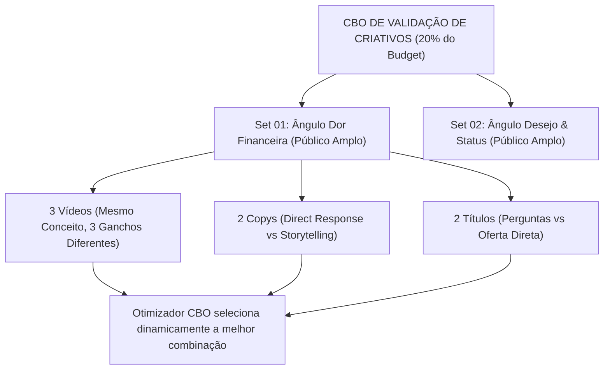
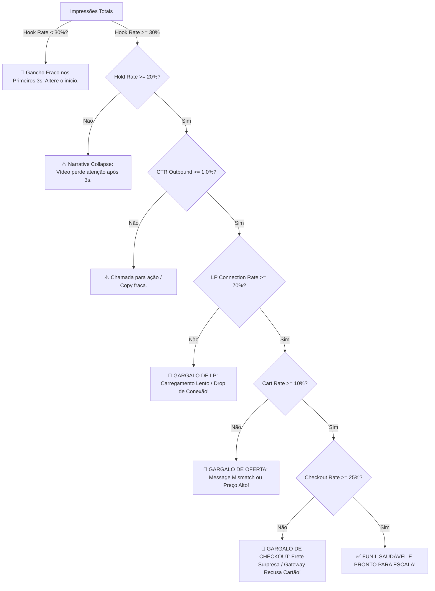

# MÓDULO 07 — CREATIVE TESTING, GANCHOS, ÂNGULOS E CRO PÓS-CLIQUE
**Programa:** MBA Meta Performance Engineering  
**Edição:** 2026  
**Disciplinas Integradas:** Creative Intelligence, Copywriting & Conversion Rate Optimization (CRO)  
**Tempo estimado de estudo:** 14 horas  

---

## 1. PROTOCOLO EXPERIMENTAL DE TESTE 3:2:2



---

## 2. ÁRVORE LÓGICA DE CRO E DIAGNÓSTICO DE FUNIL



---

## 3. PROJETO PRÁTICO: DIAGNÓSTICO AUTOMÁTICO DE FUNIL EM PYTHON (`analytics/funnel_diagnostics.py`)

```python
def diagnose_funnel(metrics: dict):
    """
    Recebe dicionário com métricas do anúncio e executa o diagnóstico lógico de CRO.
    """
    imp = metrics.get('impressions', 0)
    v3s = metrics.get('views_3s', 0)
    thru = metrics.get('thruplays', 0)
    clicks = metrics.get('clicks', 0)
    lp = metrics.get('lp_views', 0)
    atc = metrics.get('add_to_cart', 0)
    pur = metrics.get('purchases', 0)
    
    hook_rate = (v3s / imp * 100.0) if imp > 0 else 0
    hold_rate = (thru / v3s * 100.0) if v3s > 0 else 0
    ctr = (clicks / imp * 100.0) if imp > 0 else 0
    lp_connect = (lp / clicks * 100.0) if clicks > 0 else 0
    cart_rate = (atc / lp * 100.0) if lp > 0 else 0
    pur_rate = (pur / atc * 100.0) if atc > 0 else 0
    
    print("=== RELATÓRIO DE CRO E FUNIL DE PERFORMANCE ===")
    print(f"1. Hook Rate: {hook_rate:.1f}% " + ("✅" if hook_rate >= 30 else "🚨 (Ajustar 3s iniciais)"))
    print(f"2. Hold Rate: {hold_rate:.1f}% " + ("✅" if hold_rate >= 20 else "⚠️ (Melhorar narrativa)"))
    print(f"3. CTR Outbound: {ctr:.2f}% " + ("✅" if ctr >= 1.0 else "⚠️ (Ajustar CTA/Copy)"))
    print(f"4. Conexão LP: {lp_connect:.1f}% " + ("✅" if lp_connect >= 70 else "🚨 (LP Lenta!)"))
    print(f"5. Taxa de Carrinho: {cart_rate:.1f}% " + ("✅" if cart_rate >= 10 else "🚨 (Oferta/Mismatch!)"))
    print(f"6. Conversão Checkout: {pur_rate:.1f}% " + ("✅" if pur_rate >= 25 else "🚨 (Checkout/Gateway!)"))

if __name__ == "__main__":
    sample = {
        'impressions': 50000, 'views_3s': 18000, 'thruplays': 4000,
        'clicks': 650, 'lp_views': 250,
        'add_to_cart': 20, 'purchases': 4
    }
    diagnose_funnel(sample)
```

---

## 4. EXERCÍCIOS DE FIXAÇÃO

### Questão 1 (Diagnóstico de CRO)
Um anúncio teve 1.000 cliques, 350 Landing Page Views, 35 adições ao carrinho e 2 compras. Onde está o gargalo primário e qual a intervenção técnica requerida?

---
*Fim do Módulo 07.*
