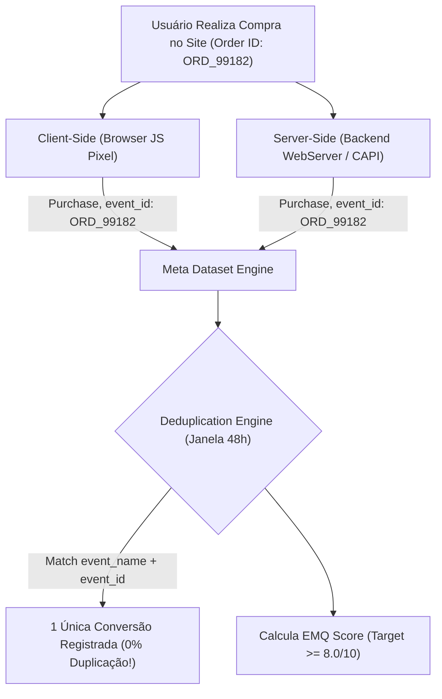
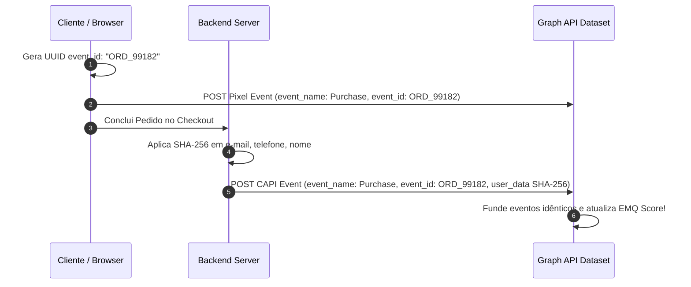

# MÓDULO 08 — TRACKING DE SINAIS: PIXEL, CAPI GATEWAY, EMQ E DEDUPLICAÇÃO
**Programa:** MBA Meta Performance Engineering  
**Edição:** 2026  
**Disciplinas Integradas:** Meta Developers, Data Engineering & Privacy Systems  
**Tempo estimado de estudo:** 16 horas  

---

## 1. ARQUITETURA DE SINAIS HÍBRIDA (BROWSER + SERVER)



---

## 2. FLUXO DE DESDUPLICAÇÃO E HASHING SHA-256



---

## 3. TABELA DE SCHEMA PII E REGRAS DE HASHING SHA-256

| Parâmetro CAPI | Descrição | Normalização Obrigatória | Exemplo SHA-256 |
| :--- | :--- | :--- | :--- |
| `em` | E-mail | Lowercase, trim | `sha256("joao@email.com")` |
| `ph` | Telefone | Apenas números com DDI | `sha256("5511999999999")` |
| `fn` / `ln` | Nome / Sobrenome | Lowercase, remover acentos | `sha256("joao")` |
| `fbp` | Cookie `_fbp` | **Texto Puro** (Não aplicar SHA-256!) | `fb.1.1759162800.1234` |
| `fbc` | Cookie `_fbc` | **Texto Puro** (Contém `fbclid`) | `fb.1.1759162800.IwAR2...` |

---

## 4. PROJETO PRÁTICO: CLIENTE SERVER-SIDE CAPI EM PYTHON (`collector/capi_client.py`)

```python
import hashlib
import time
import requests
import json

class MetaCAPIClient:
    """
    Cliente Python oficial para envio de eventos resilientes via Conversions API v26.0.
    """
    def __init__(self, dataset_id: str, access_token: str):
        self.dataset_id = dataset_id
        self.access_token = access_token
        self.url = f"https://graph.facebook.com/v26.0/{dataset_id}/events"

    @staticmethod
    def _hash_val(val: str) -> str:
        if not val:
            return None
        return hashlib.sha256(val.strip().lower().encode('utf-8')).hexdigest()

    def send_purchase(self, order_id: str, amount: float, email: str, phone: str, fbp: str = None, fbc: str = None):
        payload = {
            "data": [
                {
                    "event_name": "Purchase",
                    "event_time": int(time.time()),
                    "event_id": order_id,
                    "action_source": "website",
                    "user_data": {
                        "em": [self._hash_val(email)],
                        "ph": [self._hash_val(phone)],
                        "fbp": fbp,
                        "fbc": fbc
                    },
                    "custom_data": {
                        "currency": "BRL",
                        "value": amount,
                        "order_id": order_id
                    }
                }
            ],
            "access_token": self.access_token
        }
        res = requests.post(self.url, json=payload)
        if res.status_code == 200:
            print(f"✅ Evento CAPI Purchase ({order_id}) enviado com sucesso! EMQ Otimizado.")
        else:
            print(f"❌ Erro CAPI ({res.status_code}): {res.text}")
        return res.json()

if __name__ == "__main__":
    # client = MetaCAPIClient("DATASET_ID", "ACCESS_TOKEN")
    pass
```

---

## 5. EXERCÍCIOS DE FIXAÇÃO

### Questão 1 (Auditoria de Sinais)
O evento `Purchase` de uma loja virtual está com EMQ de $3.8/10$. Qual a causa técnica e como o envio de `_fbp`, `_fbc` e dados cadastrais SHA-256 elevarão essa nota para $\ge 8.5/10$?

---
*Fim do Módulo 08.*
