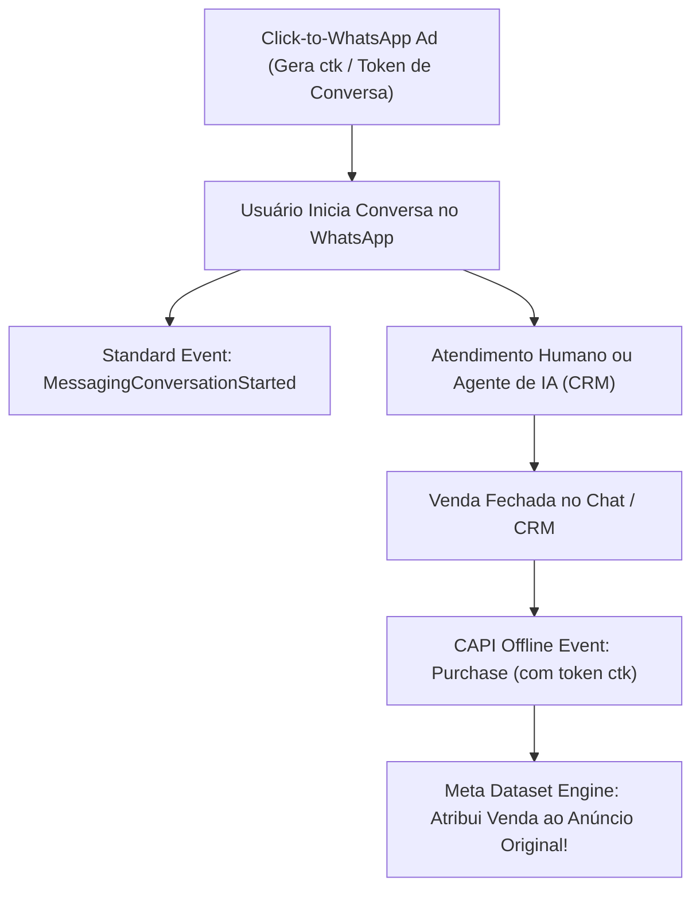
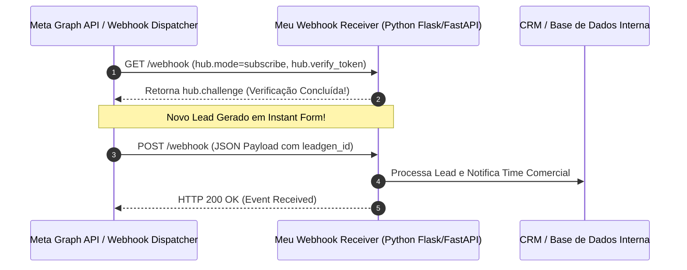

# MÓDULO 09 — CAPI OFFLINE, MESSAGING (WHATSAPP), SDK PYTHON E WEBHOOKS
**Programa:** MBA Meta Performance Engineering  
**Edição:** 2026  
**Disciplinas Integradas:** Meta Developers, AI Engineering & Messaging Architecture  
**Tempo estimado de estudo:** 14 horas  

---

## 1. CONVERSIONS API FOR MESSAGING (WHATSAPP & MESSENGER)

O comércio conversacional via WhatsApp Business Platform é uma alavanca crítica de vendas. O **CAPI for Messaging** atribui vendas fechadas no chat diretamente aos anúncios originadores (Click-to-WhatsApp Ads).



---

## 2. ARQUITETURA DE RECEPÇÃO DE WEBHOOKS EM TEMPO REAL



---

## 3. PROJETO PRÁTICO: SERVIDOR DE WEBHOOKS EM PYTHON FLASK (`collector/webhook_server.py`)

```python
from flask import Flask, request, jsonify
import os
import json

app = Flask(__name__)
VERIFY_TOKEN = os.getenv("META_WEBHOOK_VERIFY_TOKEN", "meta_mba_secure_token_2026")

@app.route('/webhook', methods=['GET'])
def verify():
    mode = request.args.get('hub.mode')
    token = request.args.get('hub.verify_token')
    challenge = request.args.get('hub.challenge')
    
    if mode == 'subscribe' and token == VERIFY_TOKEN:
        print("✅ WEBHOOK VERIFICADO COM SUCESSO PELA META!")
        return challenge, 200
    return 'Forbidden', 403

@app.route('/webhook', methods=['POST'])
def handle_event():
    data = request.get_json()
    print("📩 Webhook Recebido em Tempo Real:")
    print(json.dumps(data, indent=2))
    # Inserir lógica de integração com CRM...
    return jsonify({"status": "SUCCESS"}), 200

if __name__ == '__main__':
    app.run(port=5000, debug=True)
```

---

## 4. EXERCÍCIOS DE FIXAÇÃO

### Questão 1 (Arquitetura Conversacional)
Como o token `ctk` gerado em um anúncio Click-to-WhatsApp garante que uma compra realizada no atendimento presencial ou via chave PIX no chat seja atribuída à campanha correta?

---
*Fim do Módulo 09 (Versão Expandida com Diagramas Mermaid).*
