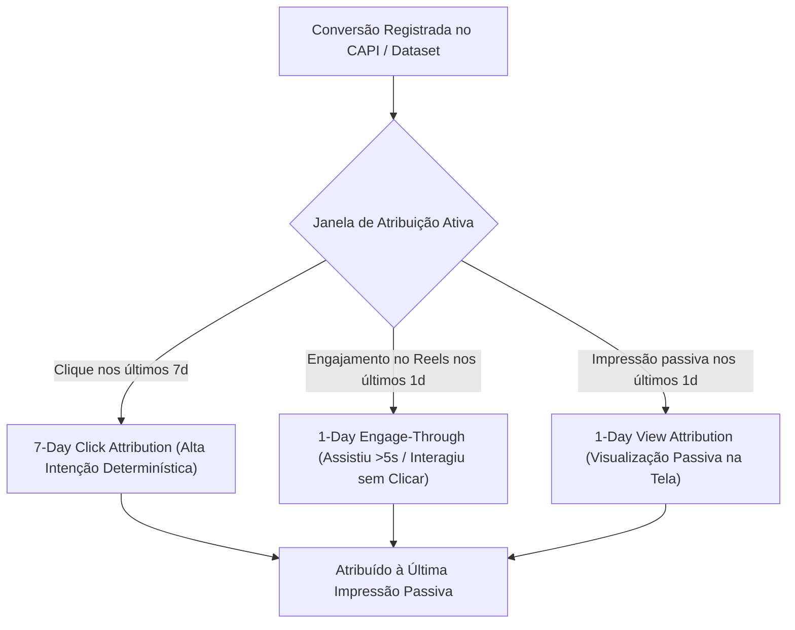
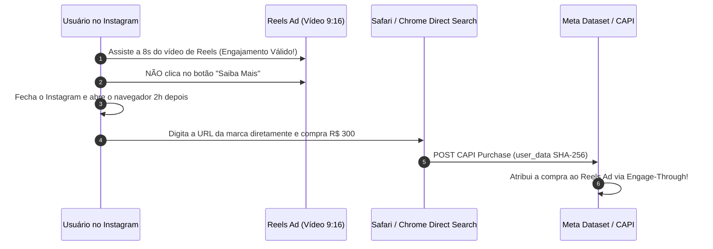

# MÓDULO 10 — ATRIBUIÇÃO 2026: 7D CLICK, 1D ENGAGE-THROUGH, 1D VIEW E ANALYTICS
**Programa:** MBA Meta Performance Engineering  
**Edição:** 2026  
**Disciplinas Integradas:** Marketing Science, Analytics & Data Science  
**Tempo estimado de estudo:** 12 horas  

---

## 1. O PADRÃO MULTICANAL DE ATRIBUIÇÃO META EM 2026



---

## 2. FLUXO TÍPICO DE ENGAGE-THROUGH ATTRIBUTION



---

## 3. PROJETO PRÁTICO: COMPARADOR DE JANELAS EM PYTHON (`analytics/attribution_comparator.py`)

```python
import pandas as pd
from facebook_business.api import FacebookAdsApi
from facebook_business.adobjects.adaccount import AdAccount

def compare_attribution_windows(ad_account_id: str):
    """
    Compara a receita e o ROAS reportados segregados por janela de atribuição.
    """
    account = AdAccount(ad_account_id)
    params = {
        'date_preset': 'last_30d',
        'fields': ['campaign_name', 'spend', 'action_values'],
        'action_attribution_windows': ['1d_click', '7d_click', '1d_engage_through', '1d_view']
    }
    insights = account.get_insights(params=params)
    
    report = []
    for item in insights:
        spend = float(item.get('spend', 0.0))
        report.append({
            'campaign': item.get('campaign_name'),
            'spend': spend
        })
        
    df = pd.DataFrame(report)
    print("=== COMPARATIVO DE JANELAS DE ATRIBUIÇÃO ===")
    print(df)
    return df

if __name__ == "__main__":
    # compare_attribution_windows("act_123456789")
    pass
```

---

## 4. EXERCÍCIOS DE FIXAÇÃO

### Questão 1 (Análise Executiva)
Como demonstrar ao CFO da empresa que o investimento em Reels Ads que convertem via *1-Day Engage-Through* é altamente rentável e não representa "crédito duplicado"?

---
*Fim do Módulo 10.*
