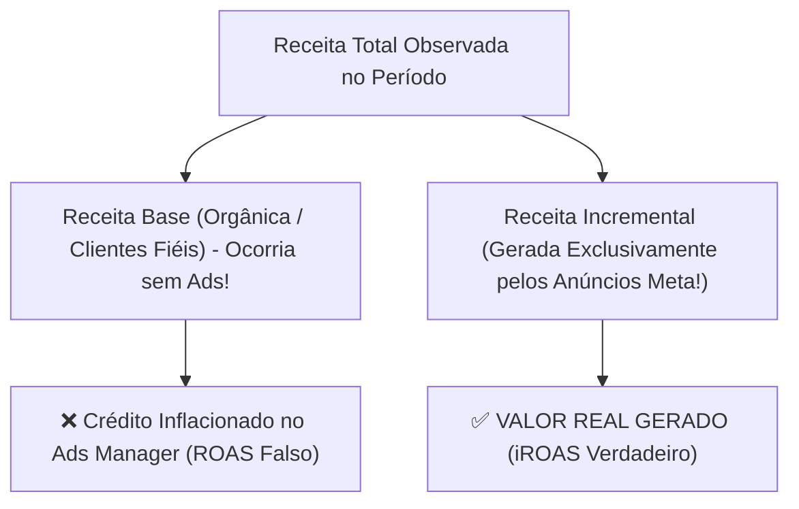
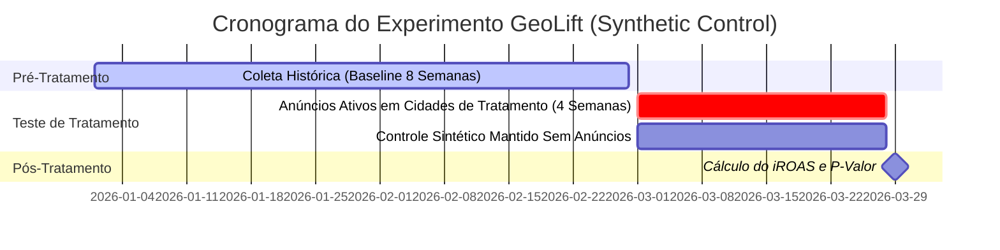
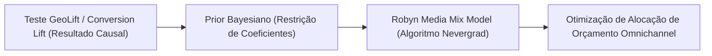

# MÓDULO 11 — MARKETING SCIENCE: INCREMENTALIDADE, GEOLIFT E ROBYN MMM
**Programa:** MBA Meta Performance Engineering  
**Edição:** 2026  
**Disciplinas Integradas:** Marketing Science, Econometria & Causal Inference  
**Tempo estimado of estudo:** 16 horas  

---

## 1. O PARADIGMA DA INFERÊNCIA CAUSAL EM MARKETING



---

## 2. METODOLOGIA GEOLIFT (SYNTHETIC CONTROL METHOD)



---

## 3. CALIBRAÇÃO DE ROBYN MMM COM PRIORS BAYESIANOS



---

## 4. PROJETO PRÁTICO: CALCULADORA DE IROAS EM PYTHON (`analytics/incremental_roas.py`)

```python
def calculate_incremental_roas(treatment_revenue: float, synthetic_control_revenue: float, media_spend: float):
    """
    Calcula a Receita Incremental Causal e o iROAS de um teste GeoLift.
    """
    incremental_rev = treatment_revenue - synthetic_control_revenue
    lift_pct = (incremental_rev / synthetic_control_revenue * 100.0) if synthetic_control_revenue > 0 else 0
    iroas = (incremental_rev / media_spend) if media_spend > 0 else 0
    
    print("=== RELATÓRIO DE INCREMENTALIDADE (MARKETING SCIENCE) ===")
    print(f"Receita Tratamento: R$ {treatment_revenue:,.2f}")
    print(f"Receita Controle Sintético: R$ {synthetic_control_revenue:,.2f}")
    print(f"RECEITA INCREMENTAL REAL: R$ {incremental_rev:,.2f} (Lift: +{lift_pct:.1f}%)")
    print(f"Investimento em Mídia: R$ {media_spend:,.2f}")
    print(f"iROAS (ROAS INCREMENTAL REAL): {iroas:.2fx}")
    
    if iroas < 1.0:
        print("🚨 ALERTA: O investimento marginal está destruindo valor operacional!")
    else:
        print("✅ EXCELENTE: Retorno incremental comprovado causualmente. Pode escalar!")

if __name__ == "__main__":
    calculate_incremental_roas(1200000.0, 900000.0, 100000.0)
```

---

## 5. EXERCÍCIOS DE FIXAÇÃO

### Questão 1 (Marketing Science)
Um painel do Ads Manager reporta um ROAS de $4.5x$. No entanto, o teste GeoLift demonstrou que $60\%$ da receita teria ocorrido sem os anúncios. Qual é o $iROAS$ verdadeiro dessa campanha?

---
*Fim do Módulo 11 (Versão Expandida com Diagramas Mermaid).*
