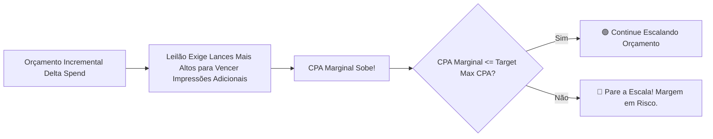
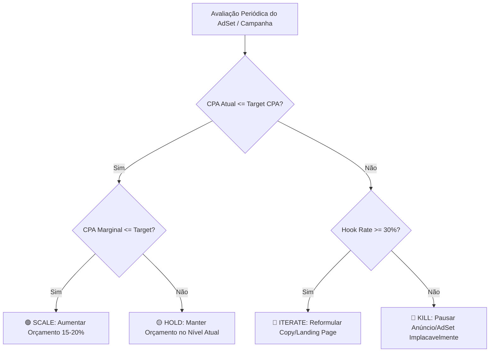

# MÓDULO 12 — ESTRATÉGIAS DE ESCALA, DIMINISHING RETURNS E DECISION SCIENCE
**Programa:** MBA Meta Performance Engineering  
**Edição:** 2026  
**Disciplinas Integradas:** Decision Science, Meta Ads Engineering & Microeconomia  
**Tempo estimado de estudo:** 14 horas  

---

## 1. A CURVA DE RENDIMENTOS DECRESCENTES E CPA MARGINAL



### 1.1 A Equação do CPA Marginal
$$CPA_{\text{marginal}} = \frac{\Delta \text{Gasto Total}}{\Delta \text{Total de Conversões}} = \frac{\text{Gasto}_2 - \text{Gasto}_1}{\text{Conversões}_2 - \text{Conversões}_1}$$

---

## 2. A MÁQUINA DE ESTADOS DECISÓRIA DE DECISION SCIENCE



---

## 3. PROJETO PRÁTICO: CALCULADORA DE CPA MARGINAL EM PYTHON (`analytics/marginal_cpa_calculator.py`)

```python
def analyze_scale_decision(spend1: float, convs1: int, spend2: float, convs2: int, target_cpa: float):
    """
    Calcula CPA Marginal entre dois níveis de orçamento e emite recomendação decisória.
    """
    delta_spend = spend2 - spend1
    delta_convs = convs2 - convs1
    
    cpa1 = spend1 / convs1 if convs1 > 0 else 0
    cpa2 = spend2 / convs2 if convs2 > 0 else 0
    
    cpa_marginal = (delta_spend / delta_convs) if delta_convs > 0 else float('inf')
    
    print("=== ANÁLISE DE DECISION SCIENCE & MARGINAL CPA ===")
    print(f"Nível 1: R$ {spend1:.2f} -> {convs1} convs (CPA Médio: R$ {cpa1:.2f})")
    print(f"Nível 2: R$ {spend2:.2f} -> {convs2} convs (CPA Médio: R$ {cpa2:.2f})")
    print(f"CPA MARGINAL DO INCREMENTO: R$ {cpa_marginal:.2f}")
    
    if cpa_marginal <= target_cpa:
        print("🟢 DECISÃO: SCALE (Escala rentável confirmada).")
    elif cpa2 <= target_cpa and cpa_marginal > target_cpa:
        print("🟡 DECISÃO: HOLD (Manter no Nível 2. Próximo aumento destruirá a margem).")
    else:
        print("🔴 DECISÃO: KILL / REVERT (Retornar imediatamente ao Nível 1!).")

if __name__ == "__main__":
    analyze_scale_decision(5000.0, 100, 8000.0, 120, 100.0)
```

---

## 4. EXERCÍCIOS DE FIXAÇÃO

### Questão 1 (Decision Science)
Ao passar uma campanha de R\$ 1.000/dia para R\$ 2.000/dia, o número de vendas subiu de 50 para 60. O $CAC_{\text{max}}$ da empresa é R\$ 80,00.
1. Qual o CPA Médio no Nível 2?
2. Qual foi o CPA Marginal dessas 10 vendas adicionais?
3. Qual a sua decisão oficial?

---
*Fim do Módulo 12.*
