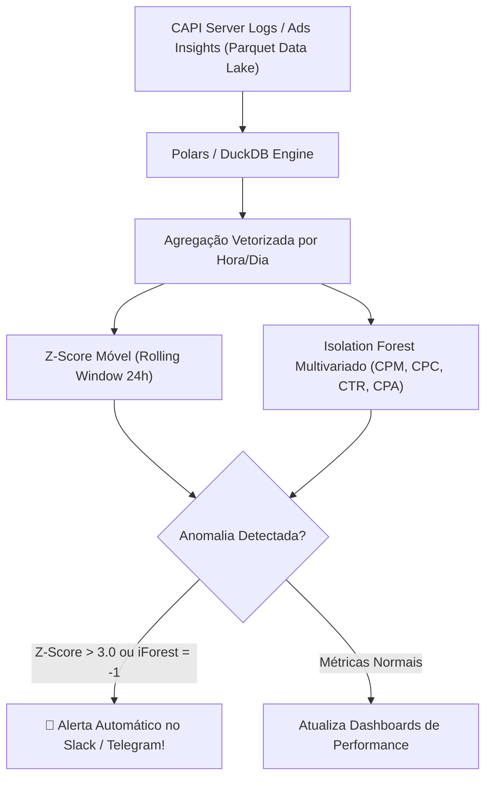

# MÓDULO 13 — DATA SCIENCE APLICADO: SQL, POLARS, ANOMALY DETECTION E FORECASTING
**Programa:** MBA Meta Performance Engineering  
**Edição:** 2026  
**Disciplinas Integradas:** Data Science, Data Engineering & Machine Learning  
**Tempo estimado de estudo:** 16 horas  

---

## 1. ARQUITETURA DE DATA PIPELINES DE ALTA PERFORMANCE



---

## 2. SQL AVANÇADO PARA AUDITORIA DE LOGS CAPI & MATCH RATES

```sql
-- Query de Auditoria de Preenchimento de PII e EMQ por Tipo de Evento
SELECT 
    DATE(FROM_UNIXTIME(event_time)) AS event_date,
    event_name,
    COUNT(1) AS total_events,
    ROUND(COUNT(user_data_hashed->>'$.em') * 100.0 / COUNT(1), 2) AS pct_email,
    ROUND(COUNT(user_data_hashed->>'$.ph') * 100.0 / COUNT(1), 2) AS pct_phone,
    ROUND(COUNT(fbp) * 100.0 / COUNT(1), 2) AS pct_fbp,
    ROUND(COUNT(fbc) * 100.0 / COUNT(1), 2) AS pct_fbc,
    AVG(match_quality_score) AS avg_emq
FROM capi_event_logs
WHERE event_time >= UNIX_TIMESTAMP(DATE_SUB(CURRENT_DATE(), INTERVAL 7 DAY))
GROUP BY 1, 2
ORDER BY 1 DESC, total_events DESC;
```

---

## 3. PROJETO PRÁTICO: DETECTOR MULTIVARIADO DE ANOMALIAS EM PYTHON (`analytics/anomaly_detector.py`)

```python
import numpy as np
import pandas as pd
from sklearn.ensemble import IsolationForest

def detect_cpa_anomalies(df_hourly: pd.DataFrame, z_threshold: float = 3.0):
    """
    Aplica Z-score móvel e Isolation Forest para identificar anomalias no CPA horário.
    """
    df = df_hourly.copy().sort_values('timestamp')
    
    # Z-score móvel
    df['cpa_mean'] = df['cpa'].rolling(window=24, min_periods=6).mean()
    df['cpa_std'] = df['cpa'].rolling(window=24, min_periods=6).std()
    df['z_score'] = (df['cpa'] - df['cpa_mean']) / (df['cpa_std'] + 1e-6)
    df['zscore_anomaly'] = df['z_score'] > z_threshold
    
    # Isolation Forest
    features = ['cpm', 'cpc', 'ctr', 'cpa']
    X = df[features].fillna(0)
    iso = IsolationForest(contamination=0.05, random_state=42)
    df['iforest_anomaly'] = iso.fit_predict(X) == -1
    
    anomalies = df[df['zscore_anomaly'] | df['iforest_anomaly']]
    
    print("=== ANÁLISE DE DETECÇÃO DE ANOMALIAS (DATA SCIENCE) ===")
    print(f"Total Registros Horários: {len(df)}")
    print(f"Anomalias Identificadas: {len(anomalies)}")
    
    return anomalies
```

---

## 4. EXERCÍCIOS DE FIXAÇÃO

### Questão 1 (Data Science)
Em um log horário de CAPI, o CPA das últimas 2 horas atingiu um Z-score de $+3.4$. Quais ações automáticas seu script de pipeline deve disparar para proteger a conta de anúncios?

---
*Fim do Módulo 13.*
