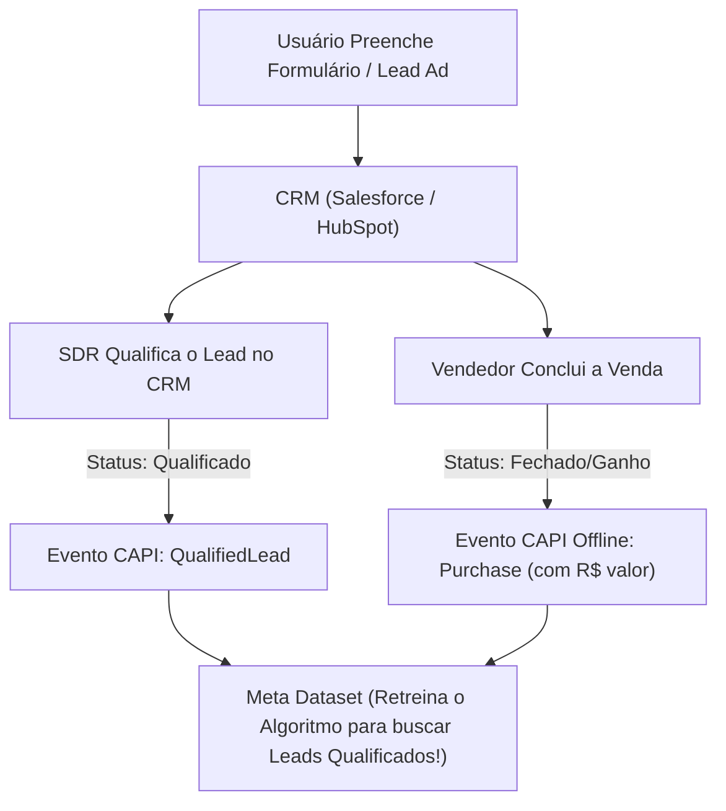
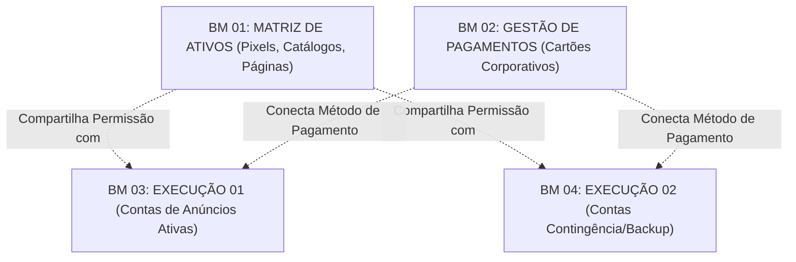

# MÓDULO 14 — INTEGRAÇÃO COM CRM, REVENUE INTELLIGENCE, GOVERNANÇA E LGPD
**Programa:** MBA Meta Performance Engineering  
**Edição:** 2026  
**Disciplinas Integradas:** Operations, Governance & Business Architecture  
**Tempo estimado de estudo:** 12 horas  

---

## 1. CLOSED-LOOP MARKETING: CRM FEEDBACK TO META CAPI



---

## 2. ARQUITETURA DE BMs E MITIGAÇÃO DE RISCOS (GOVERNANÇA)



---

## 3. PROJETO PRÁTICO: SINCRONIZADOR DE CRM EM PYTHON (`collector/crm_offline_sync.py`)

```python
import hashlib
import time
import requests

def send_crm_event_to_meta(dataset_id: str, access_token: str, email: str, phone: str, event_name: str, deal_val: float):
    """
    Envia status de qualificação do CRM para o Meta Dataset via CAPI Offline.
    """
    url = f"https://graph.facebook.com/v26.0/{dataset_id}/events"
    payload = {
        "data": [
            {
                "event_name": event_name,
                "event_time": int(time.time()),
                "action_source": "system_generated",
                "user_data": {
                    "em": [hashlib.sha256(email.strip().lower().encode('utf-8')).hexdigest()],
                    "ph": [hashlib.sha256(phone.strip().encode('utf-8')).hexdigest()]
                },
                "custom_data": {
                    "currency": "BRL",
                    "value": deal_val
                }
            }
        ],
        "access_token": access_token
    }
    res = requests.post(url, json=payload)
    if res.status_code == 200:
        print(f"✅ Sinal de CRM ({event_name}) enviado com sucesso!")
    else:
        print(f"❌ Erro no envio CRM: {res.text}")
    return res.json()
```

---

## 4. EXERCÍCIOS DE FIXAÇÃO

### Questão 1 (Governança Corporativa)
Por que a recomendação de arquitetura proíbe rigorosamente criar o Pixel e manter o cartão de crédito dentro da mesma BM de Execução de Anúncios?

---
*Fim do Módulo 14 (Versão Expandida com Diagramas Mermaid).*
