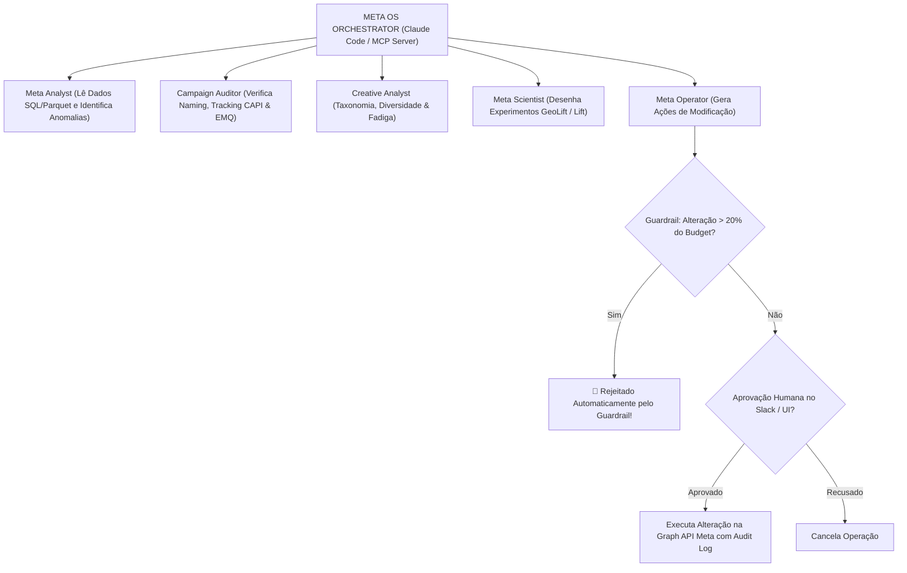
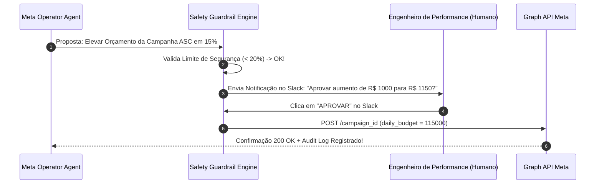

# MÓDULO 15 — META OS: INTEGRAÇÃO DE AGENTES DE IA (MCP, CLAUDE CODE E CONNECTORS)
**Programa:** MBA Meta Performance Engineering  
**Edição:** 2026  
**Disciplinas Integradas:** AI Engineering, Agent Architecture & Meta Developers  
**Tempo estimado de estudo:** 16 horas  

---

## 1. O SISTEMA OPERACIONAL AGÊNTICO: META OS



---

## 2. FLUXO DE APROVAÇÃO HUMANA (HUMAN-IN-THE-LOOP)



---

## 3. PROJETO PRÁTICO: ORQUESTRADOR META OS EM PYTHON (`agents/orchestrator.py`)

```python
import json

class MetaOSOrchestrator:
    """
    Orquestrador Central de Agentes do Meta OS com Guardrails de Segurança.
    """
    def __init__(self, ad_account_id: str):
        self.ad_account_id = ad_account_id

    def run_full_diagnostic(self):
        print(f"🤖 INICIANDO DIAGNÓSTICO AGÊNTICO META OS PARA {self.ad_account_id}...")
        
        # 1. Executa Auditor
        print("  1️⃣ Campaign Auditor: Verificando Saúde de Sinais...")
        
        # 2. Executa Analyst
        print("  2️⃣ Meta Analyst: Verificando Anomalias de CPA...")
        
        # 3. Executa Creative Analyst
        print("  3️⃣ Creative Analyst: Verificando Diversidade e Fadiga...")
        
        report = {
            "account_id": self.ad_account_id,
            "status": "HEALTHY",
            "anomalies": 0,
            "actions_proposed": [
                {"action": "SCALE_BUDGET", "campaign_id": "23849123", "pct": 15, "requires_human_approval": True}
            ]
        }
        print("\n=== RELATÓRIO DO ORQUESTRADOR META OS ===")
        print(json.dumps(report, indent=2))
        return report

if __name__ == "__main__":
    orc = MetaOSOrchestrator("act_123456789")
    orc.run_full_diagnostic()
```

---

## 4. EXERCÍCIOS DE FIXAÇÃO

### Questão 1 (Engenharia de IA)
Por que uma alteração de orçamento feita por um agente de IA deve passar por travas determinísticas de código (Guardrails) antes mesmo de ser submetida à aprovação humana?

---
*Fim do Módulo 15.*
