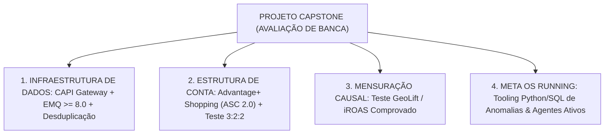
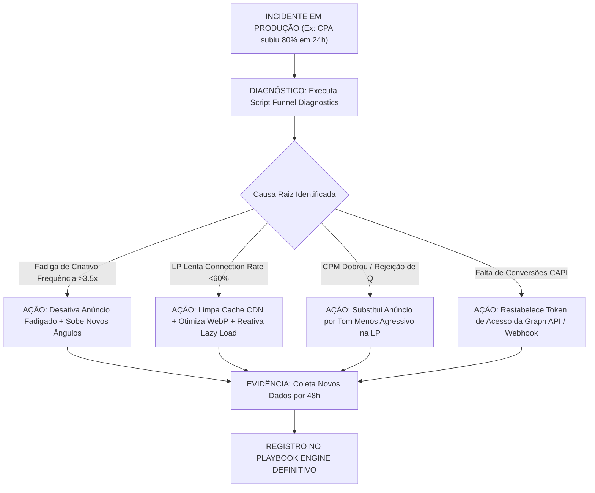

# MÓDULO 16 — CAPSTONE PROJECT E META PLAYBOOK ENGINE DEFINITIVO
**Programa:** MBA Meta Performance Engineering  
**Edição:** 2026  
**Disciplinas Integradas:** Integração Final, Capstone Project & Operations  
**Tempo estimado de estudo:** 20 horas  

---

## 1. O PROJETO CAPSTONE FINAL DE CERTIFICAÇÃO

---

## 2. O META PLAYBOOK ENGINE: RESPOSTA A INCIDENTES DE PERFORMANCE

---

## 3. CHECKLIST FINAL DO META PERFORMANCE ENGINEER

- [x] Fórmula do Valor Total ($V = Bid \times EAR + Q$) e Precificação VCG.
- [x] Modelagem Financeira ($ROAS_{BE}, CAC_{max}, MC, MER$).
- [x] Account Simplification (Advantage+ Shopping + CBO Creative Testing).
- [x] Tracking CAPI Server-Side com EMQ $\ge 8.0$ e desduplicação por `event_id`.
- [x] Metadados Visuais (Andromeda Engine) e *Creative Diversity Score*.
- [x] Diagnóstico de Funil pós-clique (Hook Rate, Hold Rate, CRO).
- [x] Janelas de Atribuição 2026 (7d click, 1d engage-through, 1d view) e $iROAS$ via GeoLift.
- [x] Avaliação de Escala via CPA Marginal ($CPA_{marginal}$) e Rendimentos Decrescentes.
- [x] Data Science em Python/SQL (Polars, Anomaly Detection Z-Score / Isolation Forest, Forecasting).
- [x] Agentes de IA com Guardrails de Segurança e Human-in-the-Loop no **Meta OS**.

---

## 4. CONCLUSÃO DA APOSTILA

Parabéns! Você concluiu a formação completa em **Meta Performance Engineering**. Você domina a base científica, técnica, algorítmica e prática para operar tráfego como uma disciplina de engenharia de alta performance.

---
*Fim da Apostila Completa do MBA.*
