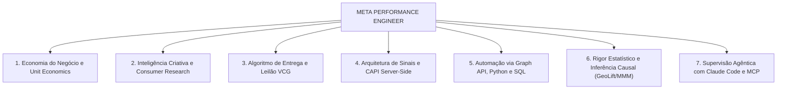
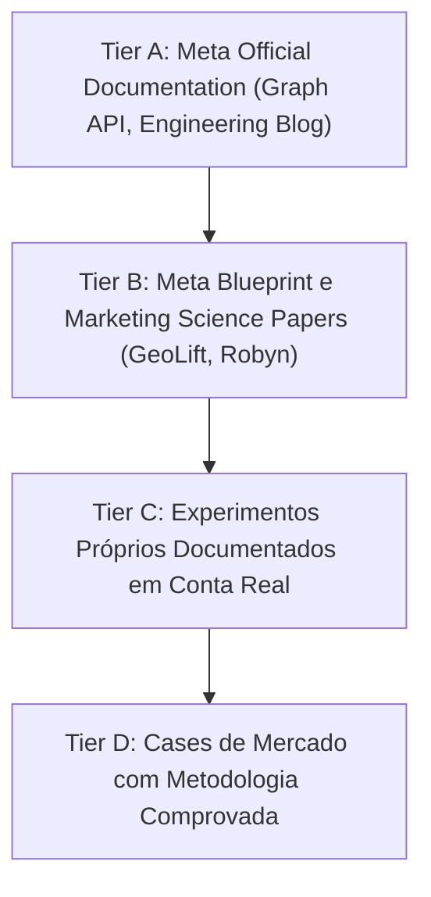
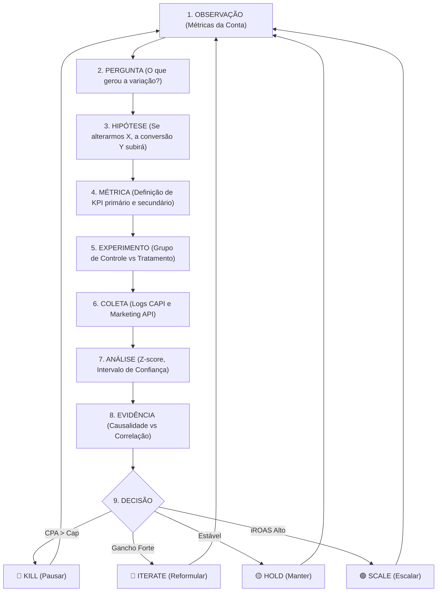
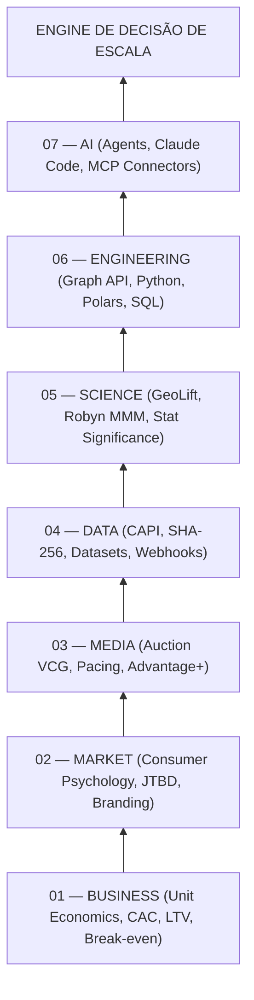
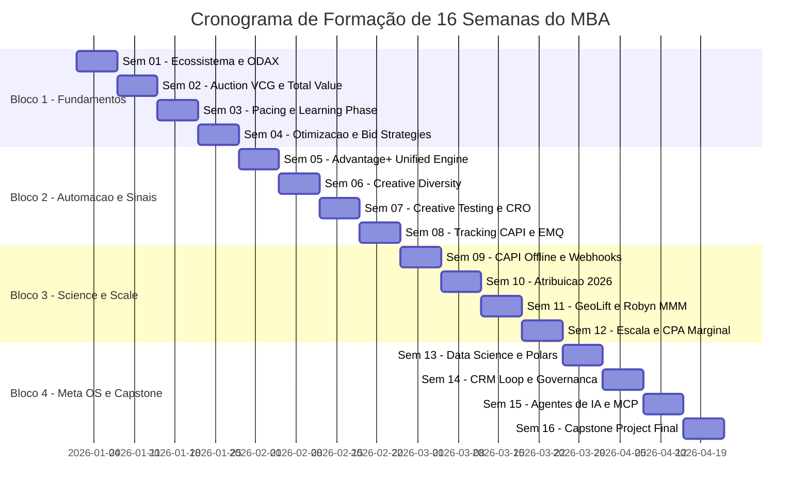
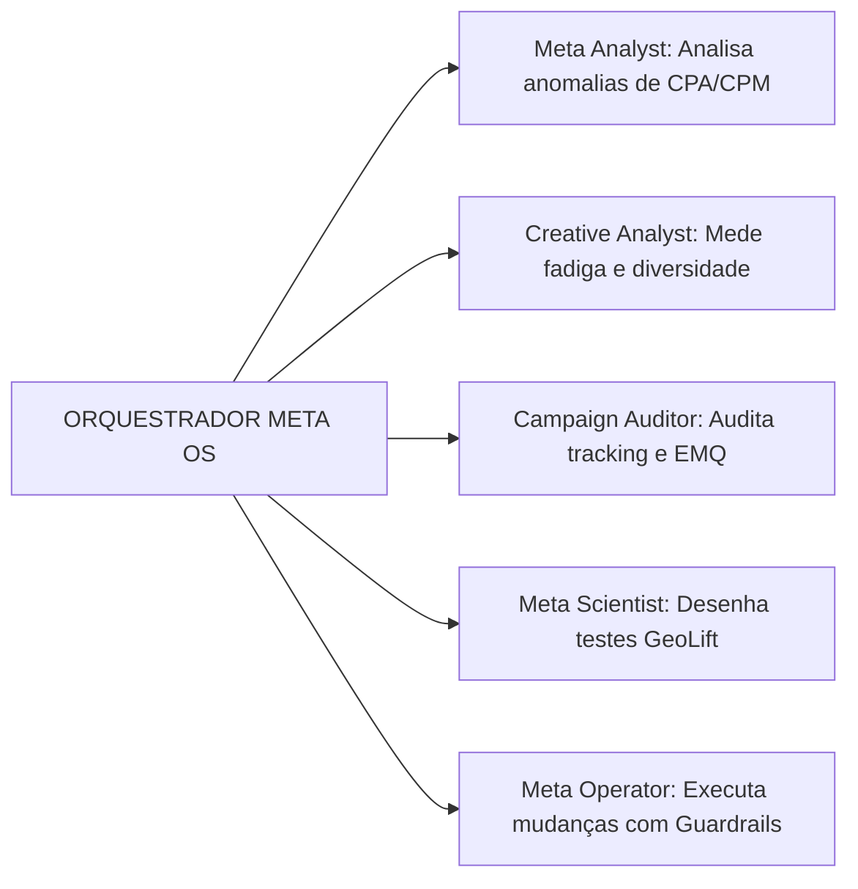

# DOCUMENTO 1 — MBA META PERFORMANCE ENGINEERING 2026
**Versão:** v2.0 — Edição 2026 (Enriquecido com Diagramas e Fórmulas)  
**Idioma:** Português  
**Status:** Arquitetura Curricular Aprovada  

---

> **O que é este documento:** A arquitetura completa do programa de formação Meta Performance Engineering. Define missão, estrutura, 10 disciplinas, 16 módulos semanais, competências-alvo, projetos práticos, sistema de maturidade, trilha de certificação e capstone. Este documento é a âncora curricular — todo conteúdo da apostila deve mapear de volta para ele.

---

## 0. MISSÃO E IDENTIDADE DO PROGRAMA

### 0.1 O Profissional que Queremos Formar: META PERFORMANCE ENGINEER

### 0.2 Hierarquia de Fontes do Programa (Tier Hierarchy)

---

## 1. FILOSOFIA DO MÉTODO: O CICLO CIENTÍFICO DO GESTOR

---

## 2. OS 7 PILARES DO META PERFORMANCE OS

---

## 3. AS 10 DISCIPLINAS DO PROGRAMA

| Disciplina | Categoria | Pergunta Central | Entregável Principal |
| :--- | :--- | :--- | :--- |
| **01 — Meta Ads Engineering** | Core | Como gerar performance dentro do leilão VCG? | Estrutura de Conta Advantage+ Shopping |
| **02 — Meta Developers** | Core | Como controlar a plataforma programaticamente? | Cliente Python Graph API v26.0 |
| **03 — Data Science** | Core | Como transformar dados de anúncios em evidência? | Detector de Anomalias (Z-score/Isolation Forest) |
| **04 — Marketing Science** | Core | Como provar o efeito incremental do marketing? | Estudo de Incrementalidade via GeoLift / iROAS |
| **05 — AI Engineering** | Core | Como ampliar a capacidade com Agentes de IA? | Servidor MCP e Agentes de IA no Claude Code |
| **06 — Decision Science** | Core | Como tomar decisões de alocação de orçamento? | Algoritmo de Decisão de CPA Marginal |
| **07 — Business & Unit Economics**| Comp. | Quanto podemos pagar por um cliente? | Modelagem de $ROAS_{BE}$ e $CAC_{max}$ |
| **08 — Market Science** | Comp. | Como entender o consumidor e a audiência? | Mapeamento de JTBD e Ângulos de Copys |
| **09 — Creative Intelligence** | Comp. | Como comunicar para converter no Reels? | Taxonomia e Creative Diversity Score |
| **10 — Operations & Governance**| Comp. | Como executar com segurança e conformidade? | Playbook Engine & Arquitetura Multi-BM |

---

## 4. O CRONOGRAMA DE 16 SEMANAS

---

## 5. OS AGENTES ESPECIALIZADOS DO META OS

---
*Fim do Documento 1.*
