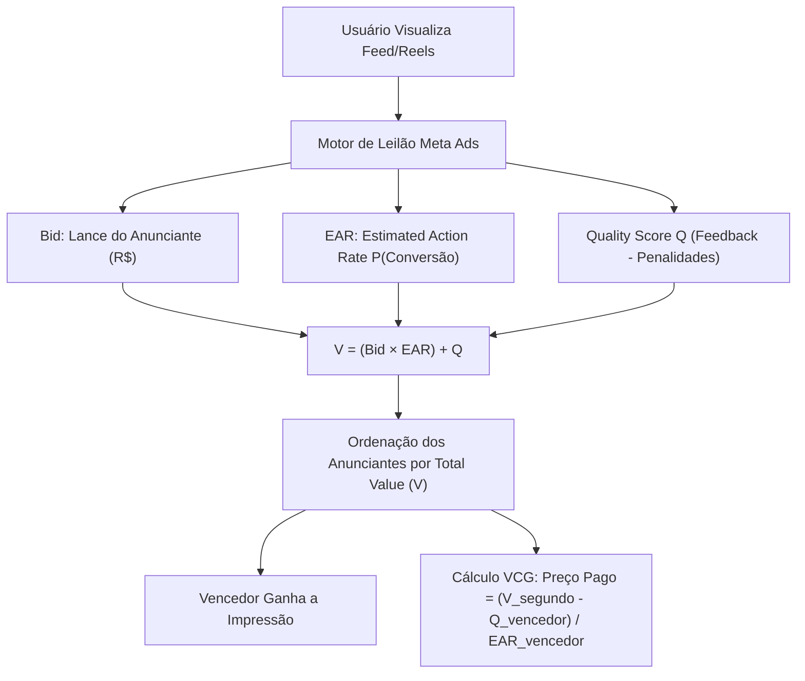
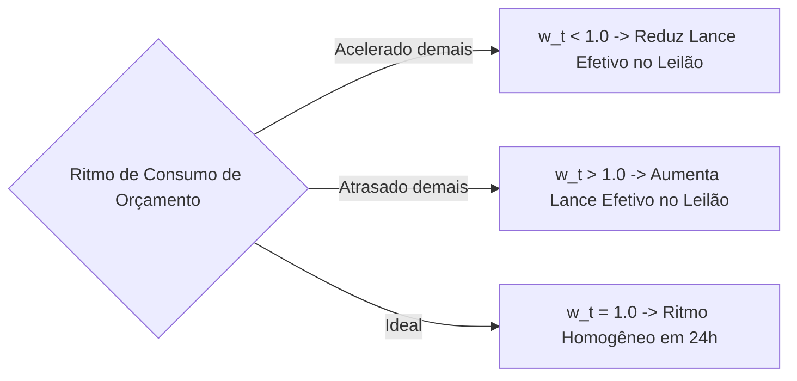
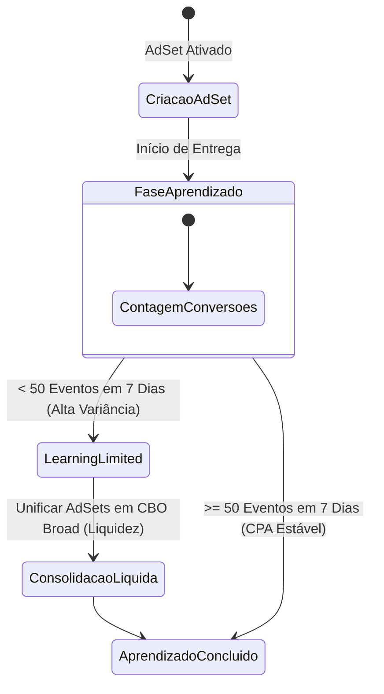

# DOCUMENTO 3 — CONTEXTO: SISTEMA DE ENTREGA, LEILÃO E ALGORITMO (2026)
**Programa:** Meta Performance Engineering  
**Versão:** v2.0 — 29/09/2026 (Enriquecido com Diagramas e Fórmulas)  
**Referências:** D-01 a D-08, B-01 a B-06 (ver Documento 2)  
**Módulos da apostila:** 1, 2, 3  

---

## 1. O LEILÃO MULTIVARIADO DA META E A FÓRMULA DO VALOR TOTAL

### 1.1 Equação Matemática do Valor Total
$$V = (Bid \times EAR) + Q$$

### 1.2 Mecanismo VCG (Vickrey-Clarke-Groves)
No leilão VCG, a estratégia dominante é a **revelação sincera de valor (truthfulness)**. O vencedor paga apenas a quantia estritamente necessária para superar a pontuação do segundo colocado:

$$\text{Preço Pago pelo Vencedor} = \frac{V_{\text{segundo colocado}} - Q_{\text{vencedor}}}{EAR_{\text{vencedor}}}$$

---

## 2. O ALGORITMO DE PACING (DESCONTO DINÂMICO)

---

## 3. FASE DE APRENDIZADO (LEARNING PHASE) E LIQUIDITY FRAMEWORK

---
*Fim do Documento 3 (Versão Expandida com Diagramas Mermaid).*
