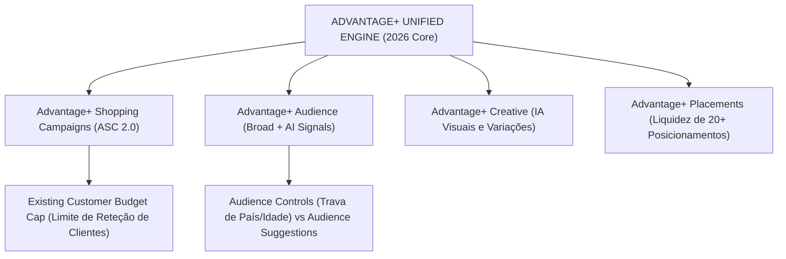
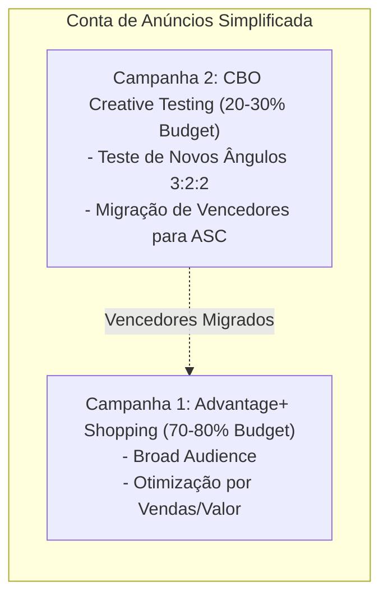

# DOCUMENTO 4 — CONTEXTO: ADVANTAGE+, ESTRUTURA DE CAMPANHA E PERFORMANCE 5 (2026)
**Programa:** Meta Performance Engineering  
**Versão:** v2.0 — 29/09/2026 (Enriquecido com Diagramas e Fórmulas)  
**Referências:** D-05, D-04, D-03, D-06, B-01, B-02 (ver Documento 2)  
**Módulos da apostila:** 4, 5, 6  

---

## 1. ADVANTAGE+ UNIFIED ENGINE

---

## 2. ESTRUTURA RECOMENDADA DE CONTA (PERFORMANCE 5)

---
*Fim do Documento 4 (Versão Expandida com Diagramas Mermaid).*
