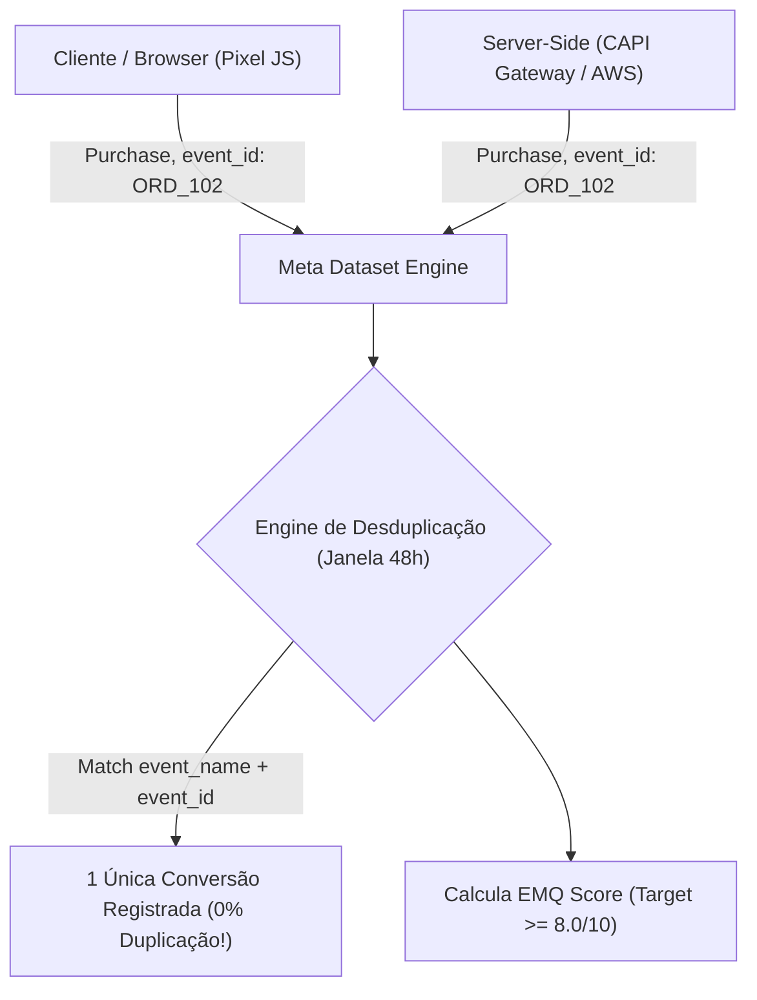
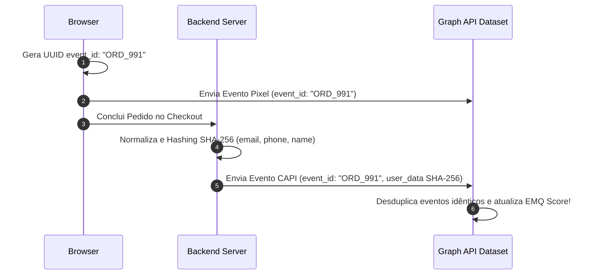

# DOCUMENTO 5 — CONTEXTO: SINAIS, CAPI E INFRAESTRUTURA DE TRACKING (2026)
**Programa:** Meta Performance Engineering  
**Versão:** v2.1 — 29/09/2026 (Sintaxe Mermaid Corrigida & Conteúdo Expandido)  
**Referências:** S-01 a S-08 (ver Documento 2)  
**Módulos da apostila:** 8, 9  

---

## 1. ARQUITETURA DE SINAIS REDUNDANTE HÍBRIDA

No cenário pós-cookie de 2026, a infraestrutura de sinais do Meta Ads exige resiliência máxima. O envio de dados exclusivamente via navegador (Pixel Client-Side) sofre perdas contínuas devido a bloqueadores de anúncios (AdBlockers), Safari ITP e navegadores restritivos.

A engenharia de performance implementa a **Arquitetura Redundante Híbrida**: envio do mesmo evento tanto pelo cliente (Pixel JS) quanto pelo servidor (Conversions API - CAPI Server-Side).

---

## 2. FLUXO DE DESDUPLICAÇÃO E IDENTIFICAÇÃO PII (SHA-256)

Para evitar duplicidade de compras no Ads Manager, o sistema da Meta exige duas chaves idênticas em ambas as pontas:
1. `event_name`: O nome exato do evento (ex: `Purchase`).
2. `event_id`: Identificador universal único (ex: UUID v4 do pedido).

---

## 3. TABELA DE SCHEMA DE PARÂMETROS PII E EVENT MATCH QUALITY (EMQ)

| Parâmetro CAPI | Descrição | Regra de Normalização | Tipo de Codificação |
| :--- | :--- | :--- | :--- |
| `em` | E-mail do cliente | Trim spaces, converter para letras minúsculas | **SHA-256** |
| `ph` | Telefone com DDD/DDI | Remover todos os caracteres não numéricos | **SHA-256** |
| `fn` / `ln` | Primeiro Nome / Sobrenome | Remover acentos, converter para minúsculas | **SHA-256** |
| `ct` / `st` / `zip` | Cidade / Estado / CEP | Formato padrão sem acentos | **SHA-256** |
| `country` | Código do País | Código ISO 3166-1 alpha-2 em minúsculas (ex: `br`) | **SHA-256** |
| `fbp` | Cookie de sessão Meta | Valor original extraído do cookie `_fbp` | **Texto Puro (NÃO HASH)** |
| `fbc` | Cookie de clique com `fbclid`| Valor original extraído do cookie `_fbc` | **Texto Puro (NÃO HASH)** |

---
*Fim do Documento 5.*
