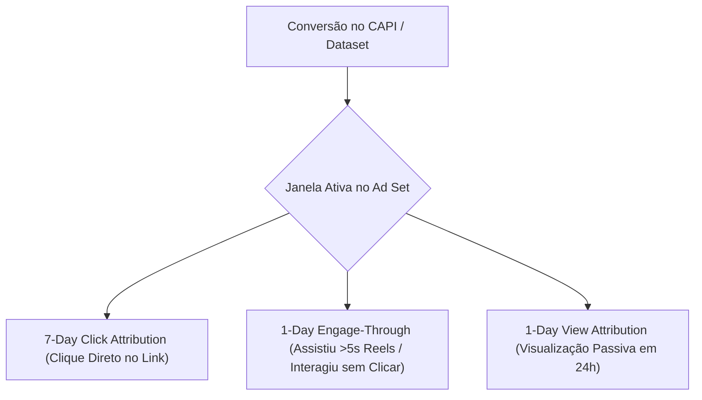
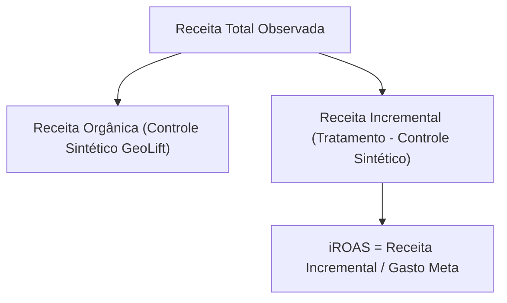

# DOCUMENTO 6 — CONTEXTO: ATRIBUIÇÃO 2026 E MARKETING SCIENCE
**Programa:** Meta Performance Engineering  
**Versão:** v2.0 — 29/09/2026 (Enriquecido com Diagramas e Fórmulas)  
**Referências:** A-01 a A-03, MS-01 a MS-04 (ver Documento 2)  
**Módulos da apostila:** 10, 11  

---

## 1. JANELAS DE ATRIBUIÇÃO EM 2026

---

## 2. INFERÊNCIA CAUSAL E GEOLIFT

---
*Fim do Documento 6 (Versão Expandida com Diagramas Mermaid).*
