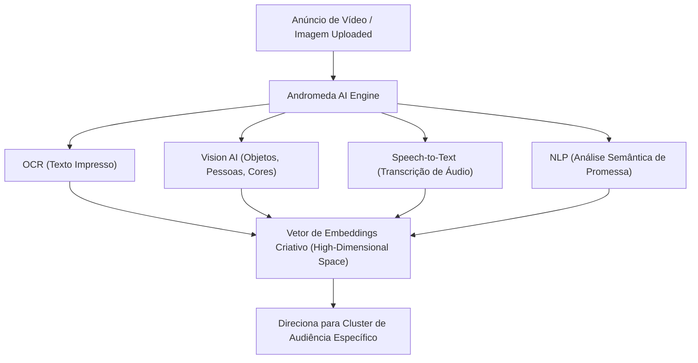
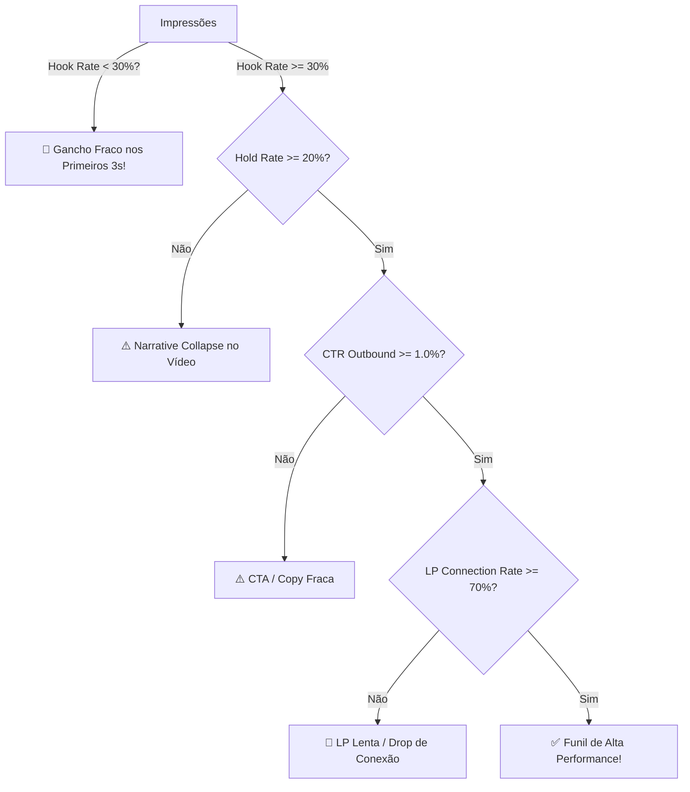

# DOCUMENTO 7 — CONTEXTO: CREATIVE INTELLIGENCE E CRO
**Programa:** Meta Performance Engineering  
**Versão:** v2.0 — 29/09/2026 (Enriquecido com Diagramas e Fórmulas)  
**Referências:** C-01 a C-08 (ver Documento 2)  
**Módulos da apostila:** 6, 7  

---

## 1. ANDROMEDA COMPUTER VISION & NLP EMBEDDINGS

---

## 2. ÁRVORE DE CRO E METRICAS DE VÍDEO

---
*Fim do Documento 7 (Versão Expandida com Diagramas Mermaid).*
