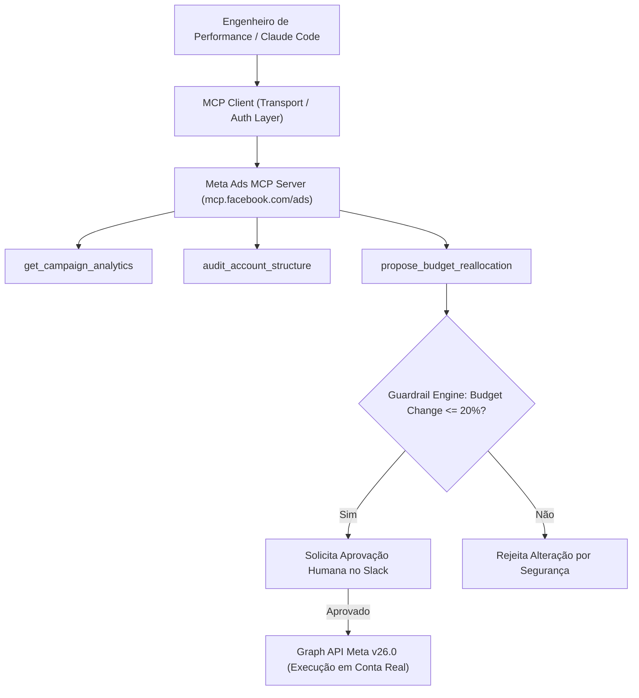

# DOCUMENTO 8 — CONTEXTO: META DEVELOPERS E AI ENGINEERING
**Programa:** Meta Performance Engineering  
**Versão:** v2.1 — 29/09/2026 (Sintaxe Mermaid Corrigida)  
**Referências:** D-01 a D-12, I-01 a I-09 (ver Documento 2)  
**Módulos da apostila:** 8, 15  

---

## 1. MODEL CONTEXT PROTOCOL (MCP) E META ADS AI CONNECTORS

---
*Fim do Documento 8.*
