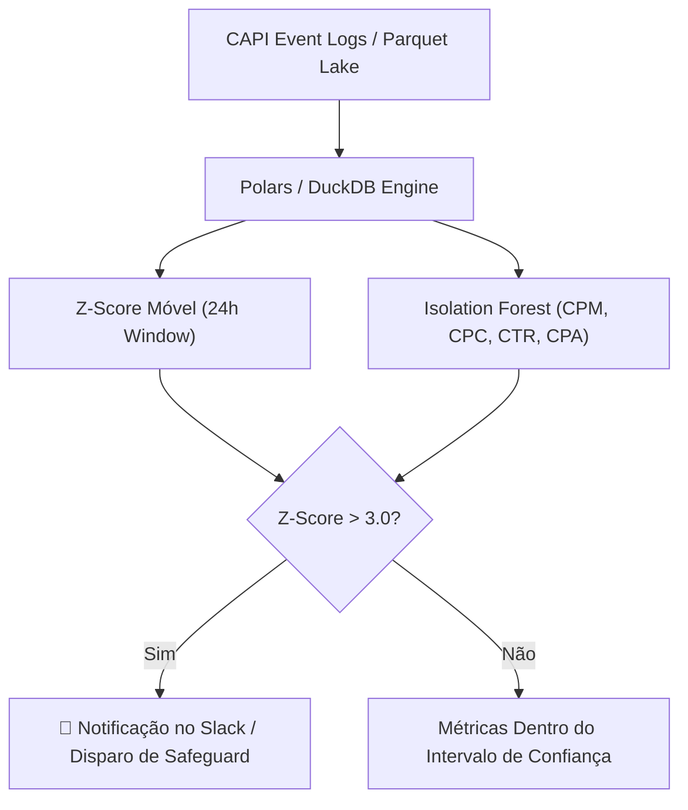
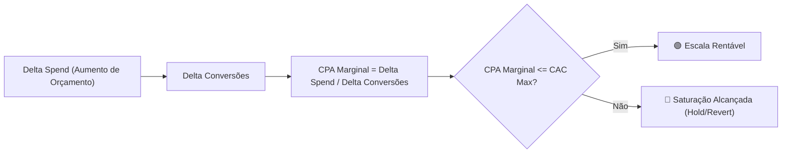

# DOCUMENTO 9 — CONTEXTO: DATA SCIENCE E DECISION SCIENCE APLICADOS À META ADS (2026)
**Programa:** Meta Performance Engineering  
**Versão:** v2.1 — 29/09/2026 (Sintaxe Mermaid Corrigida)  
**Referências:** DS-01 a DS-08, MS-01 a MS-05 (ver Documento 2)  
**Módulos da apostila:** 13, 14  

---

## 1. DATA PIPELINES E DETECÇÃO DE ANOMALIAS

---

## 2. DECISION SCIENCE E CPA MARGINAL

---
*Fim do Documento 9.*
