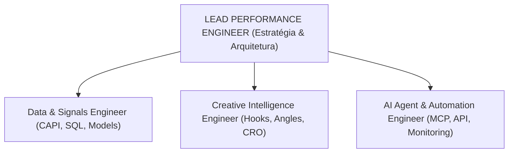
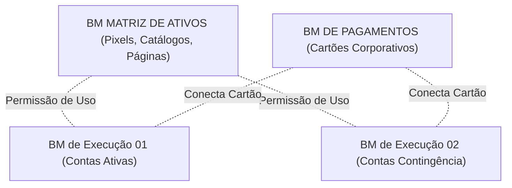

# DOCUMENTO 10 — CONTEXTO: BUSINESS, MARKET & OPERATIONS (2026)
**Programa:** Meta Performance Engineering  
**Versão:** v2.0 — 29/09/2026 (Enriquecido com Diagramas e Fórmulas)  
**Referências:** B-01 a B-06, E-01 a E-06, G-01 a G-05 (ver Documento 2)  
**Módulos da apostila:** 15, 16, 17  

---

## 1. ESTRUTURA DE PODS AUTÔNOMOS EM AGÊNCIAS DE PERFORMANCE

---

## 2. TOPOLOGIA DE BM E PREVENÇÃO DE RISCOS (GOVERNANÇA)

---
*Fim do Documento 10 (Versão Expandida com Diagramas Mermaid).*
