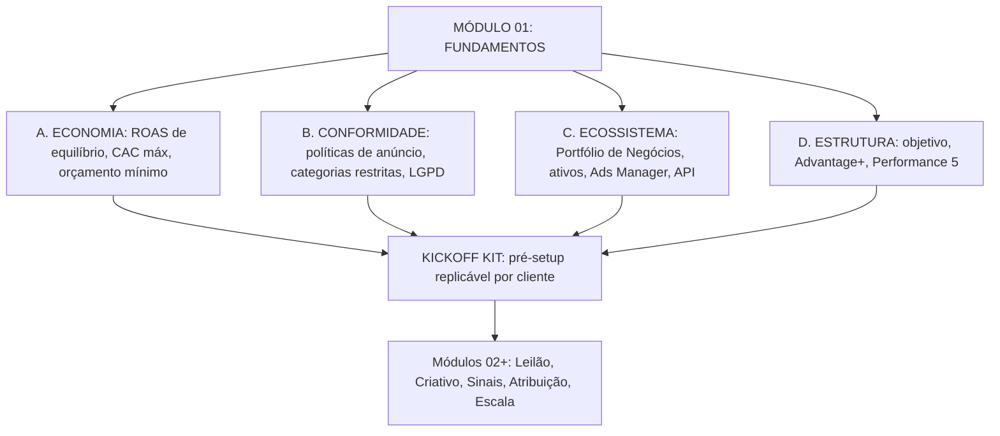
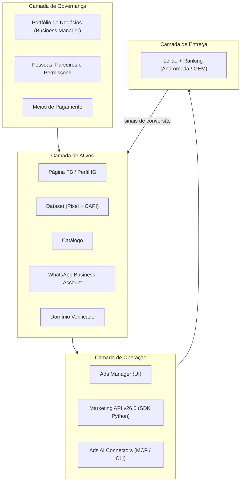
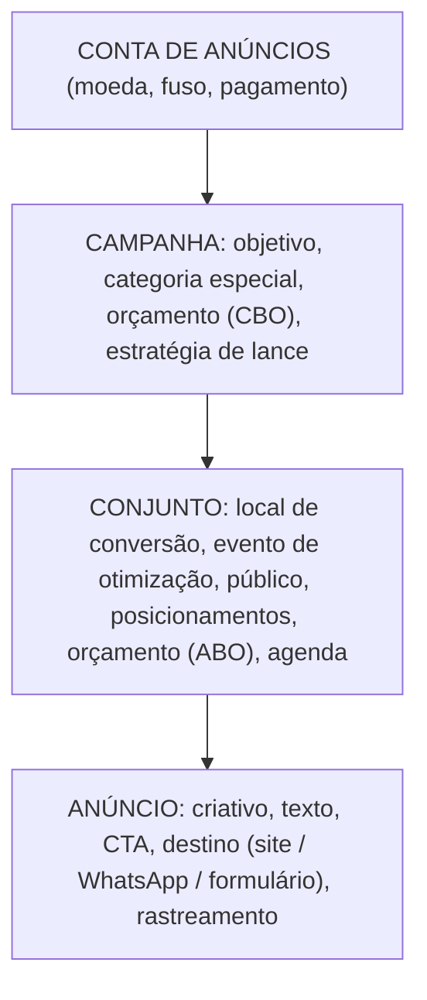
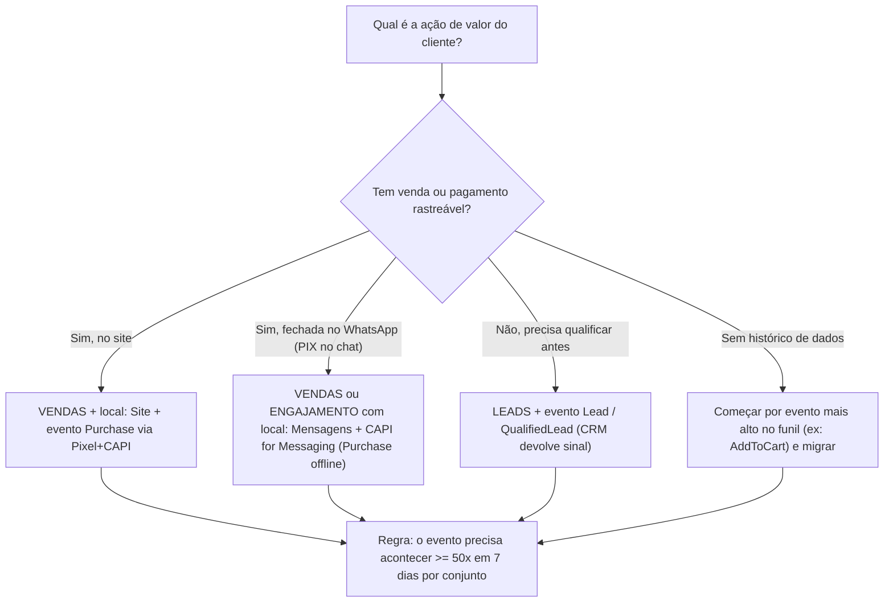
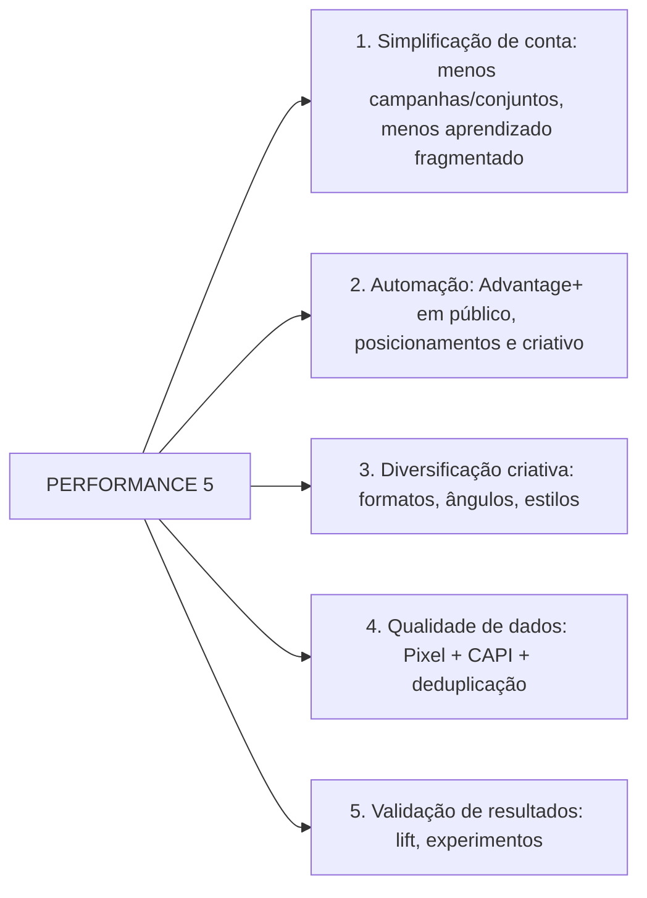
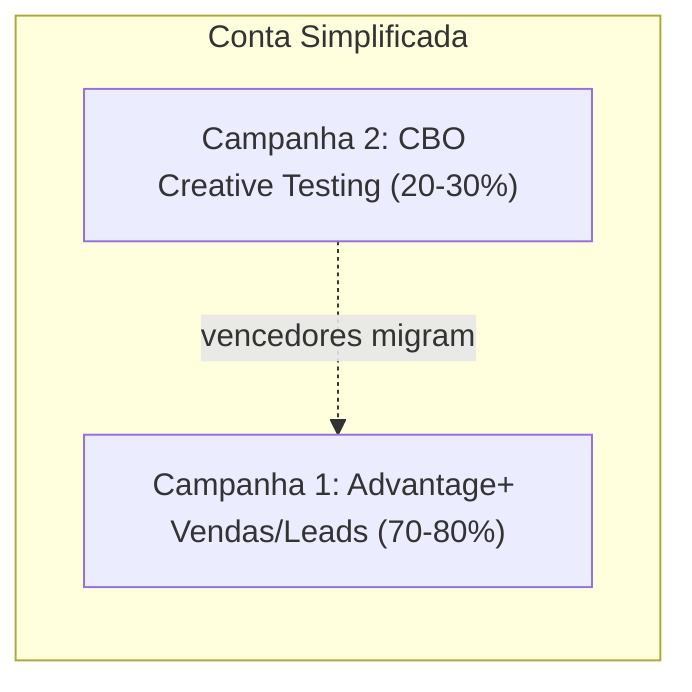
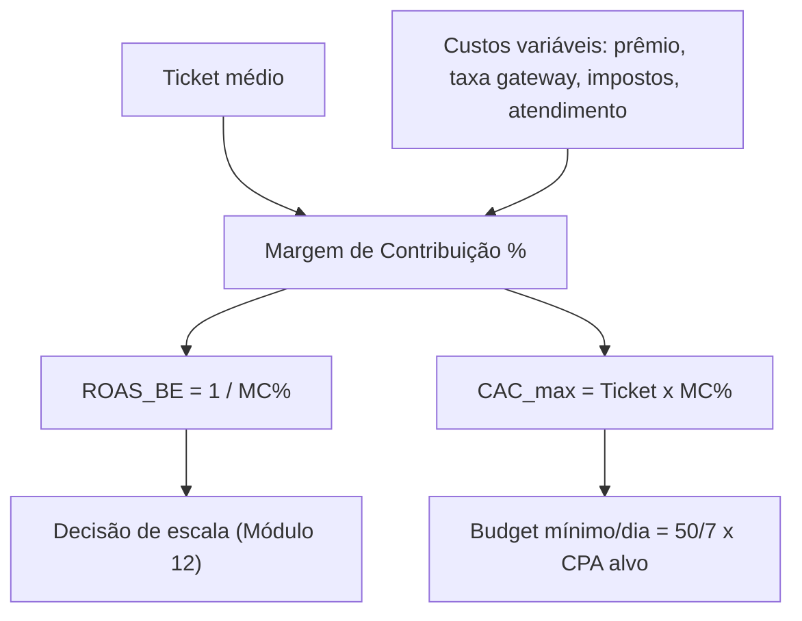
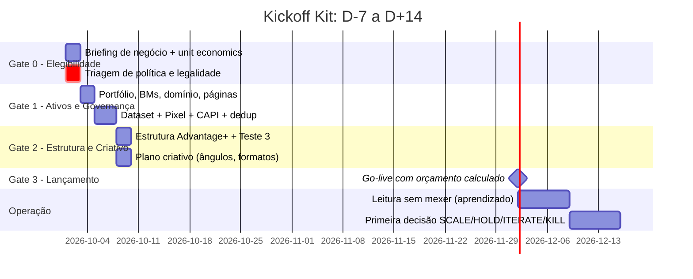
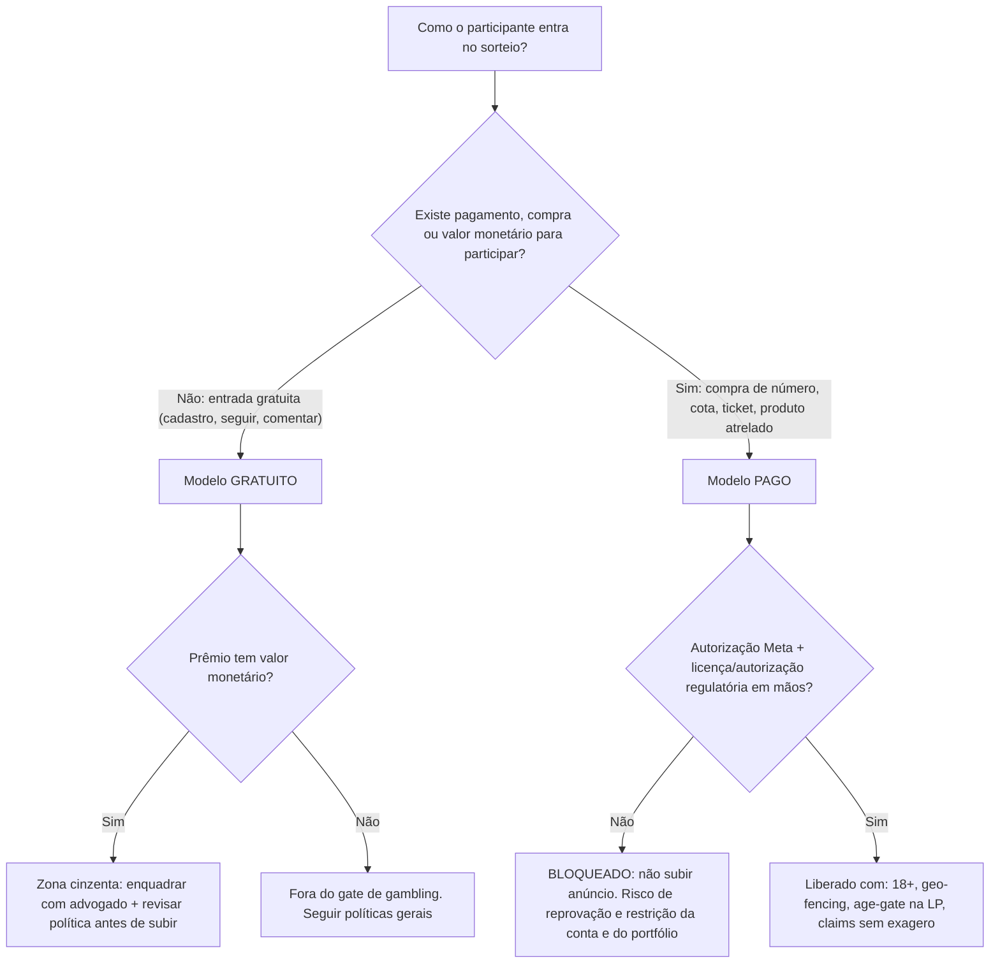
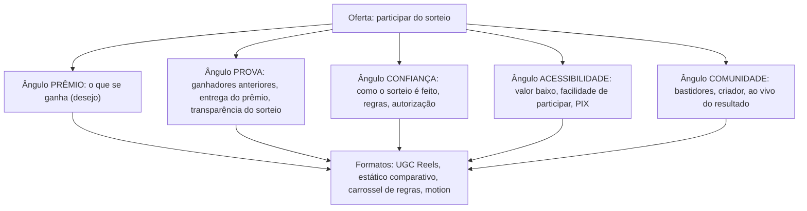

# MÓDULO 01 — FUNDAMENTOS OFICIAIS, ECOSSISTEMA E ESTRUTURA (SET/2026)
**Programa:** MBA Meta Performance Engineering  
**Edição:** 2026 — versão expandida (kickoff replicável + caso Sorteios)  
**Disciplinas Integradas:** Meta Ads Engineering, Business & Unit Economics, Operations & Governance  
**Tempo estimado de estudo:** 14 horas  
**Referências (Doc. 2):** D-01, D-04, D-05, B-01, B-02, E-06, E-07, G-01, G-03  

> **Regra de leitura:** cada afirmação vem rotulada. **[DOC-META]** = documentado pela Meta. **[INFERÊNCIA]** = leitura lógica nossa, não documentada. **[MERCADO]** = folclore/Tier C, testar antes de usar. Nada de [MERCADO] vira regra sem teste em conta real.

---

## 1. POR QUE ESTE MÓDULO EXISTE

O Módulo 01 é o **alicerce e o checklist de entrada**. Tudo que vem depois (leilão, criativo, CAPI, atribuição, escala) só funciona se o cliente entrar no sistema com três coisas resolvidas:

1. **Economia**: sabemos quanto podemos pagar por uma venda.
2. **Conformidade**: a Meta permite anunciar essa oferta.
3. **Estrutura**: ativos, conta e campanhas montados para alimentar o algoritmo, não brigar com ele.



---

## 2. O ECOSSISTEMA OFICIAL META (O MAPA DO TERRITÓRIO)

### 2.1 Camadas do ecossistema



**[DOC-META]** Portfólio de Negócios agrupa ativos e permissões; a Marketing API (atual v26.0, lançada em 29/07/2026) é a via programática; os Ads AI Connectors (MCP em `mcp.facebook.com/ads`, beta aberto desde 29/04/2026) são a via oficial para agentes de IA.  
**[DOC-META]** Desde a v25.0 (18/02/2026) não se cria nem atualiza ASC/AAC pela API. O nome atual é **campanhas Advantage+ de vendas / app / leads** (estrutura unificada). Neste programa, "ASC" só aparece como **legado**.  
**[INFERÊNCIA]** O ciclo fecha em si mesmo: o que você conecta na camada de ativos (Dataset) é o que alimenta a entrega. Ativo mal configurado = algoritmo cego.

### 2.2 Hierarquia de uma conta e o que cada nível controla



| Nível | Decisão-chave | Erro comum |
| :--- | :--- | :--- |
| Campanha | Objetivo (o que o sistema tenta maximizar) | Escolher tráfego "porque é barato" e esperar vendas |
| Conjunto | **Evento de otimização** e local de conversão | Otimizar para evento raro (< 50/semana) |
| Anúncio | Criativo e destino | Ângulos parecidos (baixa diversidade) e página sem coerência com a promessa |

**[DOC-META]** O objetivo define o que o sistema busca; o evento de otimização define qual sinal ele persegue. **[INFERÊNCIA]** Pagar por clique e receber cliques é o comportamento *correto* do sistema, o erro é do gestor que pediu clique.

---

## 3. OBJETIVOS (ODAX) E COMO ESCOLHER

**[DOC-META]** Seis objetivos: Reconhecimento, Tráfego, Engajamento, Leads, Promoção do app, Vendas. Cada um permite locais de conversão diferentes (site, app, mensagens, formulário instantâneo, ligação etc.; confirmar as combinações vigentes no Ads Manager).



**Regra prática do programa** [INFERÊNCIA baseada em E-07]: *escolha o evento mais profundo do funil que ainda consiga ~50 ocorrências por semana por conjunto.*

---

## 4. ESTRUTURA UNIFICADA ADVANTAGE+ E PERFORMANCE 5

### 4.1 As três alavancas [DOC-META, D-05]
Na estrutura unificada, o gestor decide sobre **orçamento, público e posicionamentos** escolhendo quanto de automação Advantage+ liga em cada um. Tratamos como um dial, não um botão liga/desliga.

### 4.2 Performance 5 (B-02, ainda ◐ em fonte oficial direta)



**[INFERÊNCIA]** "Menos de 20% do budget em learning" e "70–80% na campanha principal / 20–30% em teste" são **benchmarks do programa**, não regras Meta. Registre como hipótese H-ESTRUT-01 e valide por conta.

### 4.3 Estrutura padrão do programa (ponto de partida para qualquer cliente)



### 4.4 Learning Phase e orçamento mínimo (a conta que quase ninguém faz)

**[DOC-META]** O conjunto sai do aprendizado com ~50 eventos de otimização em 7 dias.

$$Budget_{min/dia} \approx \frac{50}{7} \times CPA_{alvo}$$

Exemplo: CPA alvo R$ 25 → ≈ R$ 178/dia **por conjunto**. Se o cliente não banca isso, as saídas são: (a) consolidar conjuntos; (b) otimizar para evento mais alto no funil; (c) reduzir metas de escala e aceitar instabilidade consciente. Nunca abrir 6 conjuntos com R$ 30/dia cada.

---

## 5. ECONOMIA DO CLIENTE ANTES DE QUALQUER ANÚNCIO

$$ROAS_{BE} = \frac{1}{MC\%} \qquad CAC_{max} = Ticket \times MC\%$$

- **MC%** = margem de contribuição (receita menos custos variáveis: produto/prêmio, taxas de pagamento, impostos, frete, comissões, atendimento).
- Meta de escala: operar com folga sobre o ROAS_BE (ex.: 1.3x a 1.5x do BE como zona de lucro inicial, **[INFERÊNCIA]**).



---

## 6. KICKOFF KIT: PRÉ-SETUP REPLICÁVEL PARA VIRALS / ORACLUM

O objetivo é que **qualquer cliente novo** passe pelo mesmo funil de entrada, com portões (gates) que impedem subir campanha antes do básico existir.

### 6.1 Linha do tempo padrão



### 6.2 Checklist dos 5 gates

| Gate | Pergunta de aprovação | Evidência exigida | Módulo de aprofundamento |
| :--- | :--- | :--- | :--- |
| **0. Elegibilidade** | A oferta é permitida pela Meta e legal no país? Tem margem para anunciar? | Enquadramento de política, ROAS_BE, CAC_max | 01, 14 |
| **1a. Governança** | Pixel/Dataset e pagamento estão em BMs separadas da execução? | Diagrama de BMs, acessos por função | 14 |
| **1b. Sinais** | Evento de otimização chega via Pixel+CAPI, deduplicado, EMQ ≥ 8.0? | Test Events, Dataset Quality API | 08, 09 |
| **2. Estrutura** | Orçamento cobre 50 eventos/7d? Campanha principal + teste? | Cálculo de budget mínimo | 01, 04 |
| **3. Criativo** | Há ≥ 3 ângulos realmente distintos e taxonomia de nomes? | Planilha de ângulos + naming | 06, 07 |
| **4. Medição** | Como saberemos se é incremental? Janelas definidas? | Plano de leitura + gatilho de lift | 10, 11 |

### 6.3 Brief de cliente (YAML replicável)

```yaml
cliente: NOME
vertical: sorteios | ecommerce | infoproduto | servicos
oferta:
  descricao: ""
  ticket_medio: 0.0
  margem_contribuicao_pct: 0.0   # ex: 0.35
  modelo: site | whatsapp | lead
politica:
  enquadramento: livre | restrita | gambling
  autorizacao_meta: nao_aplicavel | pendente | aprovada
  licenca_regulatoria: nao_aplicavel | pendente | ok
  age_gate_18: false
ativos:
  bm_ativos_separada_da_execucao: false
  dominio_verificado: false
  dataset_id: ""
tracking:
  pixel: false
  capi: false
  event_id_dedup: false
  emq_atual: 0.0
orcamento:
  cpa_alvo: 0.0
  budget_dia_disponivel: 0.0
criativo:
  angulos_distintos: 0
  formatos_distintos: 0
```

---

## 7. CASO PRÁTICO: CLIENTE DO NICHO DE SORTEIOS

> **Aviso:** não sou advogado. A parte legal abaixo é mapa de risco, não parecer. Sorteios, rifas e promoções com prêmio no Brasil são regulados (em especial pela Lei 5.768/1971 e normas do Ministério da Fazenda); validar o enquadramento do cliente com advogado especializado **antes** de gastar em mídia.

### 7.1 O ponto que decide tudo: a política de jogos online da Meta

**[DOC-META]** A Meta define jogo/aposta online como qualquer produto ou serviço em que algo de valor monetário faz parte do método de entrada **e** do prêmio. Anunciar isso exige **permissão prévia por escrito** da Meta, com evidência de licenciamento pelo regulador ou de legalidade no território alvo, e sem segmentar menores de 18. A lista de exemplos da própria política inclui **loterias, rifas e sweepstakes**.  
**[DOC-META]** Jogos totalmente gratuitos (sem valor monetário na entrada nem no prêmio) ficam fora dessa exigência, mas seguem as demais políticas.  
**[MERCADO]** Fontes Tier C de 2026 descrevem a aprovação via aba "Autorizações e verificações" no Business Suite, e apontam que landing page com promoção de jogo pode acionar a regra mesmo sem apostar ali. **Confirmar o fluxo atual em Tier A** (G-01, lacuna aberta no Doc. 2).



**Por que isso é o item nº 1 do kickoff deste cliente:** o risco não é só o anúncio reprovar. Reprovações repetidas e tentativa de contornar (cloaking, "página segura") podem derrubar ativos do portfólio. **[INFERÊNCIA]** Por isso o Módulo 14 separa BM de ativos, BM de pagamento e BMs de execução: o dano de uma conta não deve contaminar o Dataset.

### 7.2 Aplicando cada tema do módulo ao cliente

| Tema | Como aplicar no cliente de sorteios |
| :--- | :--- |
| **Economia** | MC% = valor do bilhete menos prêmio (rateado), taxa PIX/gateway, impostos, plataforma e atendimento. Sem esse número não há CAC_max. |
| **Objetivo** | Modelo pago com checkout no site: Vendas + Purchase. Modelo com venda no WhatsApp/PIX: mensagens + CAPI for Messaging devolvendo Purchase. Modelo gratuito de captação: Leads. |
| **Evento** | Compra costuma ser frequente (volume alto), o que **ajuda** o aprendizado. Se o ticket é baixo e o volume alto, o risco muda de "falta de dado" para "qualidade e recorrência". |
| **Estrutura** | Campanha principal Advantage+ + campanha CBO de teste de ângulos. Poucos conjuntos, orçamento por conjunto pelo cálculo 50/7. |
| **Criativo** | Diversidade real de ângulo (ver 7.3). Sorteio tende a gerar 10 criativos com a mesma promessa de prêmio, o que colapsa a diversidade. |
| **Sinais** | Purchase com `event_id` = ID do pedido, `value` correto, `fbp`/`fbc` em texto puro, e-mail/telefone com SHA-256. Se a venda fecha no chat, ctk e CAPI for Messaging. |
| **Governança** | Pixel e cartão fora da BM de execução; conta de contingência **legítima** e não uma forma de burlar reprovação. |
| **Medição** | Sorteio tem forte compra impulsiva e demanda orgânica em picos (divulgação de resultado, influenciadores). ROAS do Ads Manager pode inflar; planejar teste de incrementalidade (Módulo 11) quando o gasto justificar. |

### 7.3 Mapa de ângulos criativos para sorteios (diversidade real, não cor de legenda)



**Cuidados de copy [MERCADO/INFERÊNCIA]:** evitar prometer resultado ("você vai ganhar"), urgência falsa, uso indevido de "grátis" quando há compra, e depoimentos de ganhadores sem comprovação. Ângulo de **confiança/transparência** costuma ser o mais valioso neste nicho e o mais negligenciado.

### 7.4 Plano dos primeiros 14 dias (cliente sorteios)

1. **D0–D2:** enquadramento (gratuito vs pago), parecer jurídico, autorização Meta se aplicável, brief YAML e unit economics.
2. **D2–D5:** BMs, domínio, página, Dataset; Pixel + CAPI com dedup; teste em Test Events; medir EMQ.
3. **D5–D7:** estrutura Advantage+ + CBO de teste; orçamento mínimo; naming padronizado; age-gate e 18+ na LP.
4. **D7–D14:** go-live e **leitura sem mexer** durante o aprendizado; sem edições significativas (reiniciam aprendizado).
5. **D14:** primeira decisão formal SCALE / HOLD / ITERATE / KILL com CPA marginal.

---

## 8. PROJETO PRÁTICO: AUDITOR DE KICKOFF EM PYTHON (`kickoff/kickoff_audit.py`)

Roda o brief do cliente pelos gates e devolve bloqueios, alertas e cálculos base. Sem dependências externas.

```python
def audit_kickoff(brief: dict) -> dict:
    """
    Recebe o brief (mesma estrutura do YAML da seção 6.3) e devolve
    cálculos de economia, bloqueios (gate) e alertas.
    """
    blockers, warnings = [], []

    oferta = brief.get("oferta", {})
    politica = brief.get("politica", {})
    ativos = brief.get("ativos", {})
    tracking = brief.get("tracking", {})
    orc = brief.get("orcamento", {})
    criativo = brief.get("criativo", {})

    # --- Economia ---
    ticket = oferta.get("ticket_medio", 0.0)
    mc = oferta.get("margem_contribuicao_pct", 0.0)
    roas_be = (1.0 / mc) if mc > 0 else None
    cac_max = ticket * mc if ticket and mc else None
    cpa_alvo = orc.get("cpa_alvo", 0.0)
    budget_min = (50.0 / 7.0) * cpa_alvo if cpa_alvo else None

    if mc <= 0:
        blockers.append("Margem de contribuição não definida: impossível calcular ROAS_BE/CAC_max.")
    if cac_max and cpa_alvo and cpa_alvo > cac_max:
        blockers.append(f"CPA alvo (R$ {cpa_alvo:.2f}) acima do CAC máximo (R$ {cac_max:.2f}).")
    disp = orc.get("budget_dia_disponivel", 0.0)
    if budget_min and disp and disp < budget_min:
        warnings.append(
            f"Budget/dia (R$ {disp:.2f}) abaixo do mínimo p/ sair do aprendizado (R$ {budget_min:.2f}). "
            "Consolidar conjuntos ou otimizar para evento mais alto no funil."
        )

    # --- Gate de política (jogos / sorteios) ---
    enquad = politica.get("enquadramento", "livre")
    if enquad == "gambling":
        if politica.get("autorizacao_meta") != "aprovada":
            blockers.append("Oferta enquadrada como jogo online: autorização prévia da Meta não aprovada.")
        if politica.get("licenca_regulatoria") != "ok":
            blockers.append("Licença/autorização regulatória não comprovada para o território alvo.")
        if not politica.get("age_gate_18"):
            blockers.append("Sem age-gate/segmentação 18+.")
    elif enquad == "restrita":
        warnings.append("Categoria restrita: revisar Advertising Standards antes do go-live.")

    # --- Governança ---
    if not ativos.get("bm_ativos_separada_da_execucao"):
        warnings.append("Pixel/Dataset e pagamento ainda dentro da BM de execução (risco de contaminação).")
    if not ativos.get("dominio_verificado"):
        warnings.append("Domínio não verificado.")

    # --- Sinais ---
    if not tracking.get("capi"):
        blockers.append("CAPI ausente: sinal apenas client-side.")
    if tracking.get("capi") and tracking.get("pixel") and not tracking.get("event_id_dedup"):
        blockers.append("Pixel + CAPI sem deduplicação por event_id (risco de conversão duplicada).")
    if tracking.get("emq_atual", 0.0) < 8.0:
        warnings.append(f"EMQ {tracking.get('emq_atual', 0.0):.1f} < 8.0 (meta do programa).")

    # --- Criativo ---
    if criativo.get("angulos_distintos", 0) < 3:
        warnings.append("Menos de 3 ângulos distintos: risco de baixa diversidade criativa.")

    status = "BLOQUEADO" if blockers else ("LIBERADO COM RESSALVAS" if warnings else "LIBERADO")
    result = {
        "status": status,
        "roas_be": round(roas_be, 2) if roas_be else None,
        "cac_max": round(cac_max, 2) if cac_max else None,
        "budget_min_dia": round(budget_min, 2) if budget_min else None,
        "blockers": blockers,
        "warnings": warnings,
    }

    print("=== AUDITORIA DE KICKOFF ===")
    print(f"STATUS: {status}")
    print(f"ROAS_BE: {result['roas_be']} | CAC_max: {result['cac_max']} | Budget mínimo/dia: {result['budget_min_dia']}")
    for b in blockers:
        print(f"🚨 BLOQUEIO: {b}")
    for w in warnings:
        print(f"⚠️  ALERTA: {w}")
    return result


if __name__ == "__main__":
    exemplo = {
        "oferta": {"ticket_medio": 40.0, "margem_contribuicao_pct": 0.35},
        "politica": {"enquadramento": "gambling", "autorizacao_meta": "pendente",
                     "licenca_regulatoria": "pendente", "age_gate_18": False},
        "ativos": {"bm_ativos_separada_da_execucao": False, "dominio_verificado": True},
        "tracking": {"pixel": True, "capi": True, "event_id_dedup": True, "emq_atual": 6.9},
        "orcamento": {"cpa_alvo": 12.0, "budget_dia_disponivel": 60.0},
        "criativo": {"angulos_distintos": 2, "formatos_distintos": 2},
    }
    audit_kickoff(exemplo)
```

---

## 9. EXERCÍCIOS DE FIXAÇÃO

### Questão 1 (Economia)
Ticket de R$ 50, custos variáveis de R$ 32,50 por venda. Calcule MC%, ROAS_BE e CAC_max.

### Questão 2 (Aprendizado)
CPA alvo de R$ 18. Qual o orçamento mínimo diário por conjunto? O cliente tem R$ 200/dia e quer 4 conjuntos. O que você recomenda?

### Questão 3 (Objetivo)
O cliente vende cotas de sorteio e fecha o pagamento via PIX dentro do WhatsApp. Qual local de conversão e qual sinal precisa voltar para a Meta? Por que o Pixel do site sozinho não resolve?

### Questão 4 (Conformidade)
Explique, com a definição da Meta, por que "compre 1 número e concorra a um carro" não é o mesmo caso de "cadastre seu e-mail e concorra a um brinde", e o que muda no kickoff em cada caso.

### Questão 5 (Governança)
Por que manter o Dataset na mesma BM que executa anúncios de uma vertical restrita aumenta o risco operacional?

### Gabarito resumido
1. MC = 17,50/50 = 35%; ROAS_BE = 1/0,35 ≈ 2,86x; CAC_max = R$ 17,50.
2. 50/7 × 18 ≈ R$ 128,57/dia por conjunto. Com R$ 200/dia, no máximo 1 conjunto (talvez 1 principal + evento mais alto no funil para o teste).
3. Mensagens como local; Purchase via CAPI for Messaging com o token da conversa; a venda ocorre fora do navegador, então o Pixel não a vê.
4. No primeiro há valor monetário na entrada e no prêmio (gate de jogos online, permissão prévia); no segundo a entrada é gratuita (fora do gate, mas ainda sob políticas gerais e lei local). No primeiro, o kickoff trava até haver autorização e licença.
5. Uma reprovação/restrição pode comprometer o ativo que alimenta todas as outras contas; separar BMs isola o dano.

---

## 10. LACUNAS DE FONTE DESTE MÓDULO (a fechar antes de tratar como definitivo)

| Item | Situação | Ação |
| :--- | :--- | :--- |
| Redação oficial do leilão e aprendizado (E-06, E-07) | ◐ snippets | Abrir Business Help Center e anexar URL |
| Performance 5 oficial (B-02) | ◐ | Confirmar versão e redação |
| Fluxo atual de autorização de jogos (G-01) | Política lida em Tier A; **fluxo de solicitação atual** vem de Tier C | Ler a página de Advertising Standards e o portal de permissões |
| Enquadramento legal BR de sorteios/rifas | Fora do escopo Meta | Parecer jurídico por cliente |
| Combinações objetivo × local de conversão vigentes | Variam por versão | Conferir no Ads Manager/Marketing API no dia do setup |

---
*Fim do Módulo 01 (Versão Expandida).*
