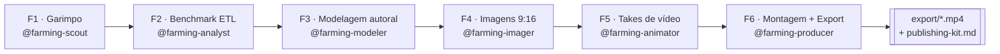

# 🌱 Virals Farming Squad

Squad de **aquecimento de contas TikTok**. Garimpa criativos virais em nichos de alto
engajamento, faz benchmark ETL completo, gera um plano de modelagem autoral e produz o
criativo final — imagem, take de vídeo, edição e export — pronto para publicar.

**Objetivo de negócio:** levar contas TikTok aos requisitos mínimos de seguidores e
visualizações que habilitam o TikTok Shop.

---

## Overview

O squad opera um pipeline de 6 fases. Cada fase tem um agente responsável, uma task
executável e um output verificável. Nenhuma fase avança sem gate.



| Fase | O que faz | Output |
|:---|:---|:---|
| **F1 Garimpo** | Monitora hashtags e/ou perfis do TikTok por nicho, aplica nota de corte | `ranking-{nicho}-{data}.md` |
| **F2 Benchmark ETL** | Baixa cada criativo aprovado: frames, áudio, transcrição, metadados | `benchmark/{origem}/{rank}-{handle}/` |
| **F3 Modelagem** | Plano de criativo autoral + prompts de imagem + prompts de animação | 3 documentos por criativo |
| **F4 Imagens** | Gera as imagens 9:16 (API) ou entrega os prompts prontos (híbrido) | `images/*.png` |
| **F5 Takes** | Anima cada imagem em take de vídeo (API ou híbrido) | `takes/*.mp4` |
| **F6 Montagem** | Timeline no video-studio: takes + áudio original + legendas + zoom, e export | `export/*.mp4` + kit de publicação |

### Nichos pré-configurados

| Nicho | Risco de política | Motor de vídeo preferido |
|:---|:---|:---|
| 🙏 Religioso | Médio | Procedural (parallax) |
| 🐾 Pet | Baixo | IA generativa (movimento é o conteúdo) |
| 📰 Notícias | **Alto** — gate de fidelidade factual bloqueante | Tier B |
| 🔮 Cartomante | **Alto** — gate de enquadramento como entretenimento | Procedural |

Cada nicho vive em `data/niches/{nicho}.yaml` com hashtags seed, nota de corte própria,
estética de modelagem e **guardrails de conteúdo**. Os guardrails são gates bloqueantes,
não recomendações.

### Modos de operação

O squad roda os dois modos em paridade — nenhum é "o de verdade":

- **`--mode=auto`** — chama as APIs de geração seguindo a cascata free-first.
- **`--mode=hybrid`** — entrega os prompts formatados para você gerar no Krea, Leonardo,
  Gemini, Hailuo ou Kling e devolve os arquivos para o pipeline continuar.

### Cascata free-first de IA generativa

Configurada em `config/ai-providers.yaml`. Consome primeiro a cota gratuita dos melhores
modelos; ao estourar, rebaixa para modelos de cota generosa. O último degrau **nunca falha**:

- **Imagem** → Gemini/Nano Banana → FLUX/Cloudflare → Pollinations (sem chave)
- **Vídeo** → Veo/Hailuo → Kling → **animação procedural local via ffmpeg**

O degrau final de vídeo não é um fallback pior: "imagem animada + áudio" *é* o formato
nativo dos nichos de farming. Custo zero, ilimitado, determinístico.

> ⚠️ Os `daily_limit` do YAML são defaults de configuração, **não fatos verificados**
> sobre a política de cada provider. O ledger em `data/runs/.provider-quota-ledger.json`
> rastreia consumo real e é a fonte de verdade do roteador.

---

## Installation

Pré-requisitos já presentes no monorepo:

```bash
node --version          # 18+
yt-dlp                  # services/ETL/bin/yt-dlp.exe (incluso)
ffmpeg / ffprobe        # services/ETL/yt-dlp_win/ (incluso)
```

Dependências opcionais por modo:

```bash
# Modo auto (F4/F5) — configure ao menos uma chave no .env da raiz
GEMINI_API_KEY=...        # imagem tier A + vídeo tier A
TOGETHER_API_KEY=...      # imagem tier B
MINIMAX_API_KEY=...       # vídeo tier A (Hailuo)
KLING_API_KEY=...         # vídeo tier B
# Sem nenhuma chave, o pipeline ainda roda: imagem cai em Pollinations,
# vídeo cai em animação procedural local.

# Sessão TikTok (opcional, melhora a captura)
node services/ETL/Extract/scrapers/tt-login.js
```

---

## Quick Start

```text
@farming-chief
```

```text
*farm religioso                       # pipeline completo, um nicho
*farm religioso,pet --mode=hybrid     # dois nichos, geração manual
*discover religioso --source=hashtags # só F1
*benchmark --top=8                    # F2 sobre o último ranking
*status                               # onde está a sessão atual
```

Ou direto pela CLI, sem agente:

```bash
# Pipeline inteiro, uma linha
node squads/virals-farming-squad/scripts/farm-run.js --niche=religioso --handles=a,b --mode=hybrid

# Ver o plano antes de rodar
node squads/virals-farming-squad/scripts/farm-run.js --niche=religioso --dry-run

# Retomar de uma fase específica
node squads/virals-farming-squad/scripts/farm-run.js --niche=religioso --session={id} --from=f4

# Fase a fase
node squads/virals-farming-squad/scripts/farm-monitor.js  --niche=religioso --source=profiles   # F1
node squads/virals-farming-squad/scripts/farm-benchmark.js --niche=religioso --top=8            # F2
node squads/virals-farming-squad/scripts/farm-model.js     --niche=religioso                    # F3
node squads/virals-farming-squad/scripts/farm-images.js    --niche=religioso --mode=auto        # F4
node squads/virals-farming-squad/scripts/farm-takes.js     --niche=religioso --procedural       # F5
node squads/virals-farming-squad/scripts/farm-assemble.js  --niche=religioso                    # F6
```

### Diagnóstico

```bash
node squads/virals-farming-squad/scripts/farm-doctor.js            # integridade do squad
node squads/virals-farming-squad/scripts/farm-doctor.js --verbose  # detalha tudo
node squads/virals-farming-squad/scripts/farm-doctor.js --session={id}  # audita uma sessão
```

O `farm-doctor` valida estrutura, contratos entre fases, dependências dos agentes, sintaxe
e API dos módulos, motores presentes, nichos, e o ambiente (yt-dlp, ffmpeg, Playwright,
sessão TikTok, credenciais). **Enquanto ele passa, o squad está íntegro** — inclusive a
checagem de que o status declarado de um pack bate com o que existe em disco.

### Anatomia do output

```text
workspaces/businesses/virals/farming/{date}/{session-id}/
├── ranking-religioso-2026-07-26.md          # F1
├── session.json                             # manifesto da sessão
├── benchmark/
│   ├── hashtag/
│   │   └── 01-handle-a1b2c3/                # F2
│   │       ├── benchmark.json               # link, metadados, descrição, hashtags
│   │       ├── screenshots/                 # frames-chave
│   │       ├── audio.mp3
│   │       ├── audio-description.md         # música (título+tradução) ou transcrição
│   │       ├── plano-criativo.md            # F3
│   │       ├── prompts-imagem.md            # F3
│   │       ├── prompts-animacao.md          # F3
│   │       ├── images/                      # F4
│   │       ├── takes/                       # F5
│   │       └── export/                      # F6
│   │           ├── criativo.mp4
│   │           └── publishing-kit.md        # descrição + hashtags do original
│   └── perfil/
└── _degraded.md                             # itens que falharam, sem mascarar
```

---

## Agents

| Agente | Persona | Inspiração | Fase |
|:---|:---|:---|:---|
| `@farming-chief` 👑 | Kane | Brendan Kane — *Hook Point*, escala de contas | Orquestra F1→F6 |
| `@farming-scout` | Berger | Jonah Berger — *Contagious* / STEPPS | F1 Garimpo |
| `@farming-analyst` | Paddy | Paddy Galloway — desmonte de short-form | F2 Benchmark |
| `@farming-modeler` | Kleon | Austin Kleon — *Steal Like an Artist* | F3 Modelagem |
| `@farming-imager` | Javi | Javi Lopez — Magnific AI | F4 Imagens |
| `@farming-animator` | Trillo | Paul Trillo — direção de AI video | F5 Takes |
| `@farming-producer` | Ross | Ross Simmonds — distribuição em escala | F6 Montagem |

Ativação: `@farming-chief` ou `/VIRALS:agents:farming-chief`. Comandos usam prefixo `*`.
Todo agente tem `*help` e `*guide`.

---

## Reuso (IDS: REUSE > ADAPT > CREATE)

O squad **não reimplementa** infra que já existe no monorepo:

| Reusado | De onde | Para quê |
|:---|:---|:---|
| `TikTokEngine` (yt-dlp metadata sniper) | `services/ETL/Extract/scrapers/engines/` | F1 — funciona igual em `/tag/{hashtag}` e em `/@{handle}` |
| `Downloader`, `VideoProcessor` | `services/ETL/` | F2 — download e extração de frames/áudio |
| `LocalTranscriber` | `services/ETL/Transform/video-intelligence/` | F2 — transcrição via Gemini |
| `ingest.ts`, `editSpec.ts`, `render-export.ts` | `apps/video-studio/` | F6 — timeline e render |

**Independência:** o squad **não** depende do `virals-marketing-squad`. Criativos de
aquecimento são deliberadamente simples — não precisam da profundidade de copy e
persuasão que o marketing exige.

---

## Documentação

- `docs/pipeline-guide.md` — guia operacional completo, fase a fase
- `tools/ai-provider-cascade.md` — contrato dos adapters de geração
- `tools/video-studio-bridge.md` — contrato de entrega para o editor
- `squad.yaml` — manifest AIOX

---

**Versão:** 1.0.0 · **Entry agent:** `@farming-chief` · **Prefix:** `viralsFarming`
