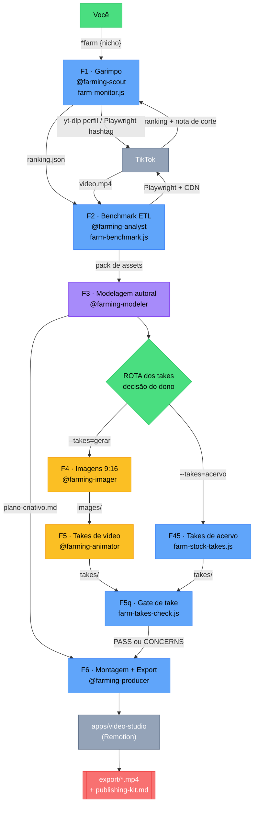

# 🌱 Guia Operacional — Pipeline de Farming TikTok

Guia fase a fase do `virals-farming-squad`. Para a visão geral, veja o `README.md`.

---

## Diagrama



---

## Estado verificado das rotas do TikTok

Testado em **2026-07-26** com yt-dlp `2026.07.04`. Isto muda com o tempo — reteste antes
de culpar a configuração.

| Operação | Rota | Estado |
|:---|:---|:---:|
| Listar vídeos de um perfil | `yt-dlp --flat-playlist /@handle` | ✅ com métricas completas |
| Listar vídeos de uma hashtag | `yt-dlp /tag/x` | ❌ `No working app info is available` |
| Listar vídeos de uma hashtag | Playwright (DOM / API / rehydration) | ⚠️ barrado por anti-bot |
| Metadados de um vídeo | `yt-dlp --dump-json {url}` | ❌ `Unable to extract universal data` |
| Metadados de um vídeo | Playwright (DOM do post) | ✅ descrição, likes, comentários, shares |
| Baixar um vídeo | `yt-dlp` (com ou sem cookies) | ❌ `No video formats found!` |
| Baixar um vídeo | `Downloader` do ETL | ❌ degrada para `metadata_only` |
| Baixar um vídeo | **Playwright + interceptação do CDN** | ✅ **mp4 completo** |

### O que isso implica no desenho

1. **A rota de perfil é a espinha dorsal.** É a única que entrega métricas de graça.
2. **Hashtag descobre handles, não métricas.** As métricas vêm sempre da rota de perfil.
   Assim, se alguma estratégia de hashtag voltar a funcionar, ela já alimenta o ranking
   completo sem mudar o resto.
3. **`anchor_profiles` é o ativo mais valioso do nicho.** Por isso o `daily-farm-discovery`
   tem uma fase de retroalimentação: handles que renderam aprovados devem ser promovidos.

---

## Rodar em produção — as duas portas de entrada

```bash
# CURADORIA — o usuário já tem os perfis
node squads/virals-farming-squad/scripts/farm-run.js --niche=religioso \
  --entry=profiles --profiles=@a,@b --items=40 --min-score=1000 --mode=auto

# MONITORAMENTO — descobrir postagens recentes do nicho
node squads/virals-farming-squad/scripts/farm-run.js --niche=religioso \
  --entry=monitor --source=both --mode=auto
```

As duas portas convergem no **mesmo contrato** — `ranking-{niche}-{date}.json` — e daí em
diante o pipeline é idêntico. Nenhuma fase posterior sabe qual foi usada.

| Porta | Fases | Quando |
|:---|:---|:---|
| `--entry=profiles` | `f1p → f1s → f2 → f2p → f3 → f4 → f4q → f5 → f6` | perfis já mapeados |
| `--entry=monitor` | `f1 → f2 → f2p → f3 → f4 → f4q → f5 → f6` | descobrir o que está performando |

| Fase | Produz | Bloqueia? |
|:---|:---|:---|
| `f1p` | dossiê por perfil + hashtags (nada é reprovado) | sim |
| `f1s` | seleção por `--min-score` (default 1000) | sim |
| `f2p` | `publicacao.md` por pack + índice | **não** |
| `f4q` | gate de qualidade de imagem | sim |

**Acionamento por agente/skill:** `/farming-pipeline` (skill) ou `@farming-chief` para o
modo interativo com `*farm`, `*audit`, `*select`, `*publication`, `*quality`. A fonte de
verdade do fluxo é `tasks/farm-pipeline-run.md` — o agente e a skill apenas a executam.

Três avisos que valem antes de qualquer rodada grande:

1. **~63s por criativo na F2.** 240 criativos são ~4h. Diga o total antes de disparar.
2. **`--min-score=1000` é permissivo** — com os pesos do religioso, 10k views já bastam.
   Numa auditoria real de 8 perfis, 241 de 320 passaram. Para recorte duro, some
   `--min-outlier=1.5`: exige que o post tenha rompido a linha de base do próprio canal.
3. **A F2 trunca em 20 criativos** por sessão (`max_creatives_per_benchmark`). Seleções
   maiores rodam em lotes com `--ranks=`.

---

## F1 — Garimpo

```bash
node squads/virals-farming-squad/scripts/farm-monitor.js --niche=religioso --source=profiles
node ... --niche=pet --handles=handle1,handle2 --items=20
node ... --niche=noticias --dry-run
```

O ranking traz quatro seções, e **nenhuma pode faltar**:

| Seção | Por quê |
|:---|:---|
| Aprovados | o entregável |
| Reprovados | mostra que o corte funcionou, não que faltou conteúdo |
| Sem métricas | separa "sem dado" de "sem engajamento" |
| Falhas de captura | sem ela, um ranking incompleto parece completo |

### Bootstrap de um nicho novo

`anchor_profiles` nasce vazio de propósito — handles reais saem do garimpo, nunca de
invenção. Para começar:

1. Rode `--source=hashtags` e veja se a cascata devolve handles.
2. Se não devolver (estado atual), colete handles à mão navegando pelas hashtags do nicho.
3. Varra com `--handles=a,b,c` para medir sem editar o YAML.
4. Promova para `anchor_profiles` os que renderem aprovados.

---

## F1-P — Auditoria de perfis (rota de curadoria)

Alternativa ao garimpo para quando **os perfis já estão escolhidos** e a decisão de
quais criativos seguem para a F2 é humana.

```bash
node squads/virals-farming-squad/scripts/farm-profiles.js --niche=religioso \
  --profiles=@a,@b,https://www.tiktok.com/@c --items=40
node ... --niche=religioso --session={id} --pick=a#1,a#4,b#2   # monta a seleção, sem rede
```

| | F1 Garimpo (`farm-monitor.js`) | F1-P Auditoria (`farm-profiles.js`) |
|:---|:---|:---|
| Perfis | descobre | recebe do operador |
| Corte | automático (nota de corte) | **nenhum** — vira sinalizador na linha |
| Saída | um ranking do nicho | um dossiê por perfil + índice + hashtags |
| Ordem | modelabilidade → viral score | índice de outlier dentro do próprio perfil |
| Decisão | do script | do operador, via `--pick` |

**Índice de outlier** (views ÷ mediana do perfil) é o eixo desta rota. Views absolutas
dentro de um mesmo canal medem o tamanho do canal, que é constante; o que revela formato
vencedor é o post que rompeu a linha de base dele. A mediana sai só de posts com mais de
48h — post recente ainda está sendo distribuído e puxaria a base para baixo, inflando o
outlier de todo o acervo. Esses posts recentes ficam marcados como `imaturo` porque caem
para o fim da tabela por idade, não por desempenho.

Saídas na sessão: `profiles-index-{date}.md`, `profiles/{handle}.md`, `hashtags-{date}.md`
(+ os `.json` equivalentes). O `--pick` grava `ranking-{niche}-{date}.json` no mesmo
contrato que a F2 já consome — a F2 não precisa saber que a seleção veio de curadoria.

---

## F2 — Benchmark ETL

```bash
node squads/virals-farming-squad/scripts/farm-benchmark.js --niche=religioso --top=8
node ... --session={id} --ranks=1,3,7
node ... --niche=pet --url=https://www.tiktok.com/@x/video/123
```

### Três armadilhas resolvidas na implementação

Vale conhecê-las porque explicam decisões que parecem estranhas no código:

1. **`res.body()` volta vazio.** O player consome o stream de mídia. A solução é capturar a
   **URL** do CDN e refazer o request pelo request context, que carrega os mesmos cookies.
2. **O CDN também serve vídeo de UI.** Capturar `ttwstatic.com/.../playback1` produz um mp4
   válido de 2 segundos — o pior tipo de falha, porque *parece* sucesso. Hosts estáticos
   são excluídos e o CDN de conteúdo tem prioridade sobre o tamanho anunciado.
3. **Script de stealth impede a captura.** `delete navigator.webdriver` quebra a execução de
   JS da página e o vídeo não toca; sem reprodução, o CDN nunca é chamado. A página do post
   abre **sem** stealth.

---

## F3 — Modelagem autoral

O gate mais barato do pipeline. **Aprove aqui** — depois deste ponto, cada erro custa cota
de imagem e de vídeo.

O passo que decide a qualidade de tudo: **descarte de camadas**. O screenshot do TikTok não
é a imagem, é a imagem mais legenda, UI, watermark e texto do autor. Traduzir tudo junto faz
o prompt pedir uma imagem com legenda dentro.

```bash
node squads/virals-farming-squad/scripts/farm-model.js --niche=religioso --session={id} --origin=teste
```

`--origin=X` recorta pela pasta sob `benchmark/` (`perfil`, `hashtag`, `teste`…). É como se
ensaia uma mudança num pack isolado sem gastar visão nos outros: ponha o pack em
`benchmark/teste/` e passe `--origin=teste`. Vale para F3, F4 e o gate de imagem.

### Estilo do nicho: acabamento, não briefing

`visual_style` descreve o criativo **típico** do nicho. Colá-lo no fim de uma cena já
traduzida produz prompts que se contradizem — medido em 2026-07-28: a cena era uma rua
noturna chuvosa de tons frios e o sufixo mandava "luz dourada, paleta quente, silhueta em
oração, cruz ao fundo", injetando sujeitos que não existiam no benchmark.

Por isso o nicho tem dois campos:

| Campo | Quando entra no prompt | O que pode conter |
|:---|:---|:---|
| `visual_grading` | sempre que a visão traduziu a cena | só paleta, luz, textura |
| `visual_style` | **só** quando a visão falhou | descrição completa, inclusive sujeitos |

## F6b — Ver e editar no video-studio

```bash
# ESPELHO (use este): reconstrói no editor o criativo EXATO que a F6 exportou.
node squads/virals-farming-squad/scripts/farm-studio-publish.js \
  --mode=mirror --niche=religioso --session={id} --origin={pasta}

# Bateria de contrato (AC0–AC9) — precisa do app rodando em localhost:3000
node squads/virals-farming-squad/scripts/farm-studio-verify.js \
  --niche=religioso --session={id} --origin={pasta}

# Diferença de PIXELS contra o export aprovado (o único juiz que importa)
node squads/virals-farming-squad/scripts/farm-studio-visual-diff.js \
  --aprovado={pack}/export/criativo.mp4 --studio={export do editor}.mp4 \
  --out=/tmp/diff --amostras=5

# Checagem NO NAVEGADOR: toca o criativo, usa a interface e reprova por erro de
# console ou piscada preta na virada de take (nem o contrato nem o diff veem isso)
node squads/virals-farming-squad/scripts/farm-studio-browser-check.js --segundos=25
```

As três baterias olham coisas diferentes e nenhuma cobre a outra:

| Bateria | O que compara | O que NÃO vê |
|:---|:---|:---|
| `farm-studio-verify` | campos do save × `timeline.json`/`captions.ass` | o desenho na tela |
| `farm-studio-visual-diff` | pixels do export do editor × export da F6 | o comportamento durante a reprodução |
| `farm-studio-browser-check` | console e tela do editor **tocando** | fidelidade ao export |

Foi por confiar só na primeira que um espelho com contrato 6/6 chegou ao operador com
outra fonte, sem contorno e piscando preto em toda virada de take.

**Nada de repetir flags entre os comandos.** O reenquadramento anti-marca-d'água é lido
do contrato (`timeline.dewatermark`, gravado pela F6) e, em packs antigos, do comando
ffmpeg real em `export/_ffmpeg-cmd.txt`. Passar `--dewatermark` continua valendo como
sobreposição manual, mas não é mais necessário — e era assim que o espelho saía com
enquadramento diferente do export sem nada acusar.

A tipografia também é lida do `captions.ass`: família, corpo, peso, contorno, sombra e
margem. As conversões libass → CSS (o `Fontsize` do ASS não é o corpo em px) estão
documentadas em `_studio-mirror.js`; o AC9 da bateria confere que o elemento de texto
carrega o estilo real do export.

Os outros modos (abaixo) continuam existindo para outros usos.

```bash
node squads/virals-farming-squad/scripts/farm-studio-publish.js \
  --niche=religioso --session={id} --origin=teste
```

Publica no cliente **`virals-farming`** (dedicado, criado sozinho na primeira execução).
O studio descobre clientes varrendo `outputs/`, e o nome de exibição cai para title-case
do slug — "Virals Farming". Nada foi editado no app.

O farming **não** publica no cliente de um perfil pessoal: marca, formato e destino são
outros, e o app lista todos juntos na home.

### Três modos

| Modo | O que publica | Resultado no frontend |
|:---|:---|:---|
| **`mirror`** | takes recortados + trilha + texto com a tipografia do `.ass` | o **mesmo desenho** do export, editável por elemento |
| `approved` (default) | só o `criativo.mp4` exportado | exatamente a versão aprovada, achatada |
| `edit` | takes + áudio + estado em camadas | a mesma composição, montada pelo editor |
| `source` | takes + áudio, sem estado salvo | **uma montagem nova**, não a aprovada |

**`--mode=edit` é o que reconstrói a F6 no editor**, lendo o `timeline.json` dela (fades,
durações e ordem reais, não estimados):

| Camada | Conteúdo | Decisão |
|:---|:---|:---|
| Vídeo | `take-1`, `take-2` separados | `audioEnabled: false` — os takes de IA carregam áudio próprio (a sirene do teste); o som é a trilha |
| Trilha (benchmark) | `audio_original.mp3` | camada de áudio, **não** `audioTrack` — este é a faixa de narração e rotularia o mp3 como fala do criador (era o "hook" do print) |
| Elementos (copy) | a frase como `type: "text"` em x=50 / y=42 | elemento editável, não legenda cronometrada |

Fades vêm do `open`/`close` da F6 (10 e 14 frames), aplicados ao primeiro e ao último take.

O studio tem pipeline de FX próprio — legenda karaokê, hook renderer, motion, SFX,
transições — calibrado para o fluxo de narração do cliente pessoal. Publicar peças soltas
num editor que monta sozinho é **pedir uma montagem nova**, não uma visualização: era daí
que vinham os sound effects, as transições que não batiam e a ausência do texto centrado.

No modo `approved` não há o que remontar: um clipe só, com texto, transições, áudio e
marca d'água já resolvidos na F6. O `audio_original.mp3` **não** é publicado nesse modo —
já está dentro do criativo, e publicá-lo à parte faria o studio tratá-lo como narração e
dobrar o som.

#### Publicar o arquivo não basta — o studio remonta por cima

Mesmo com material único, o frontend ainda divergia: aparecia `SFX impact · hook`, uma
`trilha lo-fi` e o áudio do criativo **mudo**. Duas causas, ambas em
`api/timeline/route.ts` e `lib/ingest.ts`:

| Sintoma | Causa |
|:---|:---|
| SFX e trilha que não existem no export | no ramo `if (!persisted)`, o route deriva SFX dos cortes e, sem `video-brief.yaml`, injeta trilha lo-fi default |
| "Áudio próprio do clipe" desmarcado | `audioEnabled: TALKING_HEAD.has(role)`, e `TALKING_HEAD` é só `{hook, cta}` — qualquer outro papel entra mudo |

A solução é publicar um **`studio-edit.json`** pré-salvo. Com um save válido
(`{timeline, fxPlan}`), o route trata a edição como autoritativa e **pula a pré-montagem
inteira**. O publicador grava: um clipe com `role: "hook"` (o único papel que não entra
mudo), `audioEnabled: true`, `extraLayers: []`, `audioTrack: null` e `fxPlan.captions: []`
— sem legenda do editor, porque o texto já está queimado e apareceria duas vezes.

Verificação pela API (não pela tela):

```bash
curl -s "http://localhost:3000/api/timeline?client=virals-farming&creative={id}"
# persisted: true · clips: 1 · audioEnabled: true · extraLayers: [] · captions: 0
```

Use `--mode=source` só quando a intenção for reeditar de fato, ciente de que o resultado
diverge do aprovado.

**O gap era menor do que o diagnóstico dizia.** A F6 registrava a ponte como "gap
estrutural" que exigiria um adapter dentro do app. Isso vale para o *render*
(`render-export.ts` opera sobre um Timeline interno e não lê o `timeline.json` da ponte),
mas **não** para a edição: `api/creatives/route.ts` lista qualquer pasta em
`outputs/{client}/video-plans/` e a considera editável assim que houver um vídeo em
`Materiais Brutos/`. O adapter cabe do lado do farming — nenhuma linha de
`apps/video-studio` foi tocada.

O publicador copia takes + `audio_original.mp3` e escreve um `assembly.json` com ordem,
papéis, movimento de câmera de cada take e a frase do criativo — para quem edita ver a
mesma intenção que a modelagem definiu.

### Texto na tela: modo bloco (default)

A frase aparece **inteira, do primeiro ao último frame**, centrada e um pouco acima do
meio (`--caption-y=0.42`) — como o criativo de benchmark faz.

O modo anterior fatiava o texto em cues cronometrados, como legenda de acessibilidade.
Nestes formatos isso descaracteriza o criativo: a frase não é narração legendada, é o
**conteúdo**, e existe inteira desde o início para ser lida de uma vez. Fatiada, o
espectador nunca vê a mensagem completa. `--caption-mode=sequential` volta ao antigo.

⚠️ **`\pos()` desliga a quebra automática de linha do libass** — com ele, MarginL/MarginR
são ignoradas e o texto sangra pelas duas bordas. Por isso a quebra é feita à mão
(`wrapAssText`), estimando a largura por caractere em 0,52 × fontsize.

### Frase do criativo (`creative_text`)

A F6 vinha queimando na tela a **transcrição do áudio do benchmark**. Isso funciona como
legenda de acessibilidade, mas publica a fala de outra pessoa na tela do nosso criativo —
e nos formatos deste nicho (frase sobre imagem) **a frase é o conteúdo**, não uma legenda.

Agora a visão, além de inventariar os overlays, **transcreve** o texto queimado no quadro
original. Antes o overlay era corretamente descartado do prompt de imagem (a imagem tem de
sair limpa), mas o texto ia junto para o lixo — sobrava saber que "havia um texto ali",
o que não permite modelar nada.

O `modeling.json` ganhou:

```json
"creative_text": {
  "frase": "",
  "fonte": "pendente",
  "original_detectada": [{ "take": 1, "texto": "Que haja Deus em tudo o que for meu." }]
}
```

`original_detectada` é referência de **estrutura** (tamanho, tom, quebra de linha), nunca
para copiar. `frase` nasce vazia de propósito: preenchê-la a partir do original seria
plágio, e a partir de um modelo seria invenção (Article IV).

**Precedência na montagem:** `creative_text.frase` → transcrição (com aviso) → sem texto.
O `publishing-kit.md` declara a origem, porque ela muda a decisão de publicar.

### `publicacao.md`

Cada pack ganha o registro de como o autor **publicou**: legenda literal, hashtags (as do
campo e as embutidas na legenda), trilha e a estrutura observada. O criativo não é só o
vídeo — a embalagem é metade do desempenho. A legenda modelada fica em branco de propósito:
gerar uma "no estilo de" seria invenção (Article IV).

Gera em lote, **sem visão e sem rede** — tudo vem do `benchmark.json`:

```bash
node squads/virals-farming-squad/scripts/farm-publication.js --niche=religioso --session={id} --origin=perfil
node ... --skip-existing    # preserva documentos já preenchidos à mão
```

Sai também um `publicacoes-index.md` na raiz da sessão, com a tabela de todos os criativos
e a frequência de hashtags **daquele benchmark** (recorte diferente do `hashtags-{data}.md`
da F1-P, que cobre o acervo inteiro dos perfis).

Duas regras de fidelidade que puxam para lados opostos, e por isso vivem em lugares
diferentes: o documento de cada criativo preserva o **case exato** que o autor escreveu
(`#GratidãoAoSenhor`), enquanto o índice **agrupa por minúsculas** ao contar — o TikTok
trata `#Deus` e `#deus` como a mesma hashtag, e contá-las separadas responde errado.

Rodá-lo pela F3 é redundante: a F3 já escreve o mesmo documento pelo mesmo módulo
(`_publication.js`). O script existe para cobrir packs que nunca passaram pela modelagem.

---

## Gate de qualidade de imagem (F4 → F5)

```bash
node squads/virals-farming-squad/scripts/farm-image-check.js --niche=religioso --session={id}
node ... --origin=teste --no-vision     # só a checagem técnica, sem gastar cota
node ... --strict                        # CONCERNS também reprova
```

A F4 valida que o arquivo existe, tem tamanho e está em 9:16 — **nada disso diz se a imagem
presta**. Um retângulo preto em 1080×1920 passava em tudo e só se revelava no export. O gate
responde as duas perguntas que faltavam:

| Checagem | Como | Pega |
|:---|:---|:---|
| Técnica | `ffmpeg signalstats` | imagem preta, estourada, chapada, faixa dinâmica curta |
| Semântica | visão contra `takes[].cena` | imagem perfeita mas fora do briefing |

**Texto na imagem tem dois pesos, e confundi-los zera o gate.** Texto *sobreposto* (legenda,
marca d'água) é FAIL: o pipeline aplica o texto na montagem e imagem escrita não tem
conserto. Texto *incidental* (placa de rua, letreiro de ônibus, outdoor ao fundo) é CONCERNS:
faz parte da cena fotografada. A primeira versão do gate não distinguia os dois e reprovou
imagens de aderência 10/10 por causa de uma placa no fundo — teria zerado toda cena urbana.

Veredito: `PASS` | `CONCERNS` (passa com aviso) | `FAIL` (não segue para F5). Relatório em
`images/_quality.md` e `_quality.json`.

⚠️ **`--strict` reprova quase tudo em cena urbana.** Qualquer placa, letreiro ou outdoor ao
fundo gera CONCERNS, e cena de rua praticamente sempre tem um. Medido: quatro imagens de
aderência 9–10/10 saíram todas CONCERNS por texto incidental. Use `--strict` só quando
quiser forçar curadoria manual take a take — não como padrão de lote.

### Estado validado (2026-07-28)

Exercitado ponta a ponta no pack `benchmark/teste/01-lermenn-625492`:

| Caminho | Provider | Resultado |
|:---|:---|:---|
| Geração (tier B) | `cloudflare-flux` | 1080×1920, aderência **10/10** e **9/10** |
| Fallback de acervo (tier C) | `pexels-stock` | 1080×1920, aderência **6/10** e **9/10**, com atribuição gravada |

A diferença de aderência é o comportamento esperado, não um defeito: o gerador **segue** o
prompt, o acervo apenas se **aproxima** dele. Para forçar a cascata a descer e testar os
degraus de baixo sem editar o YAML:

```bash
node ... farm-images.js --skip-providers=cloudflare-flux,cloudflare-sdxl,hf-flux,pollinations
```

Enquanto o tier B responde, a cascata nunca desce — e o fallback fica sem nunca ter sido
exercitado no roteamento real. "Nunca falhou" não é o mesmo que "funciona quando chamado".

---

## F4 e F5 — Geração

Ambos os modos produzem a **mesma árvore de arquivos**. A fase seguinte não sabe qual foi
usado.

### F5 — ETAPA MANUAL (desde 2026-07-28)

**O motor automático de vídeo saiu do pipeline.** A geração procedural local funciona e é
tecnicamente válida (medido: 2 takes h264 1080×1920 @30fps, movimento real de YAVG 8,53 e
4,20), mas não entrega qualidade publicável — e não há API paga nem hardware para modelo
local. O pipeline **para** na F5 e instrui; só gera com `--video=auto` explícito.

O fluxo passou a ser:

1. A F3 emite `prompts-animacao.md` — prompts **em inglês**, um bloco por motor.
2. O operador gera à mão em Hailuo/MiniMax, BytePlus/Seedance, Kling, Symphony ou RunningHub.
3. Salva cada resultado em `takes/take-N.mp4`.
4. Confere: `farm-takes.js --mode=hybrid --verify`.
5. Retoma: `farm-run.js --from=f6`.

#### A sequência é planejada em conjunto, nunca take a take

Corrigido 2026-07-28 com take real na mão. Cada take recebia sua câmera pelo papel
narrativo, sem olhar o vizinho — e num criativo de 2 planos isso produzia **push-in
seguido de pull-out**: o olho entra e é imediatamente expulso. Duas regras agora governam
a sequência (`planCameraSequence`):

- **Não reverter.** Pull-out só entra se o take anterior não for entrada.
- **O último assenta.** A frase na tela é o conteúdo; movimento no fechamento disputa com
  a leitura.

Para 2 takes o resultado é `entrada → assenta`. A partir do 2º take o prompt carrega uma
**âncora de continuidade** ("same location, same time of day and same color palette as the
previous shot") — é o que faz os planos conversarem em vez de parecerem vídeos diferentes.

#### Objeto que avança para a câmera

O take 2 do pack de teste saiu com um veículo em rota de colisão, parecendo uma ambulância.
Causa: o cue dizia `vehicle headlights sliding past` numa imagem que tinha um ônibus **de
frente**. Sem restrição de distância, o modelo escolhe a interpretação mais dramática.

Cues que envolvem objeto móvel agora declaram a distância na própria frase (`distant
vehicles holding their position far down the road, none approaching the camera`), o prompt
ganha um reforço explícito quando há risco, e os negativos incluem `vehicle driving toward
the camera`, `collision`, `emergency vehicle`.

#### Áudio: sempre do benchmark

Motores novos (Hailuo, Veo) geram trilha própria — no teste, uma sirene. O criativo usa o
`audio.mp3` do benchmark, então áudio gerado colide na montagem. O documento manda desligar
a geração de áudio, e `sirens`, `generated audio`, `speech` e `music` estão nos negativos.

#### Por que os prompts mudaram de língua e de foco

Os antigos eram em português e descreviam o movimento de **câmera** do preset ffmpeg
("Câmera avança lentamente em direção ao sujeito"). Isso é a instrução de um filtro de
zoom, não de um modelo generativo — e produzia vídeo ruim mesmo partindo de imagens boas:

| Problema | Correção |
|:---|:---|
| Modelos I2V são treinados sobretudo em inglês | prompt em inglês |
| Em I2V a imagem **já é** a cena; redescrevê-la faz o modelo recriar o que já está lá (origem do morphing) | o prompt diz o que **se move**, não o que se vê |
| Movimento de câmera sozinho = Ken Burns caro | movimento dos **elementos**: chuva caindo, reflexo tremulando, faróis passando, folhagem balançando |
| Um prompt genérico para todos os motores | um bloco por motor — Hailuo lê `[Push in]` como comando literal; Kling e Seedance têm campo de negativo |

Os elementos móveis são derivados da cena traduzida por um mapa determinístico
(`_motion.js`) — sem chamada extra de modelo, auditável, e errando de forma previsível.
Sem pista de movimento na cena, o prompt pede quase parado: inventar movimento é o caminho
mais curto para o modelo alucinar elemento novo.

### Fallback de acervo (Pexels) — último degrau da imagem

Quando toda a cascata de geração falha, o take ainda precisa de uma imagem. O degrau final
não gera: **busca** no Pexels, alimentado pelo mesmo prompt que alimentaria o gerador.

A busca usa `takes[].stock_query`, derivada pela F3 de **sujeito + fundo + luz** — não o
prompt inteiro. Prompt de difusão é uma lista longa de qualificadores de renderização, e
busca textual em banco de imagens degrada com ruído: quanto mais termos, menos resultados.
A query fica gravada no `modeling.json` para ser corrigível à mão quando errar o alvo.

Medido em 2026-07-28 com a cena "rua noturna chuvosa com reflexos e árvores": o Pexels
devolveu uma foto de rua molhada à noite com árvores, praticamente a mesma cena. Mas veio
com letreiros de loja legíveis — **cena urbana de acervo quase sempre traz texto incidental,
mais do que a geração traz**. É por isso que o gate de qualidade roda depois, não antes.

Todo take vindo de acervo grava procedência em `images/_attribution.json` (autor, URL,
query usada). Sem isso o pack não distingue imagem gerada de foto de banco — e a diferença
importa para licença e para diagnóstico: acervo fora do alvo é erro de **busca**, não de
prompt.

```text
images/                        takes/
├── take-1.png                 ├── take-1.mp4
├── _slots.json                ├── _slots.json
└── _prompts-para-colar.md     └── _prompts-para-colar.md   (só no híbrido)
```

### Onde gastar cota

Só no **pet**, onde o movimento é o conteúdo. Nos outros nichos, o parallax procedural
entrega a estética nativa de graça e sem limite.

---

## ROTA — a pergunta que o pipeline faz antes de gastar cota

Entre a modelagem e a produção dos takes existe uma decisão que não é do script:

```
⏸️  ROTA DOS TAKES — decisão do dono

   🎨 Geração por IA  (--takes=gerar)
      como:   imagem 9:16 (F4) → gate de imagem → animação I2V (F5)
      custo:  cota de imagem + cota/trabalho manual de vídeo por take
      quando: a cena é específica demais para existir em acervo

   🎞️  Banco de vídeo (--takes=acervo)
      como:   busca o clipe pronto pela cena traduzida (F45)
      custo:  uma busca por take — sem cota de imagem nem de vídeo
      quando: a cena é ambiente/natureza/urbano, que o acervo cobre bem
```

**Não se lê stdin de propósito.** Este pipeline precisa rodar igual no terminal, dentro de
um agente e, um dia, atrás de um frontend num VPS — e prompt interativo só funciona no
primeiro caso. O orquestrador PARA, grava a pendência em `{sessão}/decisao-rota.json` e
devolve os dois comandos de retomada. Quem responde pode ser humano, agente ou API.

Com `--takes` já respondido, a fase só confirma a rota e segue. No plano de execução,
enquanto a rota não estiver decidida, **nenhuma** das duas pernas aparece — mostrar as
duas daria a impressão de que o pipeline vai rodar ambas.

## F5q — Gate de qualidade de TAKE

```bash
node squads/virals-farming-squad/scripts/farm-takes-check.js --niche=religioso --session={id}
node ... --descartar    # move reprovados para takes/_reprovados/ e atualiza os slots
node ... --strict       # CONCERNS também reprova
```

O irmão do gate de imagem, um elo adiante — e o que faltava. Até aqui a F6 só verificava
que o take EXISTIA: um mp4 preto, um clipe congelado ou o mesmo vídeo em dois takes
passavam inteiros e só apareciam no criativo montado.

| Pergunta | Reprova (FAIL) | Avisa (CONCERNS) |
|:---|:---|:---|
| É vídeo? | sem stream de vídeo, < 50KB | — |
| Dá para enquadrar? | deitado, ou altura < 640px | altura < 1280 (será ampliado) |
| Cobre o take? | menos da metade do planejado | mais curto (a montagem estende) |
| Tem imagem? | todos os quadros pretos ou chapados | alguns quadros pretos |
| Tem movimento? | — | início e fim praticamente iguais |
| É único no pack? | mesma assinatura visual de outro take | — |

**O gate reprovou os takes APROVADOS na primeira versão** — exigia 1080×1920, e os motores
I2V entregam 496×864, que a F6 amplia na montagem. Um gate que reprova material aprovado
está errado sobre o motor, não sobre o material: o critério virou *vertical com altura
suficiente para ampliar*. Vale como regra geral — **gate codifica o contrato do motor, não
a suposição de quem escreveu o gate**.

Reprovado é MOVIDO para `takes/_reprovados/`, nunca apagado: é a evidência do que deu
errado, e às vezes o dono discorda do gate.

## F4/F5 por ACERVO — takes prontos, sem gerar imagem nem vídeo

```bash
node squads/virals-farming-squad/scripts/farm-stock-takes.js \
  --niche=religioso --session={id} --origin="lote 2 - 02.08"

node ... --ranks=1 --dry-run     # mostra as buscas e o clipe escolhido, não baixa
node ... --no-llm                # só heurística, sem gastar API
```

Rota alternativa às duas fases mais caras. Em vez de `cena → prompt → imagem (cota) →
I2V (cota/manual) → take`, faz `cena → busca → clipe real → corte 9:16 → take`. Entrega
o mesmo `takes/take-N.mp4` e o mesmo `takes/_slots.json` que a F5 — **a F6 não sabe (nem
precisa saber) por qual rota o take chegou**.

### O que decide a qualidade: a query

O `stock_query` da modelagem é um truncamento dos primeiros termos da cena. Serve para
foto; para vídeo é fraco — sai coisa como `ausente fundo sólido preto` ou
`visão indisponível`. Aqui a cena ESTRUTURADA (sujeito + ambiente + luz + cor) vira **3
buscas curtas em inglês** por um modelo de texto gratuito, porque o acervo é indexado em
inglês. Sem API, cai numa heurística com glossário PT→EN.

| Situação | O que a busca usa |
|:---|:---|
| cena traduzida pela visão | sujeito + ambiente + luz + cor, em inglês |
| visão indisponível no frame | `visual_style` do nicho (mesma regra da F3) |
| sem API de texto | glossário PT→EN sobre sujeito e fundo |

**Não se pede a pessoa do original.** Metade dos benchmarks é uma pessoa específica em
cena; copiar o sujeito não seria nem desejável — o criativo é modelado, não clonado. A
tradução mira ambiente e atmosfera, que é o que sustenta o mesmo ritmo.

### Como o clipe é escolhido

A ordem do Pexels é por popularidade, não por semelhança: sem critério, uma query ruim
devolve o clipe mais baixado do banco — horizontal, curto, sem relação com a cena — e o
pipeline segue como se tivesse achado o take. A nota combina vertical nativo (peso maior),
duração que cubra o take, altura ≥1080 e os termos da query no slug do clipe. Abaixo de 40
o take é reprovado em vez de aceitar qualquer coisa.

O trecho sai do MEIO do clipe (o começo tem o movimento de câmera assentando, o fim tem o
corte do autor) e é normalizado em 1080×1920@30, sem áudio, com keyframe por segundo.

`takes/_stock.json` grava a busca que encontrou cada take e a procedência do clipe —
atribuição é opcional na licença do Pexels, mas publicar sem saber a origem é risco
silencioso. É também a MEMÓRIA da fase: uma segunda passada sem `--force` lê dali as
buscas dos takes que já existem (por isso o manifesto preserva as entradas antigas em vez
de reescrevê-las).

### Variedade no laço — a vantagem que só esta rota tem

Quando o áudio é muito mais longo que a soma dos takes, a F6 repete os mesmos arquivos em
ordem. Na rota de geração isso é inevitável: cada take extra custa cota de imagem **e** de
vídeo. Aqui custa uma busca, e o banco tem outros clipes da mesma cena — então a fase
baixa variações e grava como `take-(N+1)`, `take-(N+2)`…, que é o que o `--fill=loop` lê
do disco.

```
antes:  🔁 loop: 2 takes × 8.0 ciclos = 16 clipes para 57.7s   (2 cenas oito vezes)
agora:  🔁 loop: 14 takes × 1.1 ciclos = 16 clipes para 57.7s  (14 clipes distintos)
```

Teto de 12 extras por criativo; `--sem-extras` desliga.

### Pelo orquestrador

```bash
node squads/virals-farming-squad/scripts/farm-run.js --niche=religioso --takes=acervo --from=f3
#   Rota:  acervo (busca clipe pronto — sem F4/F5)
#   Fases: f3 → f45 → f6
```

A troca acontece na SELEÇÃO de fases: entrando a rota de acervo, saem `f4` (imagem), `f4q`
(gate de imagem) e `f5` (I2V). O `--fill=loop` entra sozinho, porque takes de 5s contra
áudio de 60s sem laço estouram a tolerância de duração.

## F6 — Montagem e export

O áudio manda na duração. Se os takes não cobrem o áudio, **estende-se o último take** —
o áudio nunca é cortado.

Todo export sai com `publishing-kit.md`, contendo a descrição e as hashtags que o autor
original usou. São parte do que fez o vídeo ser distribuído.

---

## Troubleshooting

| Sintoma | Causa provável | Ação |
|:---|:---|:---|
| F1: "Nenhum alvo para --source=profiles" | `anchor_profiles` vazio | Use `--handles=` ou popule o YAML |
| F1: hashtag falha em todos os alvos | Anti-bot do TikTok | Use `--source=profiles`; tente `--headed` |
| F1: zero aprovados, muitos reprovados por idade | Janela curta demais | Aumente `--hours` |
| F1: zero aprovados, todos perto do corte | Corte rigoroso | Ajuste `cutoff` no YAML do nicho |
| F2: captura falha em todos | Sessão TikTok morta | `node services/ETL/Extract/scrapers/tt-login.js` |
| F2: mp4 de ~2s capturado | Asset de UI em vez do post | Já tratado; se voltar, o host do CDN mudou |
| F2: transcrição falha | Cota do Gemini | Rode com `--no-transcribe` e transcreva depois |
| F2: notícias todos `blocked` | Gate terminal sem transcrição | Resolva a transcrição — não há contorno |
| F4/F5: tudo cai no tier C | Sem credencial ou cota | Confira `.env` e `*quota` |

---

## Limites de sessão

Proteção contra rodada gigante acidental (`config/scoring-weights.yaml`):

| Limite | Valor |
|:---|---:|
| Criativos por benchmark | 20 |
| Takes por criativo | 6 |
| Aviso acima de | 10 criativos |
| Itens por handle no ranking | 3 |
| Itens por nicho no ranking | 30 |

---

## Falhas que o motor já sabe evitar

Cada linha aqui foi um problema real que exigiu uma pessoa (ou uma LLM) para contornar.
Ficam registradas porque o objetivo do pipeline é **não precisar de inteligência para
rodar** — quem executa deve poder confiar no motor, não improvisar sobre ele.

| Falha | Por que enganava | Onde o motor se defende |
|:---|:---|:---|
| Captura entrega só áudio | arquivo de 263KB passa em qualquer teste de tamanho; a cascata dava por bem-sucedida e nunca tentava o navegador | `_tiktok-fetch.js` exige stream de vídeo antes de aceitar — nos dois níveis (yt-dlp e CDN) |
| CDN serve a faixa de áudio do post | mesmo motivo, um nível abaixo | o laço de candidatos grava, confere e só então para de procurar |
| Recaptura criava pack novo | `--url` avulso sempre entra como rank 1 | `farm-benchmark.js` acha o pack pelo fim do id e **repara no lugar** |
| Captura parcial encurtava o criativo | o número em `benchmark.video` é do ARQUIVO, e o CDN entrega o post em pedaço (57,7s viraram 20,5s) | `resolverDuracaoAlvo()`: divergência > 20% contra o áudio = captura parcial, o áudio manda |
| Alvo de duração em dois lugares | o laço calculava um alvo e a montagem outro; quando um ganhou a defesa e o outro não, 37s viraram quadro congelado | uma função só, usada pelos dois |
| Validação pós-render comparava com o áudio cru | qualquer pack com vídeo mais curto que o áudio reprovava mesmo tendo renderizado o que foi pedido | compara com o ALVO |
| Reenquadramento repetido à mão | a mesma flag em dois comandos; esquecer trocava o enquadramento sem aviso | a F6 grava `timeline.dewatermark`; o espelho herda (e cai no `_ffmpeg-cmd.txt` em packs antigos) |
| Busca de acervo aceitava qualquer clipe | vertical + duração + resolução já somam 95 de nota: `dark` e `book` passavam | evidência semântica exigida à parte da nota técnica |
| Modelo de texto virava query | o roteador gratuito devolve política e preâmbulo junto da resposta | lista branca: 2 a 5 palavras, só letras, sem pontuação nem número |
| Manifesto apagava a própria memória | segunda passada sem `--force` reescrevia `_stock.json` sem as buscas | preserva as entradas dos takes que não foram refeitos |
| Ensaio mentia sobre o resultado | `--dry-run` não marcava clipe como usado e repetia o mesmo em vários takes | o ensaio deduplica igual à execução |
| Take preto/congelado/duplicado | ninguém olhava o take antes do export | `farm-takes-check.js` (F5q), bloqueante |

**A regra por trás de todas:** *baixar não é capturar, existir não é prestar, e a mesma
decisão nunca pode morar em dois lugares.*
