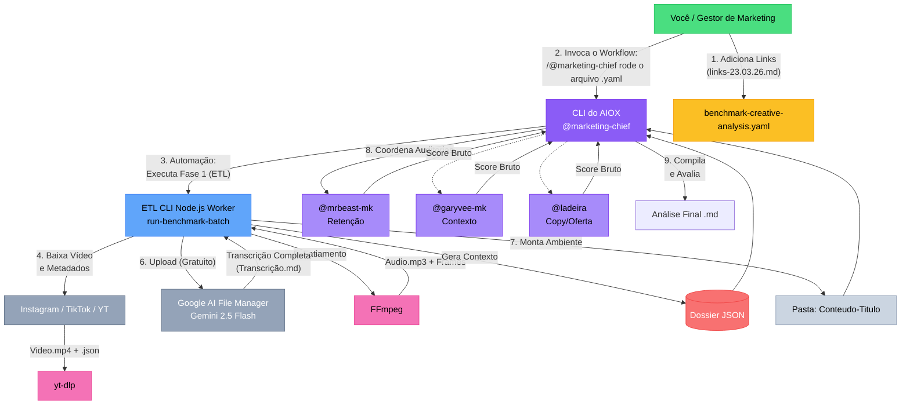

# 🚀 Pipeline de Benchmark Viral (AIOX CLI-First)

Este documento foi desenhado pela arquitetura Synkra AIOX para centralizar toda a operação de inteligência de criativos da squad de Marketing (`virals-marketing-squad`). 

## 1. Visão Geral (Como Funciona)
O sistema agora opera no modelo **Universal & Multi-Modal**. Ele uniu a extração pesada (ETL) e a análise cognitiva (Agentes de Marketing) num único fluxo capaz de processar Vídeos, Posts de Texto e **Carrosséis de Imagem**. 
Não é mais necessário executar pacotes Python localmente. Toda a transcrição e análise visual (OCR + Design) ocorre nativamente com o poder do Gemini 2.5 FileManager (Quota Gratuita). Em casos de carrosséis protegidos, o sistema aciona automação de browser para captura fidedigna de cada slide.

---

## 2. 🗺️ Arquitetura do Pipeline (Diagrama)

---

## 3. Passo a Passo: O seu Dia a Dia

Para rodar a esteira no seu dia a dia e gerar análises hiper precisas de concorrentes, o processo se adaptou 100% à sua necessidade: o Orquestrador agora aceita **tanto arquivos quanto links diretos**!

### Passo A: Preencha um Arquivo (Opcional)
Se for analisar em lote, insira todos os links num `.md` ou `.txt` da sua preferência.

### Passo B: Enviar o Único Comando Mestre
Abra a sua interface (Gemini CLI, Cursor, etc.), e envie o comando pro Chief, passando exatamente o formato que você quer analisar.

**Cenário 1: Vários Links (Batch) em um Arquivo**
> **`@marketing-chief`** ative o workflow `/workflows/benchmark-creative-analysis.yaml` e processe os links do arquivo `C:/caminho/para/meus-links-de-hoje.md`.

**Cenário 2: Analisar um Link Direto**
> **`@marketing-chief`** ative o workflow `/workflows/benchmark-creative-analysis.yaml` e processe apenas este link: `https://www.instagram.com/reel/DV14eBxESQG/`

Ao dar "Enter", **tudo a seguir acontece sozinho**, o Chief é inteligente o suficiente para saber qual script invocar na linha de comando:
1. Ele aciona nativamente o `run-benchmark-batch.js` (se fosse arquivo) ou o `run-benchmark-single.js` (se for url direto).
2. Ele executa o motor em Node (O clone gratuito via Gemini 2.5 Flash).
3. Todas as pastas dos vídeos (já com títulos ricos) são criadas automaticamente.
4. Ele lê a estrutura criada e avança pras próximas fases do YAML, chamando o `MrBeast`, `Gary` e o `Ladeira`.
5. Ele finaliza escrevendo para você o `Análise.md` mastigado com as pontuações.

---

## 4. O Que Fica Salvo na Pasta? (A Anatomia do Output)

No seu computador, ao final da Fase 1, cada conteúdo lido vira uma pasta de Inteligência Absoluta em `services/ETL/outputs/`. Ela contém:

- **`Benchmark.json`**: Seu banco de dados RICO. Identifica o `type` (video ou post) e metadados de engajamento.
- **`Transcrição.md` / `Conteudo.md`**: 
  - **Em Vídeos:** Transcrição 100% palavra por palavra.
  - **Em Carrosséis:** Análise Visual Detalhada (Slide a Slide) com OCR de todo o texto, descrição de fundo/cores e gatilhos de design.
- **`Screenshots/`**: 
  - **Em Vídeos:** Frames capturados a cada 5 segundos.
  - **Em Carrosséis:** As imagens originais de cada slide capturadas via Browser ou yt-dlp.
- **`video.mp4` / `audio.mp3`**: Assets brutos (apenas se for vídeo).

---

## 5. Troubleshooting Rápidos (Erros)

| Sintoma | Causa | Solução |
| --- | --- | --- |
| Erro `Quota Exceeded` no Transcrição.md | Limite bizarramente raro atingido no Google AI Manager. | Tente novamente no dia seguinte (Sua cota reinicia ou o agente consegue ignorar lendo do MP3). |
| `[404 Not Found] model gemini-2.5-flash` | O Google AI atualizou a flag do modelo da API. | Vá em `local-transcriber.js` -> Linha 44, e troque para apenas `gemini-1.5-flash` ou acione o SysAdmin. |
| O Chief diz que não achou o arquivo de links | O Chief está executando em root CWD errado. | Passe o caminho absoluto do arquivo `.md` de links no comando inicial de workflow. |
| Pasta gerada não pegou o título rico | Formato engessado da URL falhou o YT-DLP | Nenhuma quebra, o nome da pasta volta ao fallback padrão (`Conteudo1-ID...`) sem corromper o pipeline. |
